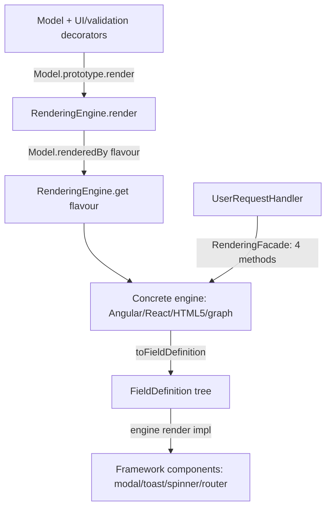

# 06 — UI Layer (`@decaf-ts/ui-decorators`)

## 1. Identity & Role

`ui-decorators` is the **framework-neutral, metadata-driven UI rendering layer** of decaf. It sits directly above `decorator-validation` (the `Model` base and validators) and `db-decorators` (CRUD `OperationKeys` and the error hierarchy), and below the framework-specific rendering adapters (`for-angular`, `for-react`, `for-react-native`, `for-nextjs`). It is published as a single package `@decaf-ts/ui-decorators` with two subpath exports: `.` (root: overrides + model + ui) and `./user-requests` (User Request Resolution Engine). The graph metadata layer is no longer part of this package: since the graph legacy cutover (SAA-503/SAA-510) the frontend-safe graph contracts live solely in `@decaf-ts/as-graph/shared` and the former `./graph` subpath was deleted outright.

It does three things:

1. Adds a `render()` method to every `Model` (via prototype override) plus a family of class/property decorators (`@uimodel`, `@uielement`, `@uiprop`, `@uichild`, `@uilayout`, `@uisteppedmodel`, `@hideOn`, `@hideFor`, `@showFor`, `@uiorder`, `@uilistprop`, `@uitablecol`, `@uipageprop`, `@uion*`, …) that attach UI metadata to model classes and properties.
2. Defines an abstract `RenderingEngine` that converts that metadata + validation metadata into a framework-neutral `FieldDefinition` tree, and a flavour registry so a concrete engine (React, Angular, HTML5, graph, …) registers itself and is selected per model via `@renderedBy`.
 3. Provides one opt-in subpath layer: a **User Request Resolution Engine** (`./user-requests`) that lets a backend `Service` resolve a typed user request through a rendering-engine facade (modal/toast/spinner/router) without any Angular/DOM dependency. The former second opt-in layer — the **graph workspace contracts layer** (`./graph`: decorated authoring metadata for visual workflow nodes/ports/workflows plus the serializable `GraphWorkflowDocument` model and the `GraphNodeManifest`/parameter-schema contracts) — was deleted with the graph legacy cutover; its canonical home is the `shared` export of `@decaf-ts/as-graph` (`@decaf-ts/as-graph/shared`), the only graph-contract import for Angular and any other frontend consumer.

It is consumed by `for-angular`, `for-react`, `for-react-native`, `for-nextjs`, `for-fabric`, `integrations`, `demo` (angular/ionic, angular/ew), and `web-page`.

## 2. Why a Model-Driven UI Layer

- **Single source of truth.** UI knowledge lives on the same validated `Model` classes that drive persistence, transport, and domain logic. Decorators express it; reflection stores it; the engine reads it. No parallel UI schema, no hand-maintained form templates that drift from the model.
- **Framework neutrality.** A concrete `RenderingEngine` is the only framework-specific seam. Models, decorators, `FieldDefinition`, visibility rules, ordering, validation folding, and graph snapshots are all framework-neutral, so a model rendered in Angular and React produces the *same* definition tree — only the leaf rendering differs.
- **Engine abstraction separate from targets.** `RenderingEngine` is split into a conversion core (`toFieldDefinition`, shared) and four abstract targets (`getModal`, `getToast`, `getSpinner`, `router`). This lets the same engine drive both inline form rendering and overlay/navigation surfaces, and lets the `user-requests` layer talk to *just* those four methods via a `RenderingFacade` without depending on the full engine.
- **Graph as decorators (not a separate schema language).** Reusing the `Model` + `Metadata` + `@uimodel` backbone for graph nodes/workflows means ports, validation, ordering, and visibility reuse the exact same machinery as forms. A graph node *is* a renderable model with extra `GraphKeys` metadata; workflows compose nodes the way `@uichild` composes nested models. (This pattern is realized in `@decaf-ts/as-graph/shared` since the graph legacy cutover.)
- **Schema-flattening for ports.** `@input`/`@output` mark a property as a Schema-typed port whose nested model's matching-direction ports are spliced **unprefixed** into the parent (with a cycle guard). This lets a node expose a structured payload's fields as individual connectable ports on the canvas while the underlying model stays nested and validated — the visual contract and the data contract decouple cleanly.
- **Service-based user requests.** `UserRequestHandler` extends core `Service`, takes a `RenderingFacade`, and dispatches statically by metadata. Backend code can render a modal/toast, await dismissal, and resolve a typed request with zero DOM/Angular imports — the user-request layer is pure-Node safe.

## 3. Architecture & Structure

`src/` is organized by subsystem, each with its own barrel, `decorators.ts`, `constants.ts`, `types.ts`, and (where needed) an `overrides.ts` that monkey-patches foreign prototypes.

```
src/
  index.ts                 # root barrel: import "./overrides"; re-export overrides + model + ui
  overrides/
    index.ts               # side-effect import of model/overrides; re-export ModelBuilderExtensions
    ModelBuilderExtensions.ts
  model/
    index.ts; model.ts; Renderable.ts; decorators.ts; overrides.ts
  ui/
    index.ts; constants.ts; types.ts; decorators.ts; Rendering.ts;
    DecafComponent.ts; DecafEventHandler.ts; DecafTranslateService.ts;
    UIValidator.ts; validator.ts (dead); overrides.ts (dead); utils.ts; errors.ts;
    interfaces/ (IDecafModal, IDecafRouter, IDecafSpinner, IDecafToast)
  user-requests/           # subpath "./user-requests"
    index.ts; constants.ts; types.ts; decorators.ts; errors.ts; UserRequestHandler.ts
  dashboard/               # root-barrel `dashboard` submodule (DECAF-53)
    index.ts; constants.ts; types.ts; decorators.ts; registry.ts; reader.ts
```

### Key subsystems

- **Model override layer** (`model/overrides.ts`): the side-effect that makes every `Model` renderable. Assigns `Model.prototype.render` and the `Model.uiXxxOf` static metadata readers, and declares the matching `declare module "@decaf-ts/decorator-validation"` namespace augmentation in `model/model.ts`.
- **Rendering engine** (`ui/Rendering.ts`): the heart of the package. A static flavour→engine cache plus a `current` engine; an abstract `render`/`initialize` contract; and a large `toFieldDefinition` that walks UI + validation metadata to emit a `FieldDefinition` tree (`tag`, `props`, `children`, `item`, `rendererId`), applying CRUD visibility (`hideOn`), namespace visibility (`hideFor`/`showFor`/`renderIf`), ordering (`uiorder` first/number/last), validation attributes/types, and nested-model children (`uichild`).
- **Component base** (`ui/DecafComponent.ts` + `DecafEventHandler.ts`): an abstract, framework-neutral component with logging, translate, router, repository, CRUD context, dark-mode/locale state, and `parseHandlers`/`parseEvents` helpers used by the `@uion*` decorators.
- **Graph layer — moved to `@decaf-ts/as-graph`.** The parallel graph metadata system (`@node`, `@graph`, `@port`, `@input`, `@output`, `@connection`, `@pinnable` on the same `Metadata`/`@uimodel` backbone, Schema flattening, category style registry, snapshot serialization) is no longer part of this package: it lives in `@decaf-ts/as-graph` (`./shared` contracts + backend engine) since the graph legacy cutover (SAA-503/SAA-510).
- **Dashboard layer** (`dashboard/`): a small flavour-neutral metadata family
  for **dashboard-selectable components** (DECAF-53). `@dashcomponent(tag?, metadata?, props?)` attaches palette metadata (label translation key, default grid size, configuration-model reference) under a `DashKeys` namespace mirroring the graph `GraphKeys` convention, side-effect-registers the constructor in a module-level `Set` registry (`registerDashComponent` / `dashComponents()` / `resetDashComponentRegistry()`), and readers (`dashComponentMetadataOf` / `dashComponentDefinitionOf`) normalize an entry to a `DashComponentDefinition` with defaults applied (tag from class name, footprint `{cols:1, rows:1}`).
- **User Request Engine** (`user-requests/`): a `Service`-based handler base driven by `@userRequest(reference)` metadata, dispatched statically, with a `RenderingFacade` (the four real `RenderingEngine` methods) and a `logCtx` override that exposes `modal`/`toast`/`spinner`/`router` getters to handler code. Pure-Node safe.

### Layering (render path)



## 4. Public API Surface

> Only what the brief documents; nothing invented.

### Root barrel (`@decaf-ts/ui-decorators`)

- **Constants/enums:** `UIKeys`, `UIMediaBreakPoints`, `ValidatableByType`, `ValidatableByAttribute`, `HTML5InputTypes`, `HTML5CheckTypes`, `HTML5DateFormat`, `ComponentEventNames`, `TransactionHooks`, `ElementSizes`, `ElementPositions`, `LayoutGridGaps`, `ActionRoles`, `WindowColorSchemes`.
- **Types:** `FieldDefinition`, `FieldProperties`, `UIElementMetadata`, `UIModelMetadata`, `UIPropMetadata`, `CrudOperationKeys`, `UIListPropMetadata`, `UIListModelMetadata`, `UIListItemElementMetadata`, `UILayoutMetadata`, `UIClassMetadata`, `UILayoutCol`, `UIListItemPosition`, `UIFunctionLike`, `UIEventHandler`, `UIEventName`, `UIEventProperty`, `UIHandlerMetadata`, `UILayoutPropMetadata`, `DecafToastRole`, `UIMediaBreakPointsType`, `DecafSpinnerOptions`, `DecafModalOptions`, `DecafToastOptions`, `CrudFormField`, `IPagedComponentProperties`.
- **Model class decorators:** `uimodel(tag?, props?)`, `renderedBy(engine)`, `uilistmodel(name?, props?)`, `uihandlers(props?)`, `uilayout(tag, colsMode?, rows?, props?)`, `uisteppedmodel(tag, pages?, paginated?, props?)`.
- **UI property decorators:** `hideOn(...ops)`, `hideFor(...namespaces)`, `showFor(...namespaces)`, `renderIf(...namespaces)` (alias of `showFor`), `uiorder(order?)`, `hidden()`, `uielement(tag|props, props?, serialize?)`, `uiprop(propName?, stringify?)`, `uichild(clazz, tag, props?, isArray?, serialize?)`, `uilistprop(propName?, props?)`, `uilayoutprop(col?, row?)`, `uipageprop(page?)`, `uion(event|map, handler?)`, `uionclick(handler)`, `uionrender(handler)`, `uitablecol(sequence?, valueParserFn?)`.
- **Rendering engine:** `RenderingEngine<T,R>` (abstract) — static `register`, `get`, `render`; instance `translate`, protected `toFieldDefinition`, `isCustomValidator`, `isValidatableByType/Attribute`, `toAttributeValue`, `sortChildrenByOrder`; abstract `initialize`, `render`, `getModal`, `getToast`, `getSpinner`, `router`.
- **Component layer:** `DecafComponent<M>` (abstract), `DecafEventHandler`, `DecafTranslateService`, `UIValidator` (abstract), `Renderable`.
- **Errors:** `RenderingError` (extends `InternalError`).
- **Utils:** `getUIAttributeKey`, `formatByType`, `parseValueByType`, `parseToNumber`, `escapeHtml`, `revertHtml`, `generateUIModelID`, `isClassConstructor`.
- **Interfaces:** `IDecafModal`, `IDecafRouter`, `IDecafSpinner`, `IDecafToast`.
- **Version consts:** `VERSION`, `COMMIT`, `FULL_VERSION`, `PACKAGE_NAME` (build-time `##…##` placeholders).
- **ModelBuilder extensions** (via `overrides`): `#uimodel`, `#renderedBy`, `#uilistmodel`, `#uihandlers`, `#uilayout`, `#uisteppedmodel`, `#decorateClass`.
- **Dashboard-selectable components** (DECAF-53): types `DashComponentSize`, `DashComponentMetadata`, `DashComponentDefinition`; class decorator `dashcomponent(tag?, dash?, props?)` (plus `DashKeys`); registry `registerDashComponent(ctor)`, `dashComponents()`, `resetDashComponentRegistry()` (test-only); readers `dashComponentMetadataOf(model)`, `dashComponentDefinitionOf(model)`.

### Subpath `./graph` — removed

The graph metadata subpath was **deleted outright** from `ui-decorators` in the
graph legacy cutover (SAA-503/SAA-510) — `src/graph/**` (decorators, registry,
reader, snapshot machinery, document/ and catalog/ contracts,
`Metadata.nodes()`/`workflows()` and `RenderingEngine#renderAsNode`
augmentations), the `./graph` export subpath and its `sideEffects` entries, and
the legacy graph test suites — with no deprecation cycle and zero `@deprecated`
markers. There is no mirror left in this package: every frontend-safe graph
contract that used to be listed here (constants/types, style registry,
decorators, registries, readers, snapshot helpers, canonical document
contracts, manifest/catalog contracts) lives solely in
**`@decaf-ts/as-graph/shared`**, the canonical import for `for-angular` and any
other frontend consumer. The backend execution engine and its NestJS entry live
in `@decaf-ts/as-graph` (standalone server entry `bin.as-graph-server`), as
specified in the [Design Specification — Graph
Design](../design-specification/08-graph-design.md).

### Subpath `./user-requests`

- `USER_REQUEST_KEY`, `CancelledError` (extends `InternalError`, HTTP 400), `UserRequest<T>`, `RenderingFacade` (`Pick<RenderingEngine, 4 methods>`), `UserRequestHandlerMetadata`, `UserRequestHandler<T,C>` (abstract; static `getHandler`/`getMetadata`/`handle`; instance `getInput`/`cancel`/`handle`/`logCtx` override; `UserRequestLogContext`), `userRequest(reference)`.

## 5. Key Patterns

- **Metadata-driven decoration.** UI knowledge is stored as reflection metadata via `@decaf-ts/decoration`: class-level decorators under `UIKeys.REFLECT` ("ui"), property decorators via `Metadata.key(UIKeys.REFLECT, DecorationKeys.PROPERTIES, prop, key)` (helper `getUIAttributeKey`). The graph decorators that used a `GraphKeys` namespace (`graph`, `graph.node`, `graph.edge`, `graph.port`) moved to `@decaf-ts/as-graph`.
- **Prototype overrides / module augmentation.** The package patches foreign classes at import time (`Model.prototype.render`, `Model.uiXxxOf`, `ModelBuilder#uiXxx`) and uses `declare module` to add the typed surface. The `sideEffects` array in `package.json` keeps these imports alive for bundlers. (The graph augmentations `Metadata.nodes/workflows` and `RenderingEngine#renderAsNode` moved to `@decaf-ts/as-graph` with the cutover.)
- **Flavour registry.** `RenderingEngine` keeps a static `cache: flavour → engine|constructor` and a `current` engine. A concrete engine calls `RenderingEngine.register(this)` in its `protected constructor(flavour)` (duplicate flavour throws `InternalError`). `Model.renderedBy(constructor)` reads the `@renderedBy(engine)` metadata; `RenderingEngine.get(flavour?)` resolves the engine, booting a cached constructor if needed.
- **FieldDefinition tree (single conversion pipeline).** `toFieldDefinition` walks class decorators (`@uimodel`/`@uilistmodel`/`@uihandlers`/`@uilayout`) → `Model.uiPropertiesOf` → per-property resolves exactly one of `@uiprop`/`@uichild`/`@uielement` (else `RenderingError`) → folds in validation decorators (`ValidatableByAttribute` → HTML attrs; `ValidatableByType` → input type + date format; custom validators → `subType` + `validationMessage`) → recurses into nested models for `@uichild` → sorts by `@uiorder` (`first` → numeric → `last`) → filters by `hidden`/`hideFor`/`showFor` against `globalProps.operation`/`namespaces`. Top-level result carries `rendererId` via `generateUIModelID(model)`.
- **CRUD- and namespace-aware visibility.** `@hideOn(...OperationKeys)` and `@hidden()` (all four ops) hide fields per `globalProps.operation`; `@hideFor`/`@showFor`/`@renderIf` filter against `globalProps.namespace` or `globalProps.namespaces`.
- **List item slot mapping.** `@uilistmodel` + `@uilistprop` build the `item` mapper and container props on the list `FieldDefinition`; `@uitablecol`, `@uilayoutprop`, `@uipageprop` contribute list-item rendering inputs (column sequence, layout col/row, stepped-form page). Exactly one element decorator per property is enforced.
- **Graph Schema flattening, category style registry, snapshot serialization — moved to as-graph.** The reader that flattens Schema-typed `@input`/`@output` into unprefixed ports, the `registerGraphCategoryStyle`-fed effective color/icon resolution, and the `graphWorkflowSnapshot*` serialization/restore helpers are part of the graph metadata layer and now live in `@decaf-ts/as-graph/shared` (removed from `ui-decorators` with the graph cutover, SAA-503/SAA-510).
- **Service-based user request handlers.** `UserRequestHandler<T,C>` extends core `Service<C>`, takes a `RenderingFacade` in its protected constructor, and exposes `logCtx(..., true)` returning `UserRequestLogContext` with `log`/`ctx`/`ctxArgs` plus `modal`/`toast`/`spinner`/`router` getters bound to the engine. Dispatch is static and metadata-based (`Metadata.get(USER_REQUEST_KEY, reference)`), so no process-wide registry.
- **Decoration DSL registration.** The user-requests decorators (and, before the graph cutover, the graph decorators — now in `@decaf-ts/as-graph`) register with the `Decoration.for(...).define(...).apply()` DSL so they are discoverable/introspectable while still writing raw `Metadata` for runtime lookup.
- **Dashboard registry (module-level `Set`).** Unlike the metadata-dispatched graph/user-request surfaces, `@dashcomponent` maintains a plain `Set<Constructor>` registry: the decorator applies `uimodel` + `metadata(DashKeys.COMPONENT, meta)` through the Decoration DSL and then calls `registerDashComponent` as a side-effect. Idempotent add; consumers get fresh arrays (`dashComponents()`), never the internal set. This mirrors the graph node registry / `InjectablesRegistry` pattern and keeps the palette bounded by build-time imports (no runtime string→class resolution — the hard rule carried over from the graph AOT constraint).

### Issue-thread interaction kinds

The brief documents the `./user-requests` subpath as the framework-neutral mechanism by which a backend `Service` resolves a typed user request through a rendering-engine facade. The concrete interaction *kinds* (e.g. `request_confirmation`, checkbox confirmations, `ask_user_questions`, `suggest_tasks`) are **not enumerated by this brief** — they are documented in the for-angular / Paperclip interaction-card layer (see `create-issue-interaction-ui` and the for-angular graph workflow editor relationship). This handbook records the contract surface (`UserRequest<T>`, `UserRequestHandler`, `RenderingFacade`, `getInput`/`awaitDismissal`/`cancel`) that such interaction kinds build on; the kind taxonomy itself is out of scope here and intentionally not fabricated.

## 6. Lifecycle, Configuration & Environment

- **Boot / init.** Importing the root barrel runs `src/index.ts`, which side-effect-imports `./overrides` (→ `model/overrides`, patching `Model.prototype.render` and `Model.uiXxxOf` statics) and calls `Metadata.registerLibrary(PACKAGE_NAME, VERSION)`. Importing `./user-requests` only re-exports; it patches nothing. (The removed `./graph` subpath used to attach `Metadata.nodes/workflows` and `RenderingEngine#renderAsNode`; those augmentations now live in `@decaf-ts/as-graph/shared`.)
- **Engine boot.** A concrete engine calls `super(flavour)` in its constructor, which calls `RenderingEngine.register(this)` (throws `InternalError` on duplicate flavour) and sets it as `current`. `RenderingEngine.get(flavour?)` returns the cached instance or, if a constructor was cached, instantiates it and **fire-and-forgets** `engine.initialize()`. The `initialized` flag is the intended gate but is not awaited — consumers needing async init should `await engine.initialize()` themselves before rendering.
- **Flavours.** Free-form strings (`'react'`, `'angular'`, `'html5'`, `'graph'`, `'mock-user-requests-N'`, …). `@renderedBy(engine)` stores the flavour on the model; `RenderingEngine.render(model)` reads it via `Model.renderedBy(constructor)` and dispatches to `RenderingEngine.get(flavour).render(...)`.
- **Env vars.** **None.** The package reads no environment variables.
- **Notable defaults.** `HTML5DateFormat = "yyyy-MM-dd"`; `uilayout` breakpoint defaults to `UIMediaBreakPoints.LARGE` (JSDoc says `'m'` — see Inaccuracies); `uiorder` defaults to `UIKeys.FIRST`; `uitablecol` sequence defaults to `UIKeys.LAST`; `uipageprop` page defaults to `1`; `uilayoutprop` col/row default to `1`; `CancelledError` defaults to HTTP `400` and message `"User request cancelled"`.
- **Build placeholders.** `VERSION`/`COMMIT`/`FULL_VERSION`/`PACKAGE_NAME` are `##VERSION##`/`##COMMIT##`/`##FULL_VERSION##`/`##PACKAGE##` placeholders replaced at publish time.

## 7. Data & Control Flow

### 7.1 Rendering a model (`user.render()`)

```mermaid
sequenceDiagram
    participant Caller
    participant Model as Model.prototype.render
    participant RE as RenderingEngine.render
    participant RG as RenderingEngine.get(flavour)
    participant CE as Concrete engine.render
    participant TFD as toFieldDefinition
    Caller->>Model: user.render(globalProps)
    Model->>RE: render(this, ...args)
    RE->>RE: resolve ctor via Model.get(name) || Model.fromObject(model)
    RE->>RE: read Model.renderedBy(ctor) → flavour
    RE->>RG: get(flavour)
    RG-->>RE: engine (boot if cached ctor)
    RE->>CE: engine.render(model, globalProps)
    CE->>TFD: toFieldDefinition(model, globalProps)
    TFD->>TFD: gather class decorators (@uimodel missing? → RenderingError)
    TFD->>TFD: for each Model.uiPropertiesOf:
    TFD->>TFD: exactly one of @uiprop/@uichild/@uielement (else RenderingError)
    TFD->>TFD: fold validation attrs/types; recurse @uichild
    TFD->>TFD: sort by @uiorder; filter hidden/hideFor/showFor
    TFD-->>CE: { tag, item, props, children, rendererId? }
    CE-->>Caller: FieldDefinition tree
```

Detail of the walk: `Model.uiDecorationOf` returns all UI decorator entries for a property, sorted so `ELEMENT`/`CHILD` process first; `Model.uiTypeOf` enforces the one-decorator rule; `hideOn` requires a `@uielement`. `@uiprop` → stored in `childProps`; `@uichild` → recursive `toFieldDefinition` on the nested model (instantiating via `Model.get(clazzName)` if undefined) with `inheritProps`/`childOf` path propagation; `@uilistprop` → builds the `item` mapper + container props; `@uielement` (and `@uion`/`@uipageprop`/`@uilayoutprop`/`@hideFor`/`@showFor`) → builds a child `FieldDefinition`, folding validation, defaulting `type` from `Metadata.type(...)`, formatting the value via `formatByType`. `rendererId` is added only at the top level via `generateUIModelID(model)`.

### 7.2 Graph authoring → canonical document (moved to as-graph)

The graph authoring pipeline — the decorated reader deriving
`GraphNodeDefinition`/`GraphWorkflowDefinition`, the `graphNodeManifest`
compiler, and the `GraphDecoratedWorkflowCompiler` compiling them into the
canonical `GraphWorkflowDocument` the editor, persistence, and backend execute
— is part of the graph metadata layer and moved to **`@decaf-ts/as-graph`**
(`./shared` contracts; see the [Design Specification — Graph
Design](../design-specification/08-graph-design.md)). It is no longer provided
by `ui-decorators` (removed with the graph legacy cutover, SAA-503/SAA-510).

### 7.3 User request flow

A caller invokes `UserRequestHandler.handle(request, renderingEngine)`. It resolves `request.type || request.id` → `getHandler` (metadata lookup) → `new Handler(renderingEngine)` → `instance.context("user-request", {})` → `instance.handle(request, ctx)`. A typical handler calls `getInput(request, ...args)`, which logs via `logCtx(..., true)`, calls `renderingEngine.getModal({ props: { request } })`, stores the modal, and returns `awaitDismissal` — a promise that patches `modal.confirm`/`modal.cancel` so a confirm resolves with `event.data ?? event` and a cancel rejects with `CancelledError`. `cancel()` rejects any pending promise and dismisses the modal. The overridden `logCtx` wraps the base `Service.logCtx` result with `modal`/`toast`/`spinner`/`router` bound getters.

## 8. Testing

- **Runner/config:** Jest (`jest.config.cjs`), `ts-jest` transform, node environment, `testRegex: /tests/.*\.(test|spec)\.(ts|tsx)$/`.
- **Coverage ignore:** `DecafComponent.ts`, `DecafEventHandler.ts`, `ui/validator.ts`, `ui/overrides.ts`, `ui/UIValidator.ts` are deliberately excluded from coverage (the component base and dead validator-override paths).
- **Notable test files:** `ui-decorators.test.ts` (basic decoration), `rendering-engine.test.ts` (`TestEngine` over `RenderingEngine<void>`, full `FieldDefinition` assertions, submodel recursion, error paths, namespace filtering), `ui.utils.test.ts` (format/parse/escape/`generateUIModelID`), `model-builder.extensions.test.ts`, `user-requests/user-requests.test.ts` (FR-1..FR-5 + cancellation + `logCtx` via `MockRenderingEngine`/`MockModal`/`MockToast`/`MockSpinner`/`MockRouter` and a real `@userRequest("user-data")` handler).
- **Coverage gaps:** `DecafComponent`, `DecafEventHandler`, `UIValidator`, `ui/validator`, `ui/overrides` excluded and effectively untested; `DecafTranslateService` has no direct test; `IDecafModal`/`IDecafRouter`/`IDecafSpinner`/`IDecafToast` only exercised via mocks; `parseValueByType` Array branch and `revertHtml` `&amp;` ordering lightly covered. No integration/e2e tests. (The graph suites and their coverage gaps moved to `@decaf-ts/as-graph` with the cutover.)

## 9. Usage Examples

Minimal renderable model + engine (derived from `tests/unit/rendering-engine.test.ts`):

```typescript
import { Model, model, required, minlength } from "@decaf-ts/decorator-validation";
import { RenderingEngine, FieldDefinition, uimodel, uielement, uiorder, hideOn } from "@decaf-ts/ui-decorators";
import { OperationKeys, id } from "@decaf-ts/db-decorators";

class TestEngine extends RenderingEngine<void> {
  constructor(flavour: string) { super(flavour); }
  async initialize(..._a: any[]): Promise<void> { this.initialized = true; }
  render<M extends Model>(m: M, globalProps: Record<string, unknown>): FieldDefinition<void> {
    return this.toFieldDefinition(m, globalProps);
  }
}

@uimodel("decaf-crud-form", { test: "1" })
@model()
class DemoModel extends Model {
  @id()
  @uielement("decaf-crud-field", { label: "translation.demo.id.label" })
  @uiorder(0)
  id!: number;

  @required()
  @minlength(5)
  @uielement("decaf-crud-field", { label: "translation.demo.name.label" })
  @hideOn(OperationKeys.UPDATE)
  name!: string;
}

const engine = new TestEngine("test");
const def = engine.render(new DemoModel({ id: 1, name: "name" }), { operation: "create" });
// def.tag === "decaf-crud-form"; def.children[0].props.order === 0; etc.
```

Graph node definition (from the `@decaf-ts/as-graph/shared` reader — the graph metadata layer lives there since the cutover):

```typescript
import { Model, model, required } from "@decaf-ts/decorator-validation";
import { uielement } from "@decaf-ts/ui-decorators";
import { node, graph, port, input, output, graphDefinitionOf,
         graphWorkflowDefinitionOf, PortDirection } from "@decaf-ts/as-graph/shared";

@node("graph-tool", { kind: "tool", category: "AI", icon: "tool", color: "#2196f3" })
@model()
class GraphToolModel extends Model {
  @required()
  @uielement("input", { label: "Prompt" })
  @port(PortDirection.INPUT, { handle: "prompt" })
  prompt!: string;

  @uielement("textarea", { label: "Result" })
  @port(PortDirection.OUTPUT)
  result!: string;
}

const def = graphDefinitionOf(GraphToolModel);
// def.tag === "graph-tool"; def.ports = [{ property: "prompt", direction: INPUT }, { property: "result", direction: OUTPUT }]
```

User request handler (derived from `tests/unit/user-requests/user-requests.test.ts`):

```typescript
import { UserRequestHandler, userRequest } from "@decaf-ts/ui-decorators/user-requests";
import type { UserRequest } from "@decaf-ts/ui-decorators/user-requests";

@userRequest("echo")
class EchoUserRequestHandler extends UserRequestHandler<string> {
  async handle(request: UserRequest<string>): Promise<string> {
    return `echo:${request.payload as string}`;
  }
}

const result = await UserRequestHandler.handle(
  { id: "req-1", type: "echo", payload: "pong" },
  renderingEngine
);
// result === "echo:pong"
```

## 10. Relationships

- **decorator-validation** — provides `Model` (the renderable base, patched here), `ModelBuilder` (extended here), the validator hierarchy referenced by `ValidatableByType`/`ValidatableByAttribute`, `ValidationKeys`, `ReservedModels`, `Primitives`, `formatDate`/`parseDate`, and `Metadata.type`/`Metadata.properties`.
- **decoration** — the reflection backbone (`Metadata`, `metadata`/`propMetadata`, `apply`/`Decoration` DSL, `DecorationKeys`, `Constructor`). (The graph augmentations `Metadata.nodes()`/`workflows()` moved to `@decaf-ts/as-graph` with the cutover.)
- **db-decorators** — `OperationKeys`/`CrudOperations` (CRUD visibility, `ActionRoles`) and the error hierarchy (`InternalError` → `RenderingError`, `CancelledError`; `NotFoundError`; `ValidationError`).
- **core** — only `user-requests` depends on it (`Service`, `Context`, `ContextFlags`, `ContextualArgs`, `LoggerOf`, `MethodOrOperation`, …).
- **logging** — `LoggedClass` base for `DecafComponent`, `DecafTranslateService`, and test mocks.
- **for-angular / for-react / for-react-native / for-nextjs** — provide concrete `RenderingEngine` implementations and framework bindings for the contracts here (`IDecafModal`, `IDecafRouter`, `IDecafSpinner`, `IDecafToast`, `DecafComponent`). The for-angular graph workflow editor projects the canonical `GraphWorkflowDocument`/manifests (imported from `@decaf-ts/as-graph/shared`) onto a canvas editor (`ngDiagram`, optional) and is the primary frontend consumer of the graph layer.
- **integrations / for-fabric / demo / web-page** — consumers that build UI forms on top of this package (`integrations` via the `user-requests` re-export shims; the graph-node consumers moved to `@decaf-ts/as-graph` with the cutover).

## 11. Consumer Notes & Trade-offs

- **Subpath imports matter.** The root barrel does **not** pull graph, and no graph metadata surface exists in this package anymore: the canonical graph-contract import is `@decaf-ts/as-graph/shared` (the former `@decaf-ts/ui-decorators/graph` subpath was deleted in the graph legacy cutover and is a bundle-wall-banned specifier in for-angular). The `user-requests` surface is only available via `./user-requests`.
- **Engine registration is global and flavour-unique.** Constructing a concrete engine registers it and sets it as `current`; a duplicate flavour throws `InternalError`. The test mocks avoid collisions via a monotonic `mock-user-requests-N` flavour.
- **`initialize()` is fire-and-forget on boot.** Consumers needing async init should `await engine.initialize()` before rendering, or rely on the `initialized` flag.
- **Exactly one of `@uiprop`/`@uichild`/`@uielement` per property.** `toFieldDefinition` throws `RenderingError` otherwise. `@hideOn`/`@hidden` require a `@uielement` on the same property.
- **`@renderedBy` is required for dispatch** only if more than one engine is registered; with a single engine it can be omitted (`RenderingEngine.get()` falls back to `current`).
- **Namespace visibility** is driven by `globalProps.namespace` (single) or `globalProps.namespaces` (array); pass the active tenant(s) when rendering.
- **`DecafToastOptions.duration` is typed as the literal `3000`** (see Inaccuracies) — consumers cannot set any other duration without casting.
- **Dead validator-override paths.** `UIValidator`, `ui/validator.ts`, and `ui/overrides.ts` are exported/declared but never wired (side-effect imports commented out in `ui/index.ts`; excluded from coverage and `sideEffects`). Do not rely on `Validator.getMessage` being patched by this package; set `UIValidator.translateService` yourself if you use `UIValidator`.
- **Build placeholders.** `VERSION`/`COMMIT`/`FULL_VERSION`/`PACKAGE_NAME` are `##…##` placeholders until publish; do not read them at dev time.
- **Maturity / versioning.** Pre-1.0; the user-requests layer is newer, and the graph layer moved to `@decaf-ts/as-graph` (comments reference DECAF-24/DECAF-32/DECAF-48). The package is consumed by all UI framework adapters, so the rendering/metadata contract is effectively stable even while the version is <1.0.

## 12. Inaccuracies Found

> Recorded verbatim from the research brief; not fixed here.

**[ui-decorators]** Model namespace vs implementation name mismatch (`uiHiddenOn` vs `uiIsHiddenOn`) — `src/model/model.ts:65-78` declares `Model.uiHiddenOn` (three overloads) but `src/model/overrides.ts:107` implements `Model.uiIsHiddenOn` (with the `Is` infix). The declared `uiHiddenOn` is never implemented and the implemented `uiIsHiddenOn` is never declared in the augmentation, so typed consumers cannot reach the implemented method through the declared surface and vice-versa. | Evidence: `src/model/model.ts:65` `function uiHiddenOn` vs `src/model/overrides.ts:107` `(Model as any).uiIsHiddenOn = function ...`. | Suggested fix: align the names (rename the implementation to `uiHiddenOn` or change the declaration to `uiIsHiddenOn`) and add the missing declaration for the implemented name.

**[ui-decorators]** `Model.uiListItems` is implemented but not declared — `src/model/overrides.ts:154` attaches `Model.uiListItems` but `src/model/model.ts` does not declare it in the `Model` namespace augmentation, so it is untyped. | Evidence: `src/model/overrides.ts:154` `(Model as any).uiListItems = function ...` with no matching `function uiListItems` in `src/model/model.ts:28-79`. | Suggested fix: add `function uiListItems<M extends Model>(model: Constructor<M>): string[] | undefined;` to the `Model` namespace declaration.

**[ui-decorators]** Dead validator-override paths are exported but never wired — `src/ui/index.ts:1-2` has `// import "./validator";` and `// export * from "./overrides";` commented out, so `src/ui/overrides.ts` (the `Validator.getMessage` static override) and `src/ui/validator.ts` (the `BaseValidator.translateService` module augmentation) never execute. `package.json` `sideEffects` does not list `ui/overrides`, and `jest.config.cjs:13-14` excludes both from coverage. `UIValidator` (exported from `ui/index.ts:10`) therefore never has its `translateService` wired by the package. | Evidence: `src/ui/index.ts:1-2`; `src/ui/overrides.ts:4-8`; `package.json:65-77` (no `ui/overrides`); `jest.config.cjs:11-17`. | Suggested fix: either remove `UIValidator`/`ui/validator.ts`/`ui/overrides.ts` or restore the side-effect imports and add `ui/overrides` to `sideEffects`.

**[ui-decorators]** `ui/overrides.ts` `Validator.getMessage` override is self-recursive — `src/ui/overrides.ts:4-8` assigns `Validator.getMessage = function(message, ...args) { ...; return this.getMessage(message, ...args); }`; when called as `Validator.getMessage(...)`, `this` is `Validator`, so `this.getMessage` is the same just-assigned function → infinite recursion whenever `translateService` is unset. | Evidence: `src/ui/overrides.ts:4-8`. | Suggested fix: capture the original `getMessage` before overriding (e.g. `const original = Validator.getMessage; ... return original.call(this, message, ...args);`) or call `super.getMessage`-equivalent. (Moot while the file is dead, but must be fixed if re-enabled.)

**[ui-decorators]** `RenderingEngine.getOrBoot` does not await `initialize()` — `src/ui/Rendering.ts:720-727` calls `engine.initialize(); // make the booting async. use the initialized flag to control it` without `await`, so `RenderingEngine.get()` returns an engine whose async initialization may still be pending. The comment acknowledges this, but the public `get`/`render` path has no synchronization, so a concrete engine that requires async init can be rendered before it is ready. | Evidence: `src/ui/Rendering.ts:725` `engine.initialize(); // make the booting async...`. | Suggested fix: make `get` async (or have `getOrBoot` await `initialize()` and cache a post-init Promise/engine) and update `RenderingEngine.render` to await it.

**[ui-decorators]** `@uion` JSDoc misstates the event type — `src/ui/decorators.ts:594-596` says the `event` argument "Must be one of the keys in `Pick<DecafComponent, 'render' | 'initialize'>`", but `UIEventName` (`src/ui/types.ts:211-214`) is `keyof Pick<DecafEventHandler, "render" | "initialize" | "handleClick" | "refresh">` — a different class (`DecafEventHandler`, not `DecafComponent`) and four keys, not two. | Evidence: `src/ui/decorators.ts:595` vs `src/ui/types.ts:211-214`. | Suggested fix: update the JSDoc to reference `DecafEventHandler` and list all four event names.

**[ui-decorators]** `@uilayout` JSDoc param list and default disagree with the implementation — `src/model/decorators.ts:240-244` documents params `(tag, colsMode=1, rows=1, breakpoint='m')`, but the actual signature (`:291-296`) is `(tag, colsMode=1, rows=1, props={})` and the breakpoint defaults to `UIMediaBreakPoints.LARGE` (`"large"`, not `"medium"`/`'m'`) via `Object.assign({ breakpoint: UIMediaBreakPoints.LARGE }, props)` (`:308`). There is no `breakpoint` parameter; it is folded into `props`. | Evidence: `src/model/decorators.ts:243` `@param {UIMediaBreakPoints} [breakpoint='m']` vs `:291-309`. | Suggested fix: correct the JSDoc param list to `(tag, colsMode, rows, props)` and state the breakpoint default is `LARGE`, overridable via `props.breakpoint`.

**[ui-decorators]** `DecafToastOptions.duration` typed as the literal `3000` — `src/ui/types.ts:263-269` declares `duration: 3000;` (a literal type, not `number`), so any value other than `3000` fails type-checking and consumers must cast. This is almost certainly unintended for an options object. | Evidence: `src/ui/types.ts:265` `duration: 3000;`. | Suggested fix: change to `duration: number;` (optionally with a default in consuming engines).

**[ui-decorators]** `@decaf-ts/logging` is a runtime dependency but declared under `devDependencies` — `src/ui/DecafComponent.ts:1`, `src/ui/DecafTranslateService.ts:1` (and the test mocks) import `LoggedClass`/`Logging` from `@decaf-ts/logging`, but `package.json:45-47` lists it under `devDependencies` only. Consumers who do not install it themselves (or via another dep) could break at runtime when importing `DecafComponent`. | Evidence: `package.json:45` `"@decaf-ts/logging": "latest"` under `devDependencies` vs `src/ui/DecafComponent.ts:1` `import { LoggedClass } from "@decaf-ts/logging";`. | Suggested fix: move `@decaf-ts/logging` to `dependencies`.

**[ui-decorators]** README decorator catalogue is incomplete — `README.md:47-60` ("Class Decorators"/"Property Decorators") omits `@uilayout`, `@uisteppedmodel`, `@uihandlers` (class) and `@uichild`, `@uilayoutprop`, `@uipageprop`, `@uiorder`, `@uitablecol`, `@uion`/`@uionclick`/`@uionrender`, `@hideFor`, `@showFor`, `@renderIf` (property), all of which exist in `src/model/decorators.ts` and `src/ui/decorators.ts`. | Evidence: `README.md:47-60` vs `src/model/decorators.ts:55-413` and `src/ui/decorators.ts:52-702`. | Suggested fix: extend the README decorator lists to cover all exported decorators.

**[ui-decorators]** removed with the graph legacy cutover (SAA-503/SAA-510) — the graph entries of this register referenced `src/graph/**` files and `tests/unit/graph.test.ts` (duplicate `./overrides` re-export in `graph/index.ts`; "re-decorating the same class does not duplicate" test not actually re-decorating; stale comment naming `IfFlowModel`/`CodeModel` instead of `IfNode`/`CodeNode`) that no longer exist; they were dropped from the register along with the deleted subsystem. Graph-layer inaccuracies are now owned by the `@decaf-ts/as-graph` documentation (design-specification `08-graph-design.md`).

**[ui-decorators]** `workdocs/documentation-status.md` references non-existent source files — the status table lists `src/ui/DecafToast.ts` and `src/ui/DecafSpinner.ts` as "✅ Done" on 2026-06-19, but those files do not exist in `src/ui/` (the actual contracts are `src/ui/interfaces/IDecafToast.ts` and `src/ui/interfaces/IDecafSpinner.ts`). | Evidence: `workdocs/documentation-status.md` ("Files" table) vs `src/ui/` directory listing (no `DecafToast.ts`/`DecafSpinner.ts`). | Suggested fix: correct the file paths to `src/ui/interfaces/IDecafToast.ts` and `src/ui/interfaces/IDecafSpinner.ts`.

**[ui-decorators]** `RenderingEngine` constructor logs via `console.log` instead of the decaf logger — `src/ui/Rendering.ts:88` uses `console.log(\`decaf's ${flavour} rendering engine loaded\`)` rather than `Logging`/`LoggedClass`, inconsistent with the rest of the package which routes through the decaf logger. | Evidence: `src/ui/Rendering.ts:88` `console.log(...)`; contrast `src/ui/DecafComponent.ts:293-295` `this.log.for(this.render).info(...)`. | Suggested fix: route the load message through `Logging.for(RenderingEngine)` (or drop it).
