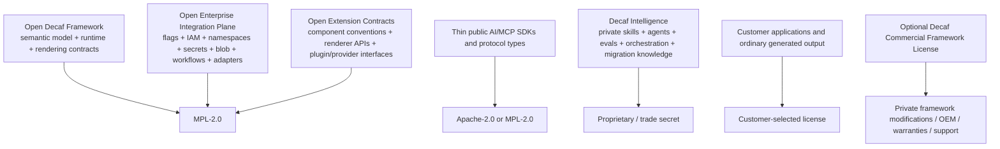
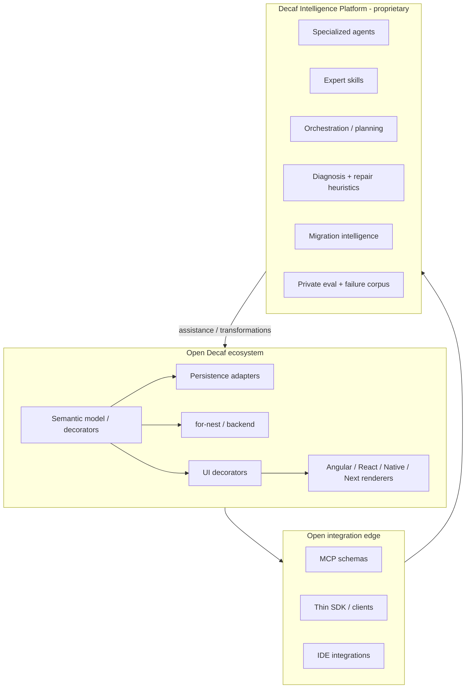
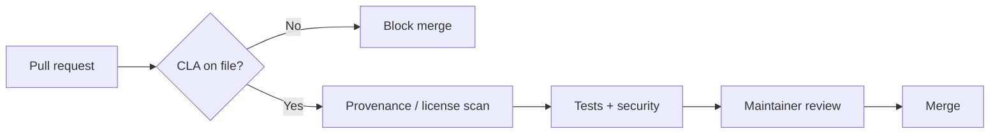
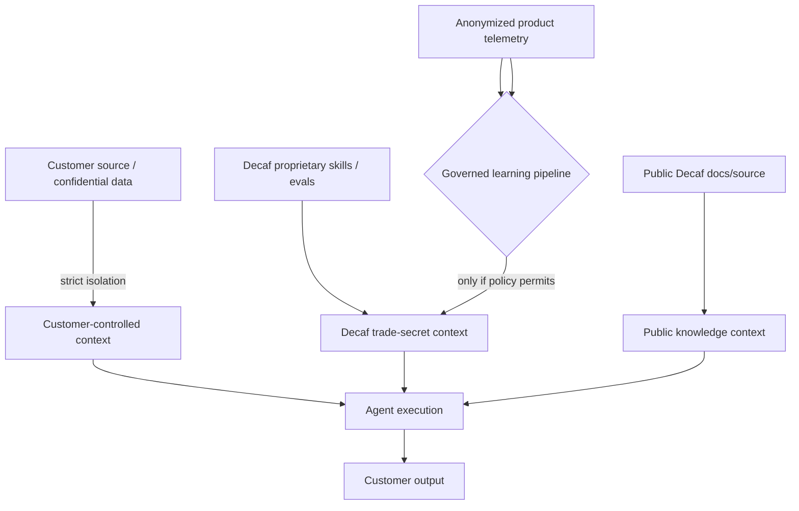
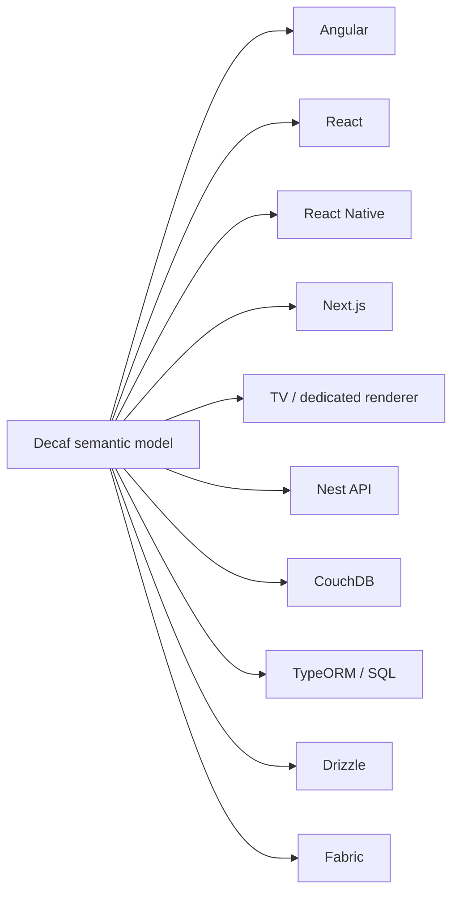
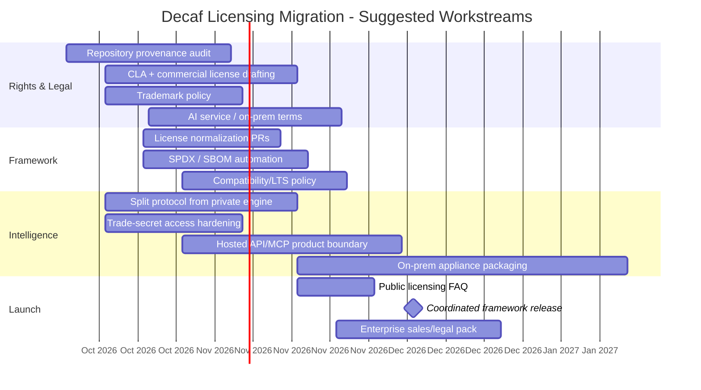

# Decaf-TS Licensing Migration Plan — Complete Framework, Integrations and Intelligence Model

**Target scheme:** open framework + open integration edge + proprietary Decaf Intelligence Platform  
**Prepared:** 3 October 2026  
**Status:** strategic implementation plan; requires final review by qualified open-source/IP counsel  

> **Important:** This document is a product and licensing strategy, not legal advice. The final license texts, CLA, commercial agreement, trademark policy, trade-secret controls, and any relicensing of existing contributions should be reviewed by counsel in the jurisdictions relevant to the copyright holder and major customers.

---

## 1. Executive decision


**Revision scope:** This version explicitly covers the complete public `@decaf-ts/integrations` surface (feature flags, namespaces, Keycloak, secrets, blob stores, user-request resolution, graph/runtime orchestration, Redis/Dragonfly, SFTP, Docker tooling, calendar/iCalendar, Kibana/Superset plugins, dynamic loading), as well as the public UI rendering-extension contract that allows Decaf to target built-in, enterprise-design-system, or custom components without making those components proprietary Decaf IP.

The licensing architecture is deliberately aligned with the product architecture:



The central licensing principle is: **make the substrate and extension surface safe to adopt and extend; keep the accumulated intelligence scarce.**

The recommended licensing architecture is:

| Asset class | Recommended license / protection | Primary objective |
|---|---|---|
| Decaf semantic/runtime framework (`core`, decorators, validation, repositories, standard persistence adapters, standard UI engines, `for-nest`, `for-angular`, React-family engines, etc.) | **MPL-2.0 only** | Maximize enterprise adoption while requiring distributed modifications to Decaf-covered files to remain available |
| Public protocol and integration edge (MCP schemas, protocol types, thin clients, IDE bridges, language-neutral API definitions) | **Apache-2.0** or **MPL-2.0** depending on component | Make Decaf easy to integrate from every tool and agent ecosystem |
| Examples / starter templates intended to be copied into customer applications | **Apache-2.0** or **MIT** | Remove friction around generated/copied application code |
| Documentation / specification | **CC BY 4.0** for prose/specification; code samples under Apache-2.0/MIT | Encourage redistribution and training while mandating attribution for documentation |
| Framework commercial alternative | **Decaf Commercial Framework License** | Permit private modifications, OEM embedding, warranties/support, or other terms not available under MPL |
| `decaf-ai` engine, complete skills, specialized agents, private prompts, orchestration, diagnosis/migration heuristics, eval corpus, failure corpus | **Proprietary; trade secret** | Preserve scarcity of the intelligence layer and prevent the framework's accumulated know-how from becoming a cloning blueprint |
| Thin public Decaf AI SDK / MCP client | **Apache-2.0** | Maximize reach of the proprietary intelligence service |
| On-prem Decaf AI appliance | **Commercial binary/appliance license**; source not delivered by default | Support regulated/sovereign deployments while containing IP leakage |
| Decaf AI source escrow | Confidential escrow agreement, release only on negotiated continuity triggers | Solve enterprise continuity risk without ordinary source disclosure |
| Decaf brand, names, logos, certification marks | **Trademark rights + published trademark policy** | Preserve canonical identity and prevent forks from presenting themselves as official Decaf |
| External contributions | **Individual + Corporate CLA; contributor retains copyright but grants broad relicensing rights** | Keep community participation compatible with both MPL and commercial licensing |
| Customer application code and normal AI-generated output | **Customer chooses its own license** | Remove a major adoption objection and make AI use frictionless |

### Core principle

**Open the semantic substrate; keep the accumulated intelligence scarce.**



---

## 2. Why the current scheme should change

At the time of this review, public Decaf packages show a mixed licensing picture. `@decaf-ts/ui-decorators` is advertised on npm as `MPL-2.0 OR AGPL-3.0`, while its README/license messaging describes MPL as the baseline and a Fair Usage Addendum that triggers AGPL for specified AI-driven use. `@decaf-ts/for-angular` similarly declares `MPL-2.0 OR AGPL-3.0` in `package.json`. Other packages are publicly described as MPL-2.0 or MIT, including persistence/infrastructure packages. This creates avoidable procurement ambiguity.

There are four business problems with the present shape.

### 2.1 `OR` is not a conditional trigger

In SPDX syntax, `A OR B` represents a **choice of licenses**. It does not mean “A normally, B when condition X occurs.” Therefore:

```text
MPL-2.0 OR AGPL-3.0
```

is conventionally interpreted as a recipient being able to choose MPL or AGPL, which is structurally different from a license addendum that attempts to switch the applicable license based on AI behavior.

For enterprise buyers, a mismatch between package metadata, README language, and the legal file is a red flag even if the project believes the intended outcome is clear.

### 2.2 AI-use conditions create adoption friction in the wrong layer

Decaf's architecture is unusually compatible with AI-assisted and agentic development. Making normal framework licensing depend on the extent of AI review creates legal questions exactly where Decaf should be reducing development friction.

A buyer should not need to ask:

- whether Copilot use changed the framework license;
- whether an autonomous refactor was “meaningfully reviewed”;
- whether every generated artifact was expressly approved;
- whether CI-based code repair changes the applicable license;
- whether agent-generated UI makes a proprietary application subject to AGPL.

Those questions suppress the strongest future adoption vector for the framework.

### 2.3 AGPL does not protect the scarce `decaf-ai` knowledge

If the complete skills, prompts, orchestrators, diagnostic rules, migration strategies and eval corpus are released under AGPL, recipients receive source access and the right to study and modify it. Copyleft protects obligations around copies/derivatives; it does **not** restore secrecy after the know-how has been disclosed.

For Decaf AI, the main strategic risk is not merely a closed fork of identical code. It is a competitor or frontier model learning the architecture, heuristics and failure corpus and independently reproducing the capabilities. That is why the intelligence layer should remain proprietary and protected operationally as a trade secret.

### 2.4 Inconsistent package licenses weaken the portability story

Decaf's business proposition depends on the same semantic model being able to move across persistence engines, backend transports, and UI stacks. A patchwork of MIT, modified MPL/AGPL, MPL-only and other terms means that a customer evaluating portability must also evaluate licensing boundaries for each move.

The desired experience is much simpler:

> **Standard Decaf framework components: MPL-2.0. Decaf Intelligence: proprietary. Public integration protocol: permissive.**

---

## 3. Target legal/product architecture

### 3.1 Layer A — Decaf Framework: MPL-2.0 only

Apply the unmodified, canonical Mozilla Public License 2.0 to the standard framework code where Decaf has the rights to do so.

Target this policy for:

- `@decaf-ts/core`
- `@decaf-ts/decoration`
- `@decaf-ts/decorator-validation`
- `@decaf-ts/db-decorators`
- dependency injection / transactional / logging modules that constitute the common framework substrate
- `@decaf-ts/ui-decorators`
- `@decaf-ts/for-angular`
- React / React Native / Next-oriented standard renderers
- `@decaf-ts/for-nest`
- CouchDB / Pouch / Nano / TypeORM / Drizzle / Fabric and other standard adapters, unless third-party provenance prevents uniform relicensing
- standard HTTP / transport adapters
- framework CLI features that are part of ordinary application development, subject to the AI separation described later

Why MPL:

1. **File-level copyleft.** Distributed modifications to MPL-covered files remain under MPL, but unrelated proprietary application files do not automatically become open source.
2. **Enterprise-friendly boundary.** Mozilla explicitly positions MPL between permissive licenses such as Apache and broad copyleft licenses such as GPL.
3. **Natural fit for npm/TypeScript.** “Covered file” is much easier to explain than dynamic/static linking boundaries.
4. **No application-runtime royalty.** The framework can be used at any user scale, including millions of users, without turning success into a licensing tax.
5. **Fork survivability.** Enterprises can rely on the code if Decaf's commercial organization disappears, reducing platform risk.
6. **Reciprocity where it matters.** If an organization distributes a modified Decaf file, the relevant MPL source obligations remain attached to that file.

### 3.2 Do not modify the MPL text

Ship the canonical MPL-2.0 text unchanged.

Do not embed Decaf-specific behavior changes into the MPL text itself. If a package says its SPDX identifier is `MPL-2.0`, automated scanners and legal teams should be able to treat it as standard MPL-2.0.

Use a separate `COMMERCIAL.md`, `TRADEMARKS.md`, `NOTICE`, or documentation page for facts that do not alter the MPL rights.

### 3.3 Layer B — Public Decaf protocol/SDK: Apache-2.0 preferred

Expose the *interface* to Decaf Intelligence broadly while keeping the implementation private.

Appropriate public artifacts include:

- MCP tool schemas;
- JSON Schema / OpenAPI descriptions;
- TypeScript interfaces;
- authentication client;
- connection/session SDK;
- VS Code / JetBrains bridge code;
- agent adapters that merely call Decaf Intelligence capabilities;
- telemetry/event types;
- capability discovery types;
- example client implementations.

Apache-2.0 is attractive here because it is permissive, familiar in enterprises, contains an explicit patent grant, and creates minimal barriers for other vendors to integrate with the protocol.

This layer should intentionally reveal **what the service can do**, not the private process by which it does it.

Bad public skill:

```text
When porting a Decaf Angular app to React Native:
1. inspect these internal metadata structures...
2. detect these 37 failure modes...
3. rewrite decorators according to these exception rules...
4. apply the following hidden compatibility heuristics...
...
```

Good public skill:

```text
For Decaf cross-stack migration, call the Decaf Intelligence
`plan_port` capability, present the structured plan, and call
`apply_port_step` for approved transformations.
```

### 3.4 Layer C — Decaf Intelligence Platform: proprietary + trade secret

Keep private:

- full `decaf-ai` repository;
- system prompts and expert prompts;
- complete skills corpus;
- agent routing and planning graphs;
- self-reflection/retry logic;
- framework-specific diagnostic rules;
- architectural heuristics;
- migration knowledge;
- prompt optimizers;
- automated repair strategies;
- scoring and quality gates;
- private examples/counterexamples;
- production failure corpus;
- benchmark/evaluation datasets;
- compatibility decision tables;
- model-specific tool strategies;
- customer-independent learnings derived from production support, after removing confidential customer material.

This is not an open-source problem. It is an **IP scarcity and trade-secret problem**.

The operational objective is to preserve all three trade-secret characteristics typically expected under European trade-secret law: secrecy, commercial value because of secrecy, and reasonable steps to keep the information secret.

### 3.5 Customer application output: license-neutral

The default policy should be explicit:

> Use of Decaf Framework or Decaf Intelligence does not, by itself, impose the Decaf framework or AI-service license on ordinary generated customer application code. Customers may license their original application code under proprietary or open-source terms of their choice, subject to third-party material actually incorporated in that output.

This should be in both commercial documentation and AI terms.

Benefits:

- dramatically easier enterprise legal review;
- makes Decaf AI comparable to a development tool rather than a source-license trap;
- encourages autonomous development;
- reduces uncertainty about generated models/tests/components;
- removes a direct disadvantage versus generic coding assistants.

Counsel should define what happens if generated output intentionally reproduces substantial Decaf implementation code, third-party code, or customer-restricted material.

---

## 4. Optional genuine dual licensing for the framework

The standard framework can be offered under:

1. **MPL-2.0**, or
2. **Decaf Commercial Framework License**.

This is a true dual-license model: the customer chooses one path for the relevant commercially controlled code.

### 4.1 What the commercial framework license should buy

Do not sell a commercial license merely to remove artificial fear. Sell concrete rights and assurance:

- private modification of Decaf-covered files without MPL distribution obligations where Decaf has authority to grant that right;
- OEM/device redistribution rights;
- proprietary derivative framework distributions;
- contractual support/SLA;
- defined LTS maintenance windows;
- security response targets;
- indemnity where commercially appropriate;
- certified compatibility matrices;
- architecture review;
- SBOM / compliance packs;
- source escrow options;
- priority bug fixes;
- white-label rights where required;
- enterprise deployment tooling.

### 4.2 Critical rights prerequisite

**A dual commercial framework license is only clean if the licensor has the rights to grant it.**

External contributors normally retain copyright unless they assign it. Merely accepting a contribution under MPL does not automatically mean the project owner can relicense that contributor's code under arbitrary proprietary terms.

Therefore Decaf should adopt an Individual CLA and Corporate CLA before promising a comprehensive proprietary alternative that covers community contributions.

For existing contributions, perform a provenance audit. Depending on the legal history, options may include:

- obtain contributor consent/relicensing grants;
- rely on already-granted rights where legitimately sufficient;
- keep affected files MPL-covered inside an otherwise commercial distribution;
- rewrite specific contributor-owned portions with independent implementation where commercially necessary and legally appropriate;
- exclude components for which rights are unclear from the commercial alternative.

Do **not** market “commercial proprietary rights to the whole framework” before this rights map is complete.

---

## 5. Contribution model

### 5.1 Use a CLA, not mandatory copyright assignment

Recommended contributor policy:

- contributor retains ownership;
- contributor warrants authority to contribute;
- contributor grants Decaf a broad, irrevocable copyright license to use, reproduce, modify, distribute, sublicense and relicense the contribution under open-source and commercial terms;
- contributor grants an appropriate patent license for patent claims necessarily infringed by the contribution, subject to counsel's drafting;
- corporate contributors can execute a company-level CLA that covers authorized employees;
- Decaf receives sufficient enforcement rights to protect the project where legally possible.

This resembles successful dual-licensing contribution structures such as Qt's: contributors retain ownership while granting rights that allow both open-source and commercial distribution.

### 5.2 Contribution gate

CI/repository policy should verify:



Add automation for:

- CLA status;
- Developer Certificate of Origin if desired as an additional provenance signal (not a replacement for relicensing rights if dual licensing is required);
- third-party snippet detection;
- dependency license checks;
- copyright notice preservation.

---

## 6. Attribution strategy

The objective should be **legal attribution without intrusive branding**.

### 6.1 Open-source builds

Follow MPL notice requirements. Preserve required notices in covered source files and distribute the MPL license as required.

### 6.2 Commercial builds

Require a modest legal notice unless a negotiated white-label/OEM agreement changes it. For example:

```text
This product includes Decaf-TS software.
Copyright © Decaf-TS copyright holders and contributors.
Decaf and DECAF-TS are trademarks of their respective owner.
```

Suitable locations:

- Third-Party Notices file;
- Legal/About screen if the product already contains one;
- product documentation;
- installer legal notices;
- SBOM/compliance package.

Do **not** require a permanent “Powered by Decaf” UI badge in ordinary applications. That creates avoidable product-design objections.

### 6.3 Voluntary visible attribution program

Encourage rather than force visible branding:

- “Built with Decaf” badge;
- showcase listing;
- partner directory placement;
- case-study eligibility;
- certification program.

This turns attribution into a marketing exchange rather than a compliance tax.

---

## 7. Trademark and naming policy

Open-source licenses do not normally grant broad trademark rights. Use that separation deliberately.

Register or otherwise protect the key marks where commercially justified:

- DECAF
- DECAF-TS
- Decaf Intelligence
- Decaf Certified / similar future certification mark
- relevant logos

Publish `TRADEMARKS.md` covering at least:

### Permitted nominative uses

- “Built with Decaf-TS”
- “Compatible with Decaf-TS”
- “Plugin for Decaf-TS”
- “Fork of Decaf-TS”

### Restricted uses without permission

- “Official Decaf” for an independent fork;
- using Decaf logos as the primary identity of a fork;
- “Decaf Enterprise” for a third-party commercial distribution;
- domain/package names that create a likelihood of official affiliation;
- certification claims without passing the certification program.

### Fork naming

A fork may say it is based on Decaf but should use a distinct product name unless granted a trademark license.

This preserves canonical project identity without making the source code less open.

---

## 8. Decaf Intelligence commercial licensing

### 8.1 Hosted service

Default offering: Decaf-hosted or Decaf-operated Intelligence Service accessed through MCP/API.

Customer receives:

- contractual right to use the service;
- no source access to skills/agents/orchestration;
- application-output rights as defined above;
- data processing/security terms;
- configurable retention/training policy;
- enterprise authentication/audit capabilities.

### 8.2 Commercial terms should protect the intelligence corpus

Counsel should consider restrictions appropriate to the relevant jurisdictions, such as prohibiting:

- redistribution of private agent/skill materials;
- unauthorized disclosure;
- sublicensing of the private runtime;
- systematic extraction of prompts, rules, skills or evaluation data;
- using confidential Decaf AI materials to train/fine-tune a competing development agent;
- bulk automated probing intended to reconstruct hidden prompts/knowledge;
- removal of protected attribution/trademark notices;
- offering the licensed Decaf Intelligence runtime as a competing service outside the agreed scope.

Avoid claiming contractual restrictions can prohibit independently developed functionality in all circumstances. The objective is to protect confidential supplied materials and contractual use, not to pretend that copyright owns abstract ideas.

### 8.3 On-prem / sovereign appliance

For customers that cannot send code externally:

- deploy a signed binary/container/appliance;
- keep expert knowledge encrypted/packaged rather than as editable Markdown where practical;
- authenticate via organization license;
- separate customer code/data from the proprietary agent bundle;
- include audit logging for administrative access;
- optionally support confidential-computing/attestation in later maturity stages;
- price higher than hosted service because IP exposure and support burden are higher.

### 8.4 Air-gapped environments

A customer controlling root, memory, storage and the full runtime can never be treated as a perfect secrecy boundary. Technical controls increase extraction cost but do not make extraction impossible.

Accordingly:

- create a distinct **Air-Gapped Enterprise** license/tier;
- limit distribution to named environments/entities;
- require strong confidentiality terms;
- consider hardware-backed keying/attestation;
- provide updates as signed bundles;
- price for the higher IP exposure.

### 8.5 Source review vs source possession

When a regulated enterprise requires due diligence, offer:

- controlled code review in a virtual data room;
- named reviewers under NDA;
- read-only access;
- logging/watermarking;
- time-limited review windows;
- independent third-party security assessment;
- penetration-test report / SOC-style controls as the product matures.

Do not automatically give permanent repository possession merely because a security team wants assurance.

### 8.6 Source escrow

For strategic customers, source escrow can solve business-continuity risk.

Possible release triggers:

- insolvency/bankruptcy;
- permanent product discontinuation;
- material uncured failure to provide contracted support;
- other negotiated continuity events.

The escrow license should be narrowly drafted for continuity, not ordinary competitive use.

---

## 9. Remove the AI-trigger license from the framework

### Required changes

1. Remove the “Fair Usage Addendum” / AI-trigger language from each framework package.
2. Change package metadata from `MPL-2.0 OR AGPL-3.0` to `MPL-2.0` where that package belongs to the open framework and Decaf has authority to do so.
3. Replace the license file with the canonical MPL-2.0 text.
4. Add SPDX headers to source files or standardize repository-level SPDX metadata.
5. State explicitly in `README.md` that ordinary use with AI coding tools does not change the framework license.
6. Point users who want first-party Decaf agent capabilities to the Decaf Intelligence service/SDK.
7. Preserve historical tags/releases under the terms that applied when they were released; do not claim past grants have been revoked.

### Suggested README wording

```text
License

This package is licensed under the Mozilla Public License 2.0 (MPL-2.0).
Use of AI-assisted or autonomous development tools does not change this
package's license.

Decaf Intelligence, including first-party expert agents, private skills,
advanced migration/diagnostic systems and related hosted or on-prem services,
is a separate commercial product and is not included in this repository.
```

---


## 9A. Licensing treatment for `@decaf-ts/integrations`

`@decaf-ts/integrations` deserves explicit treatment because it is not simply a convenience package. The current published manifest exposes a broad, modular enterprise control plane including `keycloak`, `namespaces`, `feature-flags`, `user-requests`, `secrets`, provider-specific secrets backends, `blob` and provider-specific blob backends, `calendar`, `graph`, `sftp`, `redis`, `docker`, dynamic `loader`, and BI `plugins` for Kibana/Superset.[L-S1][L-S2]

At the time of this analysis, the public repository identifies itself as MIT licensed. That means a coordinated migration to the proposed framework-wide MPL model requires an **ownership/provenance audit before any relicensing statement is made**. Existing MIT releases cannot be retroactively withdrawn from recipients. If Decaf owns or has sufficient contributor rights to the relevant code, a future major release can be offered under MPL-2.0; otherwise use contributor consent, preserve affected MIT files, or introduce successor implementations whose licensing provenance is clean.

### 9A.1 Recommended treatment by integration family

| Integration family | Target treatment | Why |
|---|---|---|
| Feature flags and decorators | **MPL-2.0** | Cross-layer semantic primitive; broad adoption increases framework value |
| Namespace / tenant authorization models | **MPL-2.0** | Core enterprise semantic layer; must remain inspectable and portable |
| Keycloak/OIDC integration | **MPL-2.0** | Open IAM bridge reduces adoption friction and vendor fear |
| Request-context / auth adapters | **MPL-2.0** | Part of the runtime security contract |
| Secrets abstraction and provider adapters | **MPL-2.0** | Portability surface; provider SDKs retain their own licenses |
| Blob abstraction and provider adapters | **MPL-2.0** | Storage portability is a framework capability |
| Dynamic loader and extension registries | **MPL-2.0** | Ecosystem-enabling extension surface |
| Graph/workflow public runtime | **MPL-2.0** | Application substrate; keep proprietary intelligence out of node-planning heuristics if those are crown-jewel IP |
| User-request resolution contracts | **MPL-2.0** | Cross-stack interaction contract and ecosystem primitive |
| Redis/Dragonfly adapter | **MPL-2.0** | Persistence adapter belongs in the open portability layer |
| SFTP, Docker, calendar/iCalendar | **MPL-2.0** | Standard enterprise adapters; adoption benefits from openness |
| Kibana/Superset plugin contracts | **MPL-2.0** | Standard integration API should be easy for third parties to implement |
| Proprietary Decaf Intelligence that selects/configures integrations | **Proprietary / trade secret** | This is accumulated expertise, not framework plumbing |

### 9A.2 Feature flags should remain open even if advanced management becomes commercial

The public `feature-flags` package should remain part of the open semantic runtime. Its value is that one feature definition can be evaluated against subjects such as users, accounts, namespaces, models, routes and UI surfaces, and decorators can gate authorization/operations or rendering behavior.[L-S3]

If Decaf later introduces a hosted feature-management console, analytics, experimentation, governance, approval workflows or fleet-wide policy management, those **management services** can be commercial without making the flag evaluation contract proprietary.

A useful future compatibility strategy is an **OpenFeature provider/bridge**: Decaf decorators and model semantics stay stable while the backing evaluator can be Decaf-native, LaunchDarkly, Flagsmith or another OpenFeature-compatible provider. That increases enterprise adoption and reduces the perception that Decaf is attempting to replace every specialized platform.

### 9A.3 Do not make ordinary UI extension proprietary

The rendering engine's ability to point to arbitrary framework components that honor the Decaf conventions is part of Decaf's adoption surface. The component registration contract, metadata conventions, base renderer/component classes, conformance tests and documentation should therefore remain in the MPL framework layer.

An enterprise must be able to create a proprietary corporate component library such as:

```text
CorporateDatePicker
CorporateMoneyField
TelevisionDPadList
RegulatedSignatureControl
SpecializedMedicalViewer
```

and register those components with Decaf without having to open-source the enterprise's own design system. MPL's file-level model is compatible with this goal: proprietary application/components can consume the open framework without becoming MPL merely because they use its APIs, while modifications to MPL-covered Decaf files remain subject to MPL when distributed.

This extension freedom is strategically important because it prevents the open-source license from reintroducing the same lock-in that the renderer architecture is designed to avoid.

## 10. Package metadata normalization

For each open framework npm package:

```json
{
  "license": "MPL-2.0"
}
```

For public protocol/SDK packages:

```json
{
  "license": "Apache-2.0"
}
```

For packages that remain MIT for a deliberate reason, document why and ensure that the inconsistency is intentional rather than historical drift.

Recommended repository files:

```text
LICENSE                 canonical license text
NOTICE                  attribution / Decaf copyright notices if useful
TRADEMARKS.md           brand policy (can also live centrally)
COMMERCIAL.md           explanation of commercial alternatives
CONTRIBUTING.md         CLA/provenance rules
SECURITY.md             vulnerability process
README.md               simple licensing summary
REUSE.toml / SPDX       optional compliance metadata
```

Avoid calling a license `MPL-2.0` if the body of the license has been edited in a way that makes it non-standard.

---

## 11. License provenance inventory before migration

Create a machine-readable inventory of every Decaf repository and package.

Minimum fields:

| Field | Purpose |
|---|---|
| Repository | Unit being assessed |
| npm package(s) | Published artifact mapping |
| Current SPDX declaration | What tooling currently sees |
| Actual LICENSE text | Detect mismatches |
| File-level headers | Identify mixed-license files |
| Original copyright holder(s) | Rights map |
| External contributors | Relicensing risk |
| CLA on file? | Commercial licensing authority |
| Third-party copied/derived code | Upstream obligations |
| Desired target license | Migration action |
| Historical-release impact | Documentation requirement |
| Commercial-relicense eligible? | Dual-license readiness |

### Special handling for permissively licensed incoming code

MIT/Apache code can often be incorporated into larger distributions subject to preservation of the applicable original notices and obligations. Do not simply delete upstream notices when normalizing a package to MPL. Maintain a proper third-party notice inventory.

### Special handling for contributor-owned MPL code

MPL is suitable for the community release, but a separate proprietary grant for the same contributor-owned code requires sufficient rights. The CLA workstream is therefore not optional if full commercial dual licensing is part of the plan.

---

## 12. Release and versioning strategy

### 12.1 Make licensing normalization a coordinated release

Even where the practical effect is less restrictive for AI users, license metadata is material. Use a clearly announced coordinated release and migration note.

Recommended approach:

- designate a framework-wide release train;
- update all target packages in the same window;
- publish a single licensing FAQ;
- provide before/after matrix;
- explain that historical releases retain their historical terms;
- make clear that the current line is plain MPL-2.0.

A major version may be appropriate for packages where removal of an explicit AGPL alternative or other legal option can reasonably be viewed as a material license change. Counsel should decide package-by-package.

### 12.2 Never imply retroactive revocation

Existing recipients retain rights already granted under historical releases. The objective is to make **new releases** clean and consistent.

---

## 13. Commercial framework agreement design

The commercial framework agreement should be short enough for procurement to understand.

### Recommended entitlement model

Do **not** charge by application end-user count.

Prefer:

- organization subscription;
- developer/maintainer seats if commercially useful;
- support/LTS tier;
- optional OEM/device redistribution tier;
- optional white-label rights;
- optional architecture/security services.

Reasons to avoid per-end-user royalties:

1. Decaf is particularly attractive for public-facing, health, government, TV/mobile and other high-scale apps.
2. An enterprise platform may go from 1,000 to millions of users without proportionally increasing Decaf support cost.
3. Per-user royalties turn Decaf into a tax on customer success and directly weaken the scalability story.
4. Procurement strongly prefers predictable infrastructure/developer costs for framework technology.

### Commercial package example

| Tier | Example purpose | Rights / service |
|---|---|---|
| Community | ordinary framework use | MPL-2.0, community support |
| Enterprise Framework | long-lived enterprise systems | commercial framework rights, LTS, security SLA, compatibility matrix, support |
| Enterprise Intelligence | hosted AI-assisted SDLC | Decaf Intelligence service, private org context, SSO/audit, support |
| Sovereign Intelligence | regulated/on-prem | on-prem binary appliance, controlled updates, enhanced confidentiality |
| Air-Gapped Intelligence | high-security | offline deployment, higher-cost IP exposure, escrow/continuity options |
| OEM | embedded redistribution | negotiated redistribution + branding terms |

---

## 14. Decaf AI data/IP policy

The AI service must distinguish at least four data classes.



Policy should define:

- whether customer code is retained;
- whether it is used for model training (default enterprise answer should normally be “no” unless explicitly opted in);
- whether non-identifying failure signatures can improve Decaf's framework/evals;
- tenant isolation;
- deletion guarantees;
- subprocessors/model providers;
- regional processing;
- audit logging;
- confidential-data boundaries.

The long-term moat should come from lawful, governed accumulation of Decaf expertise—not from mixing customer confidential information into a shared corpus.

---

## 15. Trade-secret operating controls for `decaf-ai`

A proprietary license alone is not enough. Operate the repository as a trade secret.

### Repository controls

- private organization/repository;
- least-privilege access;
- mandatory MFA/passkeys;
- named employee/contractor access groups;
- audit logs;
- branch protection;
- secret scanning;
- export/download controls where feasible;
- offboarding automation;
- prohibition on copying the complete corpus to unmanaged personal tooling;
- code-owner review for highly sensitive folders.

### Contract controls

- employee invention/confidentiality agreements;
- contractor IP assignment/license clauses;
- NDAs for controlled source reviews;
- explicit handling of AI model providers and subprocessors;
- confidentiality survival after termination;
- approved-device and access policies for crown-jewel repositories.

### Architecture controls

Classify internally:

```text
Tier 0 - public protocol/docs
Tier 1 - ordinary proprietary service code
Tier 2 - expert prompts/skills/orchestration
Tier 3 - evaluation corpus, production failure corpus, migration heuristics
```

Give Tier 3 materially stricter access than ordinary application code.

### Operational controls

- never include full private skills in client bundles;
- treat logs as potential prompt leakage;
- scrub internal chain-of-thought-like agent traces before returning customer-visible output;
- minimize error responses that expose hidden prompt/routing contents;
- rate-limit systematic prompt-extraction behavior;
- use red-team tests for prompt and skill exfiltration;
- maintain canary secrets/markers to detect leakage.

---

## 16. Public Decaf skills strategy

The existence of private expert skills does not mean Decaf should avoid the public Skills/MCP ecosystem. Use a **thin-skill pattern**.

### Public skill contents

Appropriate:

- recognize a Decaf repository;
- teach the agent when to call the Decaf MCP service;
- expose public commands;
- explain public conventions already in framework documentation;
- parse structured results;
- direct users to normal framework APIs.

Do not include:

- internal repair playbooks;
- private compatibility maps;
- internal scoring rules;
- full migration recipes;
- eval cases;
- production incident-derived heuristics;
- agent-routing logic.

The public skill should make the proprietary service easier to use, not replace it.

---

## 17. Security and compliance artifacts to add

For enterprise adoption, licensing cleanup should be accompanied by governance maturity.

Recommended public artifacts:

- `SECURITY.md` with responsible disclosure process;
- supported-version matrix;
- LTS policy;
- release signing / provenance (for example npm provenance where supported);
- SBOM generation for releases (SPDX or CycloneDX);
- dependency/license scanning in CI;
- changelog with security-impact tags;
- CVE/CVSS handling policy;
- SLSA-style build provenance goals;
- security contact;
- export-control/sanctions policy if needed for commercial distribution.

Recommended enterprise artifacts:

- standard DPA;
- subprocessors list for hosted AI;
- architecture/security whitepaper;
- penetration-test summaries;
- disaster-recovery targets;
- data-retention matrix;
- support escalation model;
- software bill of materials;
- license-compliance report.

---

## 18. Portability and licensing must reinforce one another

Decaf's strategic story is that the semantic model should outlive any particular UI or persistence implementation.



The licensing experience should make a customer feel **less locked in**, not more:

- open framework source means the semantic substrate can survive vendor failure;
- consistent MPL terms mean stack changes do not trigger a new license puzzle;
- proprietary AI is optional acceleration, not required to run the application;
- customer application code remains theirs;
- commercial support can be purchased without making the framework itself unavailable.

This is strategically stronger than a source-available core that a buyer fears they cannot maintain independently.

---

## 19. File-by-file / repository action plan

### 19.1 Every framework repository

- [ ] Audit copyright/provenance.
- [ ] Identify current `package.json` license declaration.
- [ ] Identify actual `LICENSE` body.
- [ ] Remove Fair Usage / AI-trigger addenda from framework code.
- [ ] Install canonical MPL-2.0 text.
- [ ] Set `package.json` to `MPL-2.0`.
- [ ] Add SPDX headers or repository SPDX metadata.
- [ ] Preserve third-party notices.
- [ ] Add `COMMERCIAL.md` pointing to commercial alternatives.
- [ ] Add/update `TRADEMARKS.md` reference.
- [ ] Add/update `SECURITY.md`.
- [ ] Add CLA requirement to `CONTRIBUTING.md`.
- [ ] Update README licensing section.
- [ ] Add SBOM/license scan to CI.
- [ ] Create a release note explicitly describing the change.

### 19.2 `ui-decorators`

Specific actions:

- remove the Fair Usage Addendum;
- replace `MPL-2.0 OR AGPL-3.0` metadata with `MPL-2.0`;
- keep rendering engine interfaces public;
- avoid embedding proprietary AI-driven layout-generation heuristics in this repository;
- move any non-deterministic expert generation logic into Decaf Intelligence.

### 19.3 `for-angular`

Specific actions:

- set `license` to `MPL-2.0`;
- remove AI-trigger licensing;
- document that peer dependencies and independently imported components do not change license obligations;
- publish a supported Angular/Ionic/Decaf compatibility matrix;
- stop using unconstrained `latest` for Decaf peer dependencies in stable/LTS lines; use tested semver ranges;
- document tree-shaking/lazy-loading best practices, especially direct imports for heavyweight standalone components.

### 19.4 `for-nest`

Specific actions:

- normalize to MPL-2.0 if provenance allows;
- make generated controller/service behavior and auth metadata contract part of the open framework;
- keep Decaf AI code-generation/diagnosis separate;
- publish performance/load-test harnesses so commercial licensing is not perceived as hiding quality data.

### 19.5 Persistence adapters

- normalize standard first-party adapters to MPL-2.0 where feasible;
- preserve third-party license requirements;
- allow independently developed third-party adapters to choose compatible licenses;
- create a “Decaf Compatible Adapter” trademark/certification policy rather than requiring assignment.


### 19.6 `@decaf-ts/integrations`

1. Perform contributor/provenance audit before changing the existing MIT repository license.
2. Preserve all historical MIT release notices and never imply retroactive revocation.
3. If rights permit, publish a coordinated major version under standard, unmodified MPL-2.0.
4. Normalize every subpath under the same framework license unless a third-party bundled artifact requires separate notices.
5. Add a `THIRD_PARTY_NOTICES.md` covering cloud/provider SDKs and any generated/patch-based plugin code.
6. Document optional dependencies per subpath so scanners and enterprise buyers understand that AWS/Azure/GCP/Keycloak/SFTP/IPFS stacks are not mandatory runtime dependencies.
7. Keep feature-flag decorators/evaluator interfaces, namespaces/IAM contracts, secret/blob interfaces, loader/plugin contracts and graph runtime public.
8. Do **not** move private Decaf Intelligence prompts, planning heuristics, proprietary evaluation corpora or autonomous decision policies into `integrations` merely because they configure those modules.
9. Add security documentation distinguishing feature flags from authorization; hiding a feature is not a substitute for server-side access control.
10. Add an explicit extension-policy statement: third-party implementations of integration/provider interfaces can remain under the implementer's chosen license unless they copy or modify MPL-covered Decaf files.

### 19.7 UI rendering extension surface (`ui-decorators`, `for-angular`, future renderers)

1. Keep the generic `RenderingEngine`, component registration conventions, renderer decorators and conformance contract in the MPL framework layer.
2. Make it explicit that arbitrary compatible application components may be proprietary.
3. Publish a renderer/component conformance kit so ecosystem components can demonstrate compatibility without Decaf approving their business license.
4. Reserve the Decaf trademark for certified/official components; allow nominative phrases such as “Decaf-compatible component”.
5. Keep premium component packs possible under commercial terms, but do not make the core extension API dependent on them.
6. Add a compatibility/versioning policy so third-party components can rely on stable required inputs/events/lifecycle behavior.


### 19.8 `decaf-ai`

- keep repository private;
- remove AGPL designation if source secrecy is the objective;
- apply proprietary copyright notice;
- separate public SDK/schema repo from private server/knowledge repo;
- create hosted-service Terms + Enterprise AI Agreement;
- create on-prem binary license;
- create escrow option;
- implement stricter repo access controls;
- classify skill/eval assets as confidential trade secrets internally.

---

## 20. Recommended repository split for Decaf Intelligence

```text
decaf-ai-protocol/              PUBLIC - Apache-2.0
  schemas/
  mcp/
  types/
  examples/

decaf-ai-sdk/                   PUBLIC - Apache-2.0
  typescript/
  vscode/
  adapters/

decaf-ai-engine/                PRIVATE - Proprietary
  runtime/
  orchestration/
  tool-implementation/

decaf-ai-knowledge/             PRIVATE - Trade secret
  skills/
  agents/
  prompts/
  compatibility/
  migrations/

decaf-ai-evals/                 PRIVATE - Trade secret
  golden-cases/
  failures/
  regressions/
  production-derived-tests/
```

Do not place the private knowledge as npm package assets that are automatically shipped to every development machine unless the commercial product explicitly requires on-prem deployment.

---

## 21. Proposed license-selection FAQ

### “Can I build a closed-source commercial app with Decaf?”

Yes. MPL's file-level copyleft does not require unrelated application files to become MPL merely because they use Decaf. Comply with MPL obligations for covered Decaf files you distribute.

### “Can I use ChatGPT/Codex/Copilot/Claude/other agents with Decaf?”

Yes. AI-assisted development does not change the framework's MPL-2.0 license.

### “Does using Decaf Intelligence make my generated application open source?”

No, not merely by using the service. Ordinary generated application code may be licensed by the customer under its chosen terms, subject to incorporated third-party materials.

### “Why would I buy a commercial framework license?”

For rights/assurances beyond MPL: private framework modifications when covered by the commercial grant, OEM redistribution, support, LTS, security commitments, indemnity, certification, or negotiated enterprise terms.

### “Is Decaf Intelligence open source?”

No. The first-party expert intelligence engine, private agents/skills, evaluation corpus and advanced migration/diagnostic knowledge are proprietary. Public SDKs and protocol definitions are separately licensed.

### “Can I run Decaf Intelligence on-prem?”

Under an appropriate enterprise license, including sovereign/air-gapped variants where offered.

### “Can I fork Decaf Framework?”

Yes under MPL-2.0, subject to its terms and the Decaf trademark policy.

### “Can my fork call itself Decaf?”

Nominative statements such as “fork of Decaf-TS” should be allowed; branding a fork as the official/canonical Decaf product should require trademark permission.

---

## 22. Migration roadmap



Dates are planning placeholders, not legal deadlines.

---

## 23. Acceptance criteria for the migration

The migration is complete when an enterprise architect and legal reviewer can answer the following in under five minutes:

1. **What license is Decaf Framework?** MPL-2.0.
2. **Does AI use change that license?** No.
3. **Can the enterprise keep its app proprietary?** Yes, subject to ordinary MPL/third-party compliance.
4. **Can it run without Decaf's commercial services?** Yes.
5. **What is proprietary?** Decaf Intelligence's expert implementation/knowledge and commercial enterprise services.
6. **Can it integrate any LLM/IDE?** Yes through public protocol/SDK layers.
7. **Who owns customer-generated code?** Customer, subject to the contract and third-party content actually included.
8. **What if the customer needs private framework modifications?** Commercial framework license where rights permit.
9. **What protects the Decaf name?** Trademark policy.
10. **Can external contributors participate?** Yes under a clear CLA while retaining ownership.
11. **Can a regulated customer run AI on-prem?** Yes through a commercial appliance/sovereign tier.
12. **Can a customer mitigate vendor continuity risk?** Open framework + optional source escrow for proprietary intelligence.

---

## 24. Principal legal/business risks and mitigations

| Risk | Impact | Mitigation |
|---|---|---|
| Existing contributors were never granted commercial-relicensing rights | Cannot cleanly offer all contributed code under a proprietary alternative | Provenance audit; contributor consent; CLA going forward; isolate/rewrite where appropriate |
| Historical `MPL OR AGPL` metadata conflicts with addendum intent | Legal ambiguity / scanner friction | Coordinated release with plain SPDX expression and canonical license |
| “MPL-2.0” file contains non-canonical modifications | Automated/legal trust issue | Replace with unmodified canonical text; separate project policies |
| Private Decaf AI knowledge leaks through client packages or logs | Moat erosion | Server-side execution, access controls, output filtering, red-team prompt extraction |
| Customer interprets proprietary AI as vendor lock-in | Adoption resistance | Framework remains open/runnable without AI; public API/MCP; exportable application code; escrow options |
| Commercial terms are too restrictive for procurement | Sales cycle expands | Keep restrictions focused on private AI materials/competitive hosting, not customer applications |
| Mandatory UI attribution harms white-label apps | Lost deals | Legal-notice attribution only; voluntary public badge; OEM waiver/terms |
| Different packages drift back to different licenses | Recurring compliance confusion | Central license policy + CI check for package metadata and LICENSE hash |
| Source-available on-prem AI can be extracted | Clone risk | Binary appliance, encryption/attestation where useful, contracts, higher-price air-gap tier; accept no perfect protection on customer-controlled hardware |
| Trade-secret status undermined by uncontrolled internal sharing | Weaker protection | Formal classification, NDAs, least privilege, documented reasonable secrecy measures |

---

## 25. Decisions to obtain from counsel / management

Before launch, explicitly decide:

- identity of the legal copyright/licensing entity;
- whether all open framework packages will converge on MPL-2.0 or whether a small documented MIT/Apache exception set remains;
- scope and wording of the Individual/Corporate CLA;
- ability to relicense historical external contributions;
- commercial framework license rights;
- trademark registrations/territories;
- generated-code ownership wording;
- hosted AI data-processing policy;
- restrictions for on-prem AI and their enforceability by jurisdiction;
- reverse-engineering/interoperability clauses consistent with mandatory local law;
- source escrow provider and release triggers;
- warranty/indemnity limits;
- patent strategy for any genuinely novel, externally observable mechanisms.

---

## 26. Recommended final public message

The public licensing announcement should be simple:

> **Decaf Framework is now uniformly licensed under the standard Mozilla Public License 2.0. AI-assisted development does not change the framework license. Applications built with Decaf may remain proprietary. Decaf's public SDKs and integration protocols make the ecosystem easy to extend. Decaf Intelligence—the first-party expert agent, migration, diagnosis and automation platform—is a separate commercial product.**

Then explain the details in an FAQ rather than forcing developers to understand them from license-file archaeology.

---

## 27. Source / evidence notes

The following public materials informed the strategy and should be rechecked by counsel immediately before implementation because repositories and package metadata can change:

1. Mozilla, **MPL 2.0 FAQ** — file-level copyleft, larger works, notices, proprietary files alongside MPL-covered files: https://www.mozilla.org/en-US/MPL/2.0/FAQ/
2. Mozilla, **Mozilla Public License 2.0**: https://www.mozilla.org/MPL/2.0/
3. SPDX Specification 3.0.1, **SPDX license expressions** — `OR` represents alternative license choices: https://spdx.github.io/spdx-spec/v3.0.1/annexes/spdx-license-expressions/
4. Decaf `ui-decorators` npm metadata / README — current MPL/AGPL messaging: https://www.npmjs.com/package/@decaf-ts/ui-decorators
5. Decaf `ui-decorators` license file — current Fair Usage Addendum positioning: https://github.com/decaf-ts/ui-decorators/blob/master/LICENSE.md
6. Decaf `for-angular` `package.json` — current license declaration and dependency structure: https://github.com/decaf-ts/for-angular/blob/master/package.json
7. Decaf `for-nest` public repository / README: https://github.com/decaf-ts/for-nest
8. Decaf organization overview — public module/adaptor/UI-engine positioning: https://github.com/decaf-ts
9. EU Directive (EU) 2016/943 — trade-secret framework and lawful independent discovery: https://eur-lex.europa.eu/legal-content/EN/TXT/?uri=CELEX:32016L0943
10. Qt Contribution Agreement FAQ — contributor retains ownership while granting rights supporting open and commercial licensing: https://www.qt.io/community/legal-contribution-agreement-qt
11. Qt licensing overview — example of open/commercial dual licensing: https://www.qt.io/development/download-open-source
12. GNU AGPL v3 — network-source provision and source rights: https://www.gnu.org/licenses/agpl-3.0.html

---


### Additional sources for this revision

- **[L-S1] `@decaf-ts/integrations` repository / README:** https://github.com/decaf-ts/integrations
- **[L-S2] `@decaf-ts/integrations` package manifest and exported subpaths:** https://github.com/decaf-ts/integrations/blob/master/package.json
- **[L-S3] `@decaf-ts/integrations/feature-flags` source family:** https://github.com/decaf-ts/integrations/tree/master/src/feature-flags
- **[L-S4] `@decaf-ts/ui-decorators` npm / rendering-engine overview:** https://www.npmjs.com/package/@decaf-ts/ui-decorators
- **[L-S5] `@decaf-ts/decoration` flavour-aware decorator layer:** https://www.npmjs.com/package/@decaf-ts/decoration
- **[L-S6] `@decaf-ts/for-angular` repository / dynamic component rendering:** https://github.com/decaf-ts/for-angular
- **[L-S7] OpenFeature JavaScript SDK / vendor-neutral feature flag API:** https://github.com/open-feature/js-sdk

# Final recommendation

The licensing reform should not attempt to use copyleft as a substitute for secrecy.

**Decaf Framework:** standard MPL-2.0, predictable, open, portable and enterprise-safe.  
**Decaf integration edge:** permissive/open, so every IDE, LLM and tool can call Decaf.  
**Decaf Intelligence:** proprietary and operated as a trade secret, with hosted, sovereign and air-gapped commercial forms.  
**Contributions:** community-owned but CLA-enabled for legitimate dual licensing.  
**Brand:** protected through trademark rather than source restrictions.  
**Applications:** customer-owned and freely licensable.  

This structure maximizes the probability that Decaf becomes the semantic substrate enterprises are willing to standardize on, while keeping the hardest-to-reproduce asset—the accumulated expert intelligence about how to build, diagnose, port and evolve Decaf systems—commercially scarce.
