# Decaf-TS Enterprise Business and Technical Analysis — Complete Platform Assessment

**Version:** 3.0  
**Date:** 2026-10-03  
**Audience:** CTOs, CIOs, enterprise architects, engineering leaders, product leaders, procurement, investors, platform teams  
**Scope:** Complete Decaf-TS framework and enterprise platform: semantic model, persistence, validation, `for-http`, `for-nest`, `ui-decorators`, `for-angular`, renderer extension model, `@decaf-ts/integrations` including feature flags/namespaces/Keycloak/secrets/blob/calendar/SFTP/Redis/Docker/loaders/BI/graph/user-request resolution, request-bound context/logging, cross-stack portability, private Decaf Intelligence, PharmaLedger production context, competitive landscape, economics, scalability, risk and proposed licensing model

> **Important:** This document is a business and technical analysis, not legal advice. Licensing recommendations should be converted into final legal text by qualified open-source and software counsel.

---

## 1. Executive summary

Decaf-TS is best understood not as another Angular component library, another NestJS helper package, or another CRUD generator. Its strategic proposition is **semantic compression**: encode business meaning once in a TypeScript domain model and project that meaning into persistence, validation, APIs, authorization, CRUD behavior, lists, forms, details, and multiple UI/runtime stacks.

For a conventional enterprise application, the same concept is frequently repeated across many artifacts:

- database schema or persistence entity;
- ORM model;
- validation DTOs;
- create/update DTOs;
- repository and service interfaces;
- controller routes;
- OpenAPI contracts;
- frontend model/types;
- form validation;
- create/edit/detail/list views;
- filtering and pagination configuration;
- mobile-specific forms or cards;
- permissions and visibility rules;
- tests for each representation.

Decaf attempts to make the decorated domain model the primary semantic source and to make generic runtime infrastructure perform the repetitive projection work. The business value is therefore not just reduced typing. It is reduced **artifact count, change amplification, inconsistency risk, onboarding burden, LLM context size, stack migration cost, and long-term maintenance effort**.

Two additional axes materially strengthen this thesis.

First, `@decaf-ts/integrations` is not merely a connector package. Its published package surface includes Keycloak/IAM, standardized namespaces and organization authorization, **semantic feature flags**, request/user-resolution infrastructure, cloud/on-prem secrets backends, multi-cloud blob stores, Redis/Dragonfly persistence, SFTP, Docker environment tooling, iCalendar generation, dynamic object/component loading, Kibana/Superset embedding and a graph/run execution subsystem. The package is split into independently importable subpaths with optional provider dependencies.[S28][S29][S43] This creates **horizontal operational compression**: enterprise capabilities that would normally be reassembled for every service/application can instead become common platform semantics.

Second, the UI renderer is not a closed page generator. `ui-decorators` defines a framework-independent `RenderingEngine`, while `for-angular` dynamically resolves registered components and can target a component supplied directly by field definition or by registry selector. Its `@Dynamic()` mechanism registers Angular components with the rendering engine.[S2][S45][S46] In practice, according to the Decaf stakeholder, many customizations follow a low-friction **subclass → override → register** pattern. This matters because it means model-driven defaults do not necessarily create a low-code ceiling: bespoke or corporate-design-system components can remain ordinary components while still participating in the Decaf semantic pipeline.

Decaf should therefore be evaluated as a **three-axis compression platform**:

1. **Vertical semantic compression** — one domain concept projected through persistence, validation, API and UI.
2. **Horizontal enterprise-control compression** — identity, tenancy/scope, feature rollout, context, logging, secrets, storage, workflows and integrations reused across applications.
3. **Cross-stack portability** — the same semantics projected into different UI/persistence/runtime flavours while allowing custom components where the generic renderer is insufficient.

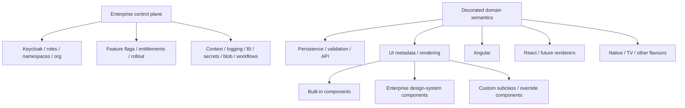


### 1.1 Core conclusion

For **large, data-centric, long-lived enterprise applications**, Decaf has the potential to create unusually strong economics when the application contains many repeated entity-oriented workflows and standard interaction patterns.

The most defensible current thesis is:

> **Decaf turns framework-level repetition into shared infrastructure. An enterprise pays the complexity cost of CRUD, validation, rendering, authorization plumbing, and stack integration once, then amortizes it across tens or hundreds of domain models.**

This is most valuable in systems such as healthcare administration, pharma, government, logistics, supply chain, financial operations, insurance, manufacturing, telecom operations, compliance, asset management, internal banking, and large B2B platforms.

It is less compelling for small sites, highly artistic consumer products, games, or applications where most value lives in custom algorithmic behavior rather than data-centric workflows.

### 1.2 Quantitative working model

The following figures are **reasoned estimates, not published Decaf benchmarks**. They are useful for business planning and should be replaced or narrowed through a controlled benchmark program.

| Dimension | Working estimate for a large CRUD-heavy enterprise application | Confidence today |
|---|---:|---|
| CRUD-specific frontend code reduction | **60-85%** | Medium |
| Whole frontend source reduction | **25-50%** | Medium |
| Repetitive backend plumbing reduction | **50-80%** | Medium |
| Whole backend source reduction | **30-60%** | Medium |
| Application-specific browser JS reduction at scale | **30-60%** | Low-Medium |
| Total browser JS reduction including vendors/framework | **10-30%** | Low-Medium |
| Initial JS reduction vs a well-lazy-loaded Angular baseline | **0-25%** | Low-Medium |
| Entity-specific lazy-chunk reduction after renderer cache | **30-70%** | Low-Medium |
| Estimated implementation saving for 100 CRUD-heavy models | **~100-400 developer-days** | Medium as scenario model |
| Expected runtime penalty from metadata indirection | **small relative to network/DB/DOM costs in normal enterprise workloads** | Medium hypothesis; benchmark required |
| Cross-stack semantic retention potential | **high; benchmark target 80%+ for suitable model-driven surfaces** | Architectural potential, not measured |
| Enterprise platform-plumbing reuse | **material; benchmark target >=50% lower bootstrap effort for SSO + scoped auth + correlated logging** | Proposed target, not measured |
| Request-context continuity | **target 100% correlation/auth-context propagation across generated routes under concurrency** | Proposed target, not measured |
| Feature-flag cross-layer coverage | **target: one semantic flag can consistently gate model/route/operation/UI behavior where intended** | Public architecture observed; production benchmark required |
| UI extension effort | **target: bespoke Decaf-compatible component in hours rather than a new page stack for standard cases** | Stakeholder design practice; benchmark required |
| Platform Bootstrap Effort (SSO + scoped auth + flags + context + logging + secrets) | **target >=50% lower than a strong composed NestJS baseline** | Proposed target, not measured |
| Control Plane Reuse Ratio across application portfolio | **target 70%+ of common enterprise concerns consumed from standardized Decaf substrate** | Proposed portfolio KPI |

### 1.3 The licensing strategy materially improves the adoption case

The recommended licensing architecture is:

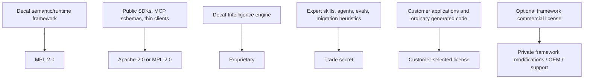

This separation is strategically strong because it aligns each asset with the appropriate economic objective:

1. **The framework should spread.** MPL makes the runtime safe enough for enterprise proprietary applications while preserving file-level reciprocity on modified framework files.
2. **Portability should become a network effect.** More renderers, adapters, stacks, and integrations increase the value of the semantic model.
3. **The intelligence layer should remain scarce.** The private Decaf Intelligence corpus, specialized agents, prompts, repair strategies, migration knowledge, production heuristics, and evaluation datasets should not be published if they are intended to be a competitive moat.
4. **Enterprise customers should not fear generated-code contamination.** Application code produced with Decaf Intelligence should remain licensable by the customer, subject to the commercial agreement and ordinary copyright rules.
5. **Commercial revenue should buy capability and assurance, not escape from artificial friction.** LTS, support, private AI, on-prem deployment, security, migration tooling, enterprise agents, compliance packs, indemnity, and OEM rights are natural monetization points.

### 1.4 Why the private AI layer is strategically important

Generic LLMs can already write Angular, React, NestJS, CRUD endpoints, and forms. The defensible value is not "AI can write code." It is the accumulated system knowledge that allows an agent to make **correct Decaf-specific decisions with fewer degrees of freedom**.

The private `decaf-ai` repository, as described by the Decaf stakeholders for this analysis, contains the specialized skills and agents needed across Decaf work. If retained as proprietary/trade-secret IP, it can function as a continuously improving expert layer over commodity frontier models.

The moat becomes:

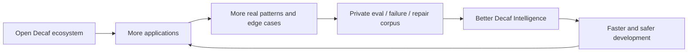

A competitor can read the public framework and build an assistant. What it should not automatically receive is years of curated diagnosis, migration, remediation, architecture, testing, and production knowledge.

### 1.5 Production evidence changes the maturity discussion

Public evidence from PharmaLedger shows a regulated, industry-backed platform with a production ePI application, a footprint described as 46 countries and 29 languages, a history emerging from a EUR 22.1 million EU/EFPIA program, and participation from global pharmaceutical companies and technology organizations.[S10][S11]

For this report, the Decaf stakeholder states that the relevant enterprise application is built with Decaf and has the potential to reach very large populations. That **Decaf-to-PharmaLedger implementation relationship is stakeholder-provided context, not independently established by the public PharmaLedger pages reviewed here**. This distinction matters for external marketing.

The recommendation is to obtain permission for a formal, jointly approved case study. If documented publicly with architecture and measured numbers, it could close a large part of Decaf's current credibility gap.

### 1.6 Overall assessment

| Dimension | Assessment | Notes |
|---|---:|---|
| Architecture / semantic compression | **9.5/10 potential** | Broad full-stack plus enterprise-plumbing abstraction is differentiated |
| Enterprise integration / IAM coherence | **8.5/10 potential** | Keycloak provisioning + roles/namespaces/org scaffolding + integration subpaths |
| Observability / request-context coherence | **8/10 potential** | Correlation/context/logging are integrated; full distributed tracing still needs stronger first-class proof |
| CRUD development leverage | **9-9.5/10 potential** | Particularly strong in large model estates |
| Frontend bundle architecture | **8-9/10 potential** | Standalone/per-control design is favorable; registry implementation matters |
| Backend development leverage | **9/10 potential** | Auto controllers/services/aggregation/bulk/auth/SSE are material |
| Desktop runtime performance | **8-9/10 estimated** | Dynamic resolution overhead should usually be secondary |
| Mobile suitability | **7.5-8.5/10 potential** | Requires disciplined lazy loading, DOM control, virtualization |
| TV suitability | **6.5-7.5/10 today; ~8/10 potential with dedicated renderer** | Rendering-flavour abstraction is strategically useful |
| Cross-stack portability | **9/10 strategic potential** | Could become a core enterprise reason to adopt |
| LLM/agent architecture | **9.5/10 potential** | Semantic compression is unusually AI-friendly |
| Implementation maturity | **~7-8/10 indicative** | Production evidence appears stronger than public awareness |
| Public ecosystem maturity | **~4/10** | Docs, community, integrations, third-party content remain comparatively small |
| Public adoption visibility | **~2-3/10** | Far behind established alternatives by visible signals |
| Enterprise adoption potential | **8/10 with execution** | Requires evidence, governance, packaging, benchmarks, and trust |

The central business challenge is therefore **not proving that model-driven development is possible**. It is converting a technically compelling architecture into an enterprise product that is easy to evaluate, trust, procure, benchmark, learn, debug, and support.

---

## 2. Methodology and evidence taxonomy

This report intentionally separates three classes of statements.

### 2.1 Observed

**Observed** means directly supported by public documentation, package manifests, repository documentation, or other publicly available evidence reviewed for this analysis.

Examples:

- `for-nest` documents auto-generated model CRUD controllers, optional services, grouping/aggregation routes, bulk operations, authorization configuration, and SSE observer events.[S5]
- the reviewed `for-angular` package manifest lists `cronstrue` as its ordinary runtime dependency while Angular, Ionic, CodeMirror, and Decaf packages appear as peers.[S3]
- Angular supports route-level dynamic imports and deferred standalone component loading.[S6][S7]
- the public Decaf organization describes persistence adapters and multiple UI engines including Angular, React, and React Native.[S1]
- PharmaLedger publicly describes a production ePI app with broad geographic/language reach.[S11]

### 2.2 Estimated

**Estimated** means an engineering or business inference based on the architecture and comparison with conventional application structures. These figures are not presented as measured Decaf performance.

Examples:

- 25-50% whole-frontend source reduction in a typical large enterprise operations application;
- low-single-digit backend request-path overhead as a hypothesis;
- 100-400 developer-days of implementation savings in a 100-model scenario.

### 2.3 Target

**Target** means a proposed benchmark or product objective that Decaf should attempt to demonstrate.

Examples:

- 80%+ semantic retention in a suitable Angular-to-React model-driven migration;
- <5% p95 API latency overhead versus equivalent hand-written Nest controllers in database-bound CRUD workloads;
- 50%+ reduction in files touched for a representative cross-layer model change;
- measurable LLM token and retry reduction when using Decaf Intelligence.

### 2.4 Why this distinction matters

A young framework can damage enterprise credibility by presenting architectural intuition as empirical fact. Decaf's strongest path is the opposite:

> Publish the architecture openly, label estimates honestly, then build a repeatable benchmark suite that turns the estimates into measured evidence.

---

## 3. Strategic thesis: semantic compression

### 3.1 The conventional enterprise duplication problem

A single business field can exist in many places.

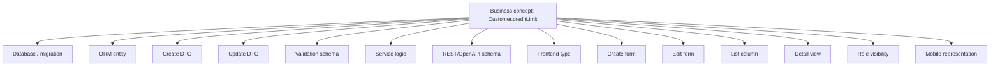

The problem is not that each file is large. The problem is that the application now contains multiple representations of the same meaning.

That creates:

- synchronized-change cost;
- more opportunities for inconsistency;
- more tests;
- more review surface;
- more onboarding material;
- more files for an LLM to locate and edit;
- more merge conflicts;
- more code that becomes coupled to a specific frontend/backend stack.

### 3.2 The Decaf compression model

Decaf's model-driven proposition is closer to:

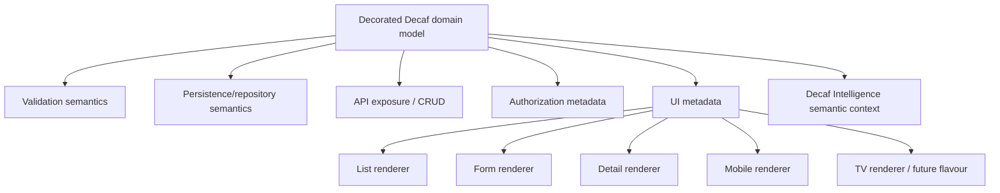

The framework carries the repeated mechanics. Application developers concentrate on:

- the domain;
- business rules;
- exceptional workflows;
- bespoke experiences;
- integration boundaries;
- performance-sensitive specialization.

This is not "zero code." It is a claim about **where code belongs**.

### 3.3 Runtime projection vs source generation

This is a crucial differentiator.

A generator such as JHipster can create many files rapidly. That speeds initial development, but the generated files become part of the application and must later be owned, maintained, merged, tested, and migrated.

Decaf's stronger proposition is that standard projections do not have to become entity-specific source files at all.

Conceptually:

```text
Generator economics:
  cost to create boilerplate -> low
  artifacts owned after generation -> high

Decaf runtime projection economics:
  shared framework cost -> paid once
  entity-specific artifacts -> low
  marginal cost per additional standard model -> low
```

This creates increasing returns with application size.

### 3.4 Two-axis semantic compression: vertical and horizontal

The earlier analysis focused mostly on **vertical semantic compression**: one domain concept projected into persistence, API behavior, validation and UI. The integration/context layer adds a second axis: **horizontal platform compression**.

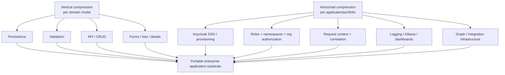

This distinction is commercially important. A conventional framework can reduce the cost of implementing a `Customer` screen while still requiring every new product/team to independently assemble SSO, role mapping, tenant scoping, request correlation, logging conventions, BI embedding, operational dashboards, and integration loaders. Decaf's broader architecture can potentially amortize **both** categories.

A useful enterprise metric is therefore **Platform Bootstrap Effort (PBE)**: developer-days from a blank service/application to a production-ready baseline containing SSO, scoped authorization, correlated structured logging, health/telemetry integration, and a standard operational dashboard. Decaf should benchmark PBE alongside CRUD LOC.

### 3.5 The scale threshold

Decaf is unlikely to create its best economics in a five-screen application. Shared generic infrastructure always has a fixed cost.

A simplified model:

```text
Traditional cost = base framework cost + N * entity implementation cost
Decaf cost       = larger shared semantic/runtime cost + N * small metadata/exception cost
```

At small `N`, the difference can be negligible or even favor conventional code. At large `N`, Decaf's cost curve can flatten dramatically.

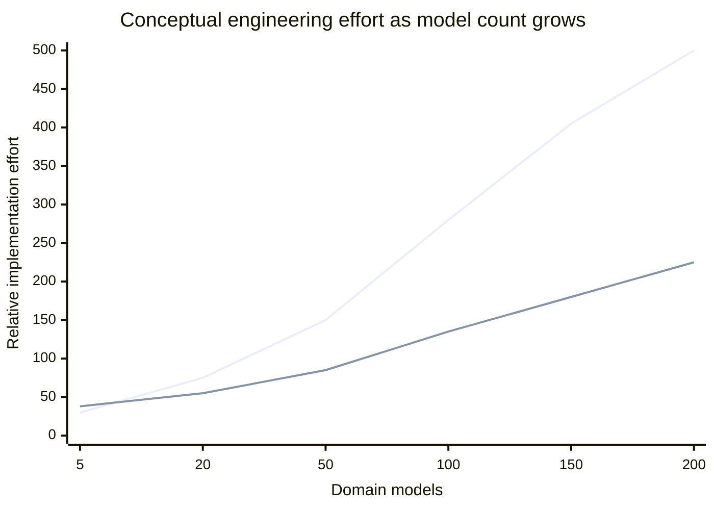

*Illustrative shape only; not measured data.*

---

## 4. Frontend development economics

### 4.1 What Decaf can remove

A conventional entity-oriented frontend often has some combination of:

- route definitions;
- list page and list template;
- create page;
- edit page;
- detail page;
- table column declarations;
- filter components;
- pagination glue;
- empty/loading/error handling;
- form controls;
- validators;
- relationship selectors;
- display formatting;
- delete confirmation;
- authorization/visibility conditions;
- mobile/card variants;
- localization bindings;
- CRUD data-service glue.

A model-driven renderer can move many of those responsibilities into shared framework behavior.

### 4.2 Estimated source reduction by application type

| Application type | Estimated CRUD-layer reduction | Estimated whole-frontend reduction | Why |
|---|---:|---:|---|
| Administrative CRUD / master data | 70-90% | 40-60% | Most screens follow standard patterns |
| Typical enterprise operations | 60-85% | 25-50% | Many CRUD surfaces plus workflows/dashboards |
| Mixed workflow + analytics | 40-70% | 15-35% | Standard forms/lists coexist with custom interaction |
| Consumer product with distinctive UX | 10-30% | 5-15% | Most value is bespoke UI, not CRUD |

These estimates should be validated by counting equivalent application artifacts in a benchmark implementation.

### 4.3 Marginal-model economics

The strongest frontend business case is the cost of model number 75, not model number 1.

For a conventional system, model 75 may still require:

```text
List + Create + Edit + Detail + Routes + Validators + Tests + Permissions
```

For a mature Decaf system, the marginal work can become:

```text
Model metadata + exceptions + validation + tests of the unique behavior
```

This is why Decaf should track **marginal engineering cost per additional model** as a first-class metric.

### 4.4 Suggested metric: Standard Surface Coverage (SSC)

Define:

```text
SSC = model-driven standard UI surfaces / total entity-oriented UI surfaces
```

If an enterprise application has 400 entity-oriented screens and 320 are produced through generic Decaf behavior, SSC = 80%.

SSC is valuable because it predicts:

- development leverage;
- migration leverage;
- testing leverage;
- design-system consistency;
- LLM leverage;
- bundle duplication reduction.

### 4.5 The escape-hatch requirement

Model-driven systems fail when they force every exception into metadata.

A successful Decaf application needs a clean rule:

> Use metadata for repeated semantics. Use ordinary components/services/code for exceptional behavior.

The framework should make it easy to override:

- one field renderer;
- one model page;
- one workflow;
- one route;
- one validation rule;
- one API operation;

without requiring a fork or a global renderer hack.

The quality of these escape hatches directly affects enterprise adoption.

---


### 4.6 Renderer extensibility: model-driven does not have to mean boxed-in

The public renderer architecture materially reduces one of the classic objections to metadata-driven and low-code systems: **what happens when the generated/default UI is not enough?**

`@decaf-ts/ui-decorators` describes a framework-independent `RenderingEngine` and metadata such as `@renderedBy`, `@uielement`, `@uiprop` and `@uilistprop`.[S2] The Angular renderer publicly exposes dynamic component resolution. `NgxRenderingEngine` maintains a component registry, can resolve a component supplied directly by a field definition, and can instantiate registered Angular components dynamically; the `@Dynamic()` decorator registers compatible components by selector.[S45][S46]

That yields a materially different extension model from rigid page generation:

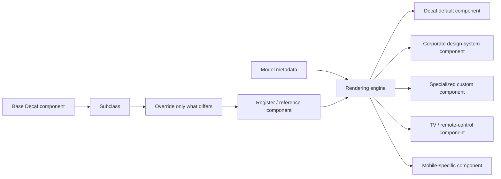

The stakeholder describes the common customization path as **subclass → override → done/register**. That practice should be measured and documented because it may be one of Decaf's highest-value developer-experience characteristics.

The strategic implications are significant:

- a Decaf application can default to model-driven forms/lists/details while escaping to bespoke UX at component granularity;
- an enterprise design system can map Decaf semantics to its own visual components rather than replacing the semantic model;
- regulated/specialized controls can remain custom without forcing a whole screen to abandon Decaf;
- renderer portability can coexist with platform-specific optimization: the same semantic field may map to different components on desktop, mobile and television;
- teams avoid a common low-code failure mode in which the first 80% is fast but the final 20% requires fighting the platform.

This also changes the **lock-in assessment**. Decaf still creates semantic/API lock-in to its metadata model, but it need not create equivalent **component-level UI lock-in** if the extension contract remains stable and ordinary framework components can participate.

### 4.7 Suggested KPI: Extension Cost Index (ECI)

Define:

```text
ECI = engineering hours to introduce a production-grade custom control or surface
      that preserves Decaf semantics / equivalent hours in the comparison stack
```

A benchmark should implement the same five non-trivial controls in Decaf and comparator stacks:

1. corporate currency field with formatting/validation;
2. relationship/entity picker;
3. rich medical/document viewer;
4. geospatial selector;
5. TV/D-pad navigable list control.

Measure:

- source lines and files changed;
- time to first working version;
- time to production accessibility/testing quality;
- semantic metadata retained;
- bundle delta;
- amount of generic renderer code forked;
- upgrade impact after a framework version change.

A strong Decaf result would show that custom UI remains **local customization**, not a return to page-by-page application construction.

### 4.8 Extensibility creates governance obligations

Infinite extensibility is valuable only if the extension contract is predictable. Decaf should formalize:

- required component inputs/outputs and lifecycle expectations;
- renderer metadata compatibility/versioning;
- registry naming and collision behavior;
- accessibility requirements;
- SSR/hydration expectations where relevant;
- lazy registration/dynamic import patterns;
- component conformance tests;
- Storybook/reference fixtures;
- deprecation windows.

Without a formal compatibility contract, “any component can participate” can drift into “every application has a subtly incompatible component dialect.” The extension surface should therefore be treated as a product API, not an implementation detail.

## 5. Frontend bundle-size analysis

### 5.1 Bundle size must be split into four metrics

"Smaller bundle" is too imprecise. A serious analysis needs at least:

1. **Initial-route JavaScript** - downloaded before the initial useful screen.
2. **Total deployable JavaScript** - all chunks available in the application deployment.
3. **Marginal feature/model JavaScript** - additional code needed to enter another feature after common runtime is cached.
4. **Runtime code/heap cost** - memory and execution overhead after loading.

Decaf can perform very differently on each metric.

### 5.2 The user's standalone-component clarification is material

The reviewed `for-angular` package manifest lists only `cronstrue` in its ordinary `dependencies` section, while Angular, Ionic, CodeMirror-related packages, and Decaf packages appear as peers.[S3]

That is consistent with a component-oriented consumption model rather than one giant monolithic package. It does not by itself prove optimal tree-shaking, but it changes the risk model substantially.

The relevant question becomes:

> Does the application's renderer registry import every optional renderer eagerly, or can renderers and their heavy transitive dependencies remain absent or lazy until used?

### 5.3 Tree-shaking and lazy-loading are different

**Tree-shaking** asks:

> If the application never uses a barcode/code-editor/chart renderer, can that code disappear from the production build?

**Lazy loading** asks:

> If the application does use that renderer somewhere, must it be in the initial chunk, or can it be loaded only when needed?

Decaf should optimize both.

### 5.4 Eager registry anti-pattern

```ts
import { CodeEditorRenderer } from './code-editor';
import { BarcodeRenderer } from './barcode';
import { DiagramRenderer } from './diagram';

registry.register('code', CodeEditorRenderer);
registry.register('barcode', BarcodeRenderer);
registry.register('diagram', DiagramRenderer);
```

This can make all three renderers reachable from the initial registry graph.

### 5.5 Preferred async registry pattern

Conceptually:

```ts
registry.registerLazy('code', () => import('./code-editor'));
registry.registerLazy('barcode', () => import('./barcode'));
registry.registerLazy('diagram', () => import('./diagram'));
```

Angular explicitly supports dynamic imports for lazy routes and deferred loading of standalone dependencies.[S6][S7]

That makes a strong Decaf bundle strategy possible:

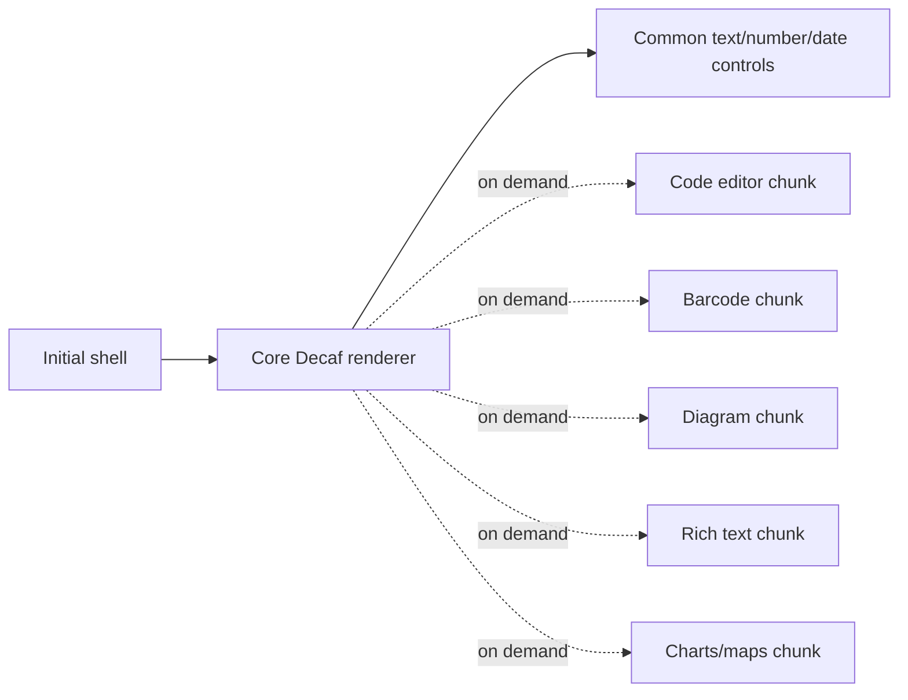

### 5.6 Initial bundle estimate

Against a badly structured conventional Angular app, Decaf might show a large initial-bundle win. That is not the right benchmark.

Against a **well-lazy-loaded** Angular application where each feature page already has route-level splitting, Decaf's initial advantage may be modest because the conventional app also excludes many screens from the initial download.

Working estimate:

> **0-25% smaller initial application JavaScript** in a well-engineered comparison, with the possibility of parity or a small regression for tiny apps where Decaf's metadata/runtime overhead is not yet amortized.

### 5.7 Total deployable JavaScript estimate

This is where Decaf can gain more.

A conventional 100-model app may contain hundreds of entity-specific compiled components and templates. Decaf can pay once for common rendering machinery and represent model differences mostly as metadata.

Working estimate for a 50-200 model, CRUD-heavy system:

- **application-specific JS:** 30-60% reduction plausible;
- **total JS including Angular/vendor libraries:** 10-30% reduction plausible.

Why the second figure is lower: Decaf cannot remove Angular itself, authentication SDKs, charts, network stacks, date libraries, observability, and other unavoidable shared dependencies.

### 5.8 Marginal lazy-chunk estimate

Once common renderers are cached, entering another ordinary domain resource can require mostly:

- model metadata;
- route/configuration metadata;
- unique business logic;
- any exceptional renderer.

It does not necessarily need dedicated list/create/edit/detail implementation code.

A **30-70% reduction in entity-specific compiled JS** is a plausible target for highly repetitive modules, but should be measured with a canonical benchmark rather than marketed as fact today.

### 5.9 Bundle-risk controls

Decaf should publish a bundle architecture guide containing:

- async/lazy renderer registration;
- "no barrel import" recommendations for optional controls where barrels defeat splitting;
- side-effect-free package metadata where technically valid;
- separate entry points for renderer families;
- bundle analyzer CI thresholds;
- budget tests for `main`, first route, common renderer set, and heavy controls;
- example applications proving that CodeMirror/charts/maps do not enter the baseline bundle unless needed.

### 5.10 Bundle KPIs

Suggested release gates:

| KPI | Purpose |
|---|---|
| Core renderer gzip/brotli delta | Prevent framework baseline growth |
| Minimal CRUD app initial JS | Track real consumer cost |
| Heavy-control exclusion test | Prove optional deps stay optional |
| Per-control lazy chunk size | Make cost transparent |
| 100-model benchmark total JS | Demonstrate amortization |
| Low-end Android parse/evaluate time | More meaningful than bytes alone |

---

## 6. Frontend runtime performance

### 6.1 Where dynamic rendering adds work

A hard-coded component already knows which components exist at compile time.

A generic renderer may perform:

```text
model metadata lookup
-> property metadata merge
-> visibility/authorization decision
-> renderer selection
-> component registry lookup
-> dynamic component creation
-> generic value/validation binding
```

That is additional work.

The correct question is not whether overhead exists. It is whether that overhead materially affects user-perceived performance compared with:

- network round trips;
- JSON parsing;
- API/database latency;
- DOM creation;
- large table rendering;
- change detection;
- image/media work;
- charts;
- rich editors.

For typical enterprise forms and lists, the metadata lookup portion is likely to be small relative to these costs, but this remains a benchmark hypothesis.

### 6.2 Important implementation choices

Runtime performance depends heavily on:

- caching effective merged metadata per model/property;
- O(1) or near-O(1) renderer lookup;
- avoiding reflection/scanning on every change-detection cycle;
- memoizing permission/visibility decisions when safe;
- not re-instantiating controls unnecessarily;
- using efficient Angular change detection patterns;
- virtualizing long lists;
- incremental pagination/server-side filtering;
- lazy loading expensive controls;
- avoiding giant generic component trees.

### 6.3 Performance estimates by target

These are architecture-based estimates, not measured scores.

| Target | Estimated suitability | Conditions |
|---|---:|---|
| Modern desktop browser | **8-9/10** | Normal enterprise forms/tables; cached metadata |
| Flagship mobile | **~8/10** | Lazy heavy controls; moderate DOM size |
| Mid-range mobile | **7-8/10** | Virtualization and chunking become important |
| Low-end mobile | **6.5-7.5/10** | Must aggressively control JS parse cost and DOM |
| Modern smart TV browser | **6.5-7.5/10** | Browser variability and focus input dominate |
| Dedicated optimized TV renderer | **~8/10 potential** | Purpose-built focus/navigation and lightweight components |

### 6.4 What to benchmark

For each target class:

- time to interactive;
- first meaningful list render;
- edit form creation time for 10, 30, 100 fields;
- 100-row, 1,000-row and 10,000-record virtualized list behavior;
- heap after repeated navigation;
- metadata resolution time cold/warm;
- renderer instantiation time;
- change-detection cost;
- low-end Android CPU throttling tests;
- TV focus-navigation latency and memory.

---

## 7. Mobile and TV analysis

### 7.1 Mobile is not merely responsive desktop

Mobile constraints include:

- slower CPUs on the long tail of devices;
- thermal throttling;
- memory pressure;
- expensive JS parse/evaluation;
- intermittent networks;
- touch target requirements;
- smaller screens;
- different workflow sequencing.

Decaf's renderer abstraction is useful if it can select controls and layouts appropriate to the target rather than merely shrink a desktop table.

### 7.2 Mobile opportunity

The semantic model can stay stable while presentation changes:

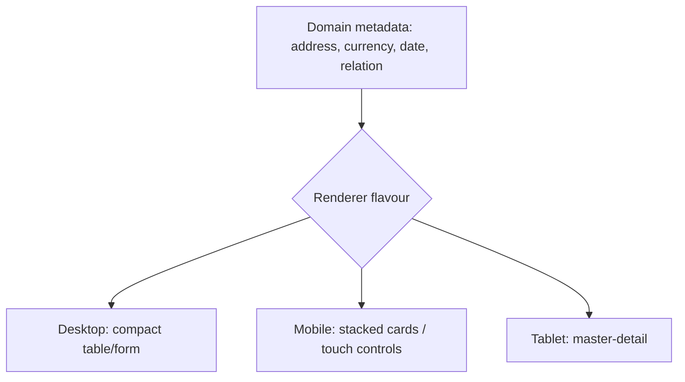

This allows the business semantics to survive device evolution.

### 7.3 TV is a stronger portability demonstration than responsive CSS

TV environments introduce:

- remote / D-pad navigation;
- explicit focus graph;
- 10-foot viewing distance;
- oversized targets and typography;
- weaker embedded hardware;
- browser fragmentation;
- fewer simultaneous controls;
- latency-sensitive input feedback.

A generic desktop renderer may perform poorly on both usability and resource consumption.

But a dedicated Decaf TV flavour can interpret the same metadata differently:

```text
@currency() price

Desktop -> compact table cell
Mobile  -> touch-friendly field/card
TV      -> large high-contrast value with focus semantics
```

That is a concrete portability advantage.

### 7.4 Recommended TV strategy

Do not promise that `for-angular` as-is is automatically optimal for TVs. Instead:

1. define a TV rendering profile;
2. use a very small component palette;
3. treat focus order as semantic metadata where needed;
4. prefetch only the next likely screen/renderer;
5. avoid rich editors and large component trees;
6. build test lanes for Tizen/WebOS/Android TV classes if they are target markets;
7. maintain target-specific performance budgets.

---

## 8. Backend architecture and `for-nest`

### 8.1 Observed capabilities

The public `for-nest` README documents configuration that can:

- auto-generate CRUD controllers for models registered to adapter flavours;
- optionally generate injectable model services;
- enable or disable grouping/aggregation endpoints such as count, avg, max, min, sum, distinct, and group;
- enable bulk CRUD routes;
- apply public/role/namespace authorization configuration to generated controllers;
- enable Server-Sent Events observer endpoints.[S5]

This makes the backend proposition much stronger than a set of decorators around hand-written Nest services.

### 8.2 Repetitive backend layers

Conventional Nest-style entity handling often includes:

```text
entity/model
repository
create DTO
update DTO
response DTO / mapper
service
controller
validation
OpenAPI decorators
authorization guards/metadata
tests
```

If generic Decaf infrastructure safely supplies most of those operations, application source can focus on exceptional domain behavior.

### 8.3 Estimated backend reduction

| Backend character | Estimated repetitive-code reduction | Rationale |
|---|---:|---|
| Pure CRUD/data service | 70-90% | Generic resource behavior dominates |
| Normal enterprise domain | 50-75% | CRUD plus meaningful business services |
| Workflow/domain-heavy | 25-50% | Custom transitions and integration logic dominate |
| Algorithmic service / little persistence | <20% | Decaf abstraction is not the main problem |

Whole-backend source reduction of **30-60%** is plausible for a CRUD-heavy service estate, but requires benchmark validation.

### 8.4 Generated-at-bootstrap is not the same as interpreted-per-request

A key performance distinction:

```text
Bootstrap-time dynamic construction:
  inspect models -> register providers/controllers -> normal request routing

versus

Per-request interpretation:
  inspect schema -> decide route -> synthesize execution every request
```

If `for-nest` creates normal Nest providers/controllers during startup, the request path can remain close to conventional Nest execution.

Therefore, a generated controller is not inherently slow merely because a factory created it.

### 8.5 Backend performance hypothesis

For database-bound CRUD workloads, this report expects the dominant costs to remain:

- database I/O;
- serialization;
- authorization checks;
- network latency;
- query complexity;
- external service calls.

Metadata/context overhead should be comparatively small if hot-path model metadata is cached.

A reasonable benchmark **target** would be:

> p95 API latency within 5% of an equivalent hand-written Nest implementation for ordinary CRUD endpoints under the same database and transport configuration.

That is a target, not an existing measurement.

### 8.6 Backend scalability dimensions

Scalability must be evaluated across:

#### Horizontal scaling

Generated controllers should remain stateless where possible so ordinary container/pod horizontal scaling works unchanged.

#### Database adapter scaling

The persistence adapter becomes critical. CouchDB, relational databases, Fabric, local/offline PouchDB, and other engines have different scaling and consistency models. Decaf should not pretend the generic repository layer erases those differences.

#### Query safety

Automatic grouping, bulk operations, relationship traversal, and generic filtering can create dangerous query shapes at enterprise scale. Production-safe generic APIs need:

- pagination defaults and hard maximums;
- query complexity controls;
- allowlists/denylists;
- aggregation authorization;
- bulk-operation limits;
- transaction boundaries;
- rate limits;
- audit logging;
- observability per generated route.

#### Startup scaling

If hundreds or thousands of models are scanned at boot, startup time and metadata memory can matter in serverless/cold-start environments. Benchmark cold start for 10, 100, 500, and 1,000 models.

### 8.7 Recommended server benchmarks

For 10/100/500 models:

- process startup time;
- resident memory after initialization;
- routes/providers registered;
- requests/sec for CRUD read/write;
- p50/p95/p99 latency;
- JSON serialization CPU;
- auth overhead;
- aggregation latency;
- bulk operations;
- SSE connection counts;
- memory under long-lived observer streams;
- horizontal scaling efficiency.

### 8.8 `@decaf-ts/integrations` changes the backend category

The public `@decaf-ts/integrations` repository materially broadens the platform story. It documents reusable modules for:[S28]

- Keycloak provisioning of realms, users, roles, identity providers, and client-scoped role wiring;
- JWT helpers that extract Keycloak roles, namespace scopes, and user context;
- the standardized `namespace(...)` model decorator;
- organization-oriented authorization scaffolding for tenants, organizational units, principals, roles, permissions, grants, effective permissions, storage bindings, and payload filters;
- Kibana spaces, data views, dashboards, and realm-specific access control;
- common Kibana/Superset embedded-dashboard contracts;
- dynamic loading of models, adapters, repositories, services, controllers, environment objects, Angular components, and graph nodes;
- a canonical graph workflow engine and Nest run lifecycle with validation, persistence, authorized replayable SSE, results, and cancellation.

The package exports those concerns through independent subpaths such as `/keycloak`, `/kibana`, `/nest`, `/namespaces`, `/plugins`, and graph-specific paths. Its Nest/HTTP/Jose peers are optional, which supports a modular "install/import the capability you use" model rather than forcing every integration into every application.[S28][S29]

This matters to the earlier bundle/dependency analysis. `@decaf-ts/integrations` is broad in functional scope, but the packaging strategy is explicitly segmented. The enterprise advantage is therefore potentially **shared implementation without mandatory shared runtime weight**. That claim should still be verified with bundle/module-graph tests.

### 8.9 Keycloak SSO, `@namespace`, and organization-scoped authorization

`@decaf-ts/for-http` documents a framework-agnostic `AuthHandler` that extracts **user identity, roles, namespaces, and organization**, validates route- and model-level role/namespace requirements, and binds the resulting auth data onto the request context for downstream decorators and services. It also documents that `namespace(...)` metadata is separate from ordinary role metadata: roles satisfy role checks, while namespaces satisfy namespace checks.[S30]

Conceptually:

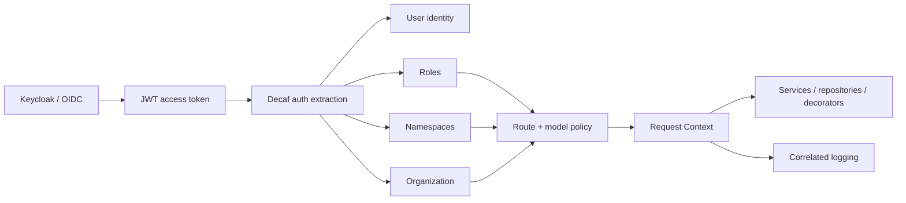

The architectural distinction is that **authentication, authorization metadata, and data/application context are designed to meet in one execution context**, rather than being unrelated libraries glued together per project.

For multi-tenant or multi-organization enterprise systems, namespaces can represent a standardized scope dimension without overloading roles. That can reduce the common anti-pattern where teams encode tenancy into ad-hoc role strings, controller conditionals, or duplicated query filters. The org authorization scaffold potentially extends the same idea to richer principal/permission/grant structures.

Important caveat: a namespace mechanism does not automatically guarantee tenant isolation. The security case depends on:

- trustworthy token issuance and claim mapping;
- default-deny semantics;
- correct namespace propagation into persistence/query operations;
- protection against namespace override/injection;
- consistent behavior in generated and hand-written routes;
- tests proving no cross-namespace data leakage;
- lifecycle/provisioning governance for Keycloak roles, realms, clients and identity providers.

These should be made part of Decaf's conformance test suite.

### 8.10 Request-bound context and correlated logging

The Decaf stack has several public pieces that support request-level traceability:

- `Context` in the database/decorator layer is explicitly intended to pass contextual information through application layers.[S32]
- `for-http` carries request-scoped flags/headers in `Context` and its `AuthHandler` binds auth data into that context; the docs explicitly note that the trailing context is used to resolve logging/contextual state.[S30]
- `@decaf-ts/logging` supports context-aware loggers, correlation IDs in formatted output, child logger contexts, filters/transports, decorators/benchmarks, and pluggable Pino/Winston backends.[S31]
- Fabric integration demonstrates the same pattern in a different execution environment with a contract logger bound to the contract context.[S41]

The stakeholder-provided architecture adds an important implementation detail: the logger is bound per request so the same request identity can be followed through the operation path. That should be surfaced as a formal, tested platform contract.

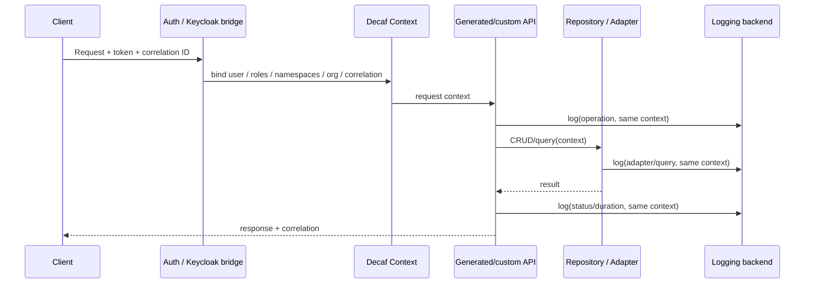

The business effect is not just nicer logs. It is potentially lower **mean time to diagnose**, stronger auditability, and less repeated middleware/setup work across services. It also creates an excellent bridge to AI operations: an authorized agent can reason over a request's model, user/namespace context, generated route, repository operation and correlated logs as one coherent execution story.

Decaf should nevertheless distinguish **correlated logging** from full **distributed tracing**. OpenTelemetry-compatible traces/spans, propagation across message queues and external calls, metrics, and exemplars should be an explicit roadmap/benchmark item rather than implied by logging alone. Modern NestJS now documents AsyncLocalStorage and first-party observability tooling for request context/trace correlation, so Decaf must prove that its integrated semantics provide more than a custom logger.[S38]

---


## 8A. Complete `@decaf-ts/integrations` capability audit

The package manifest reviewed for this analysis exposes far more than the subset summarized in the repository README. The public export map includes the package root plus dedicated subpaths for `kibana`, `docker`, `keycloak`, `nest`, `nest/graph`, `loader`, `namespaces`, `feature-flags`, `user-requests`, `secrets`, secrets providers, `blob`, blob providers, `calendar`, `graph`, `sftp`, `redis`, and dashboard plugins.[S29][S43]

This section evaluates **every exported integration family** as an enterprise-platform capability rather than treating the package as a miscellaneous connector collection.

### 8A.0 Published subpath inventory reviewed

To avoid collapsing `integrations` into a few headline features, the following export inventory was reviewed from the public package manifest. Grouping later in this report is analytical; it does not mean the omitted subpaths were ignored.

| Published subpath | Analytical family |
|---|---|
| `@decaf-ts/integrations` | root/common integration surface |
| `/kibana` | Kibana provisioning |
| `/docker` | Docker/Compose developer-environment tooling |
| `/keycloak` | Keycloak provisioning/IAM |
| `/nest` | Nest/auth/context integration |
| `/nest/graph` | Nest graph/run API integration |
| `/loader` | dynamic object/component/node loading |
| `/namespaces` | tenant/org/principal/authorization model |
| `/feature-flags` | semantic feature management / entitlements / rollout |
| `/user-requests` | user-request resolution/backend-to-renderer interaction |
| `/secrets` | provider-neutral secrets contract |
| `/secrets/aws` | AWS secrets provider |
| `/secrets/azure` | Azure secrets provider |
| `/secrets/gcp` | GCP secrets provider |
| `/secrets/oneppassword` | separately exported secrets provider path; provider naming/implementation should be clarified in public docs before external marketing |
| `/secrets/vault` | HashiCorp Vault provider |
| `/blob` | provider-neutral blob contract |
| `/blob/s3` | S3-compatible blob backend |
| `/blob/azure` | Azure Blob backend |
| `/blob/gcp` | Google Cloud Storage backend |
| `/blob/local` | local-filesystem backend |
| `/blob/ipfs` | IPFS backend |
| `/blob/memory` | in-memory/test backend |
| `/calendar` | iCalendar / recurrence output |
| `/graph` | graph/workflow runtime |
| `/sftp` | SFTP integration |
| `/redis` | Redis/Dragonfly Decaf persistence/events/transaction support |
| `/plugins` | dashboard/plugin contract surface |
| `/plugins/kibana` | Kibana embed plugin |
| `/plugins/superset` | Superset embed plugin |

The README also currently lists a `graph/shared` export. Because README and manifest surfaces can evolve independently, release documentation should be generated directly from the package export map and CI should fail when public docs fall out of sync.[S28][S29]

### 8A.1 Capability map

| Integration family | What it contributes | Enterprise value | Main caveat / risk |
|---|---|---|---|
| Keycloak | realm/user/role/IdP/client role provisioning + JWT auth bridge | standardized SSO/IAM bootstrap | Keycloak coupling; version governance |
| Namespaces / org auth | tenants, org units, principals, permissions, grants, storage bindings | multi-tenant authorization/isolation semantics | high security blast radius; must default-deny |
| Feature flags | persisted/environment flags, access grants, subject targeting, decorators for auth/operations/UI | progressive rollout, entitlements, tenant/user/model/UI gating | flag debt; flags are not a substitute for authorization |
| Nest / HTTP bridge | identity/role/namespace/org extraction into request context | consistent security context across generated/custom routes | concurrency/context propagation testing |
| User requests | framework-neutral user interaction resolution + handlers | reusable backend-to-UI interaction patterns | requires clear UX/timeout/error semantics |
| Secrets core | provider-neutral secret reference/service model | cloud/provider portability; centralized secret use | abstraction must not encourage secret material in logs/models |
| AWS/Azure/GCP/Vault/other secrets | provider implementations | deploy same application across enterprise environments | provider-specific features differ |
| Blob core | common blob API | portable binary/document storage | common denominator may hide provider capabilities |
| S3/Azure/GCP/local/IPFS/memory blobs | provider implementations | cloud, edge, local, decentralized and test storage options | consistency/ACL/lifecycle semantics differ |
| Redis/Dragonfly | Decaf adapter, query/paginator, pub/sub observer events, transactional context lock | cache/state/fast persistence and multi-process events | table-scanning query model is not a large analytic DB |
| SFTP | SSH2/AWS-oriented file transfer services | common legacy/regulated enterprise exchange channel | credential/key rotation and host verification governance |
| Docker | local/container environment lifecycle | faster reproducible developer/integration environments | not a production orchestration replacement |
| Calendar | cross-runtime iCalendar generation, reminder scheduling representation | useful healthcare/notification interoperability | not a general job scheduler |
| Dynamic loader | runtime loading of Decaf object families/components/nodes | plugin/extensibility and modular deployments | untrusted code loading is a security boundary |
| Kibana provisioning | spaces/data views/dashboards/access | reproducible observability/analytics setup | Elastic-specific surface |
| Kibana/Superset plugins | common DOM-free dashboard embed contract | BI portability behind stable application API | upstream version drift / patched plugin maintenance |
| Graph engine | validated canonical workflow docs, trusted node catalogue, run lifecycle, SSE/cancel/results | workflow/automation substrate | sandbox/node security; scaling and durability need benchmarks |

The overall pattern is important: **Decaf is standardizing the application-facing contract while allowing the provider implementation to vary.** That is the same portability principle applied beyond databases/UI into IAM, feature management, secrets, blob storage, BI and workflow execution.

### 8A.2 Feature flags are a semantic control-plane primitive, not a utility boolean

The feature-flag subsystem deserves first-class treatment because it connects deployment/rollout control to the same semantic dimensions Decaf already uses for authorization and UI projection.

The published source family defines subject categories including **user, account, namespace, model, route and UI**, and feature definitions can carry enabled state, description, metadata, scope, targets and arbitrary values.[S44] The decorator surface includes feature metadata, feature authorization/operation blocking and UI-oriented rendering/hiding behavior.[S44]

Conceptually:

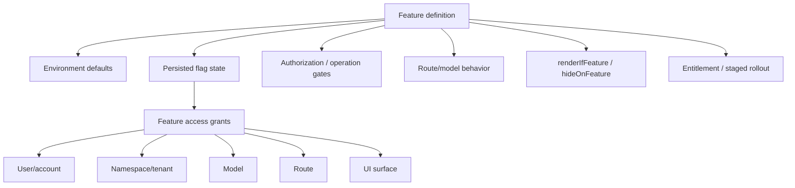

This creates several enterprise use cases:

- phased releases by namespace/tenant;
- customer-specific entitlements without hard-coded forks;
- dark launch of routes or operations;
- progressive UI enablement;
- emergency kill switches;
- controlled migration between old/new workflows;
- SaaS-plan/package entitlements;
- environment-specific capability availability;
- gradual adoption of new Decaf renderer/backend behavior.

The feature service publicly supports model-backed persistence, environment synchronization, cached lookup, grants/revocations and subject resolution, with a reader abstraction that can support alternative sources.[S44]

#### Feature flags are not authorization

This distinction must be explicit. A hidden UI control does not secure a backend operation. Feature flags can participate in entitlement/security decisions where designed, but core role/namespace/resource authorization should remain authoritative. Decaf should test combinations such as:

```text
feature enabled + role denied        => denied
feature disabled + role allowed      => denied/hidden where operation is feature-gated
UI hidden + direct HTTP request       => still server-enforced
namespace A flag + namespace B user  => no accidental grant
```

#### Feature-flag governance requirements

A serious enterprise feature-flag system needs lifecycle governance:

- owner/team;
- purpose;
- creation date;
- expiry/removal date;
- permanent-entitlement vs temporary-rollout classification;
- audit history;
- environment inheritance rules;
- emergency override procedure;
- stale-flag reporting;
- dependency/conflict detection;
- security review for auth-related flags.

Without this, feature flags become long-lived hidden configuration debt.

#### Competitive implication: use OpenFeature rather than fighting every specialist

Decaf's advantage is **semantic reach**, not necessarily being the best standalone feature-management SaaS. LaunchDarkly and Flagsmith are much more mature dedicated feature-management products with management UIs, analytics/experimentation/governance and large ecosystems, while OpenFeature provides a vendor-neutral API standard.[S47][S48][S49]

A strategically strong roadmap is:

> Keep Decaf's decorators/subject semantics stable, but provide an OpenFeature-compatible evaluator/provider bridge.

That would allow enterprises to use Decaf-native flags for simple deployments or plug in an existing corporate LaunchDarkly/Flagsmith/OpenFeature backend without losing model/route/UI integration.

### 8A.3 Namespaces and organization authorization are an isolation model

The public namespace module goes far beyond a string decorator. The exposed types/models/services describe tenants, organizational units and closure trees, users/groups/service accounts/agents/API keys as principals, scoped role/permission assignments, resource grants, effective permissions and storage bindings. It also defines isolation tiers such as **pooled, bridge and silo** and visibility/access concepts for protected resources.[S50]

This creates a plausible shared authorization substrate for SaaS and multi-organization applications:

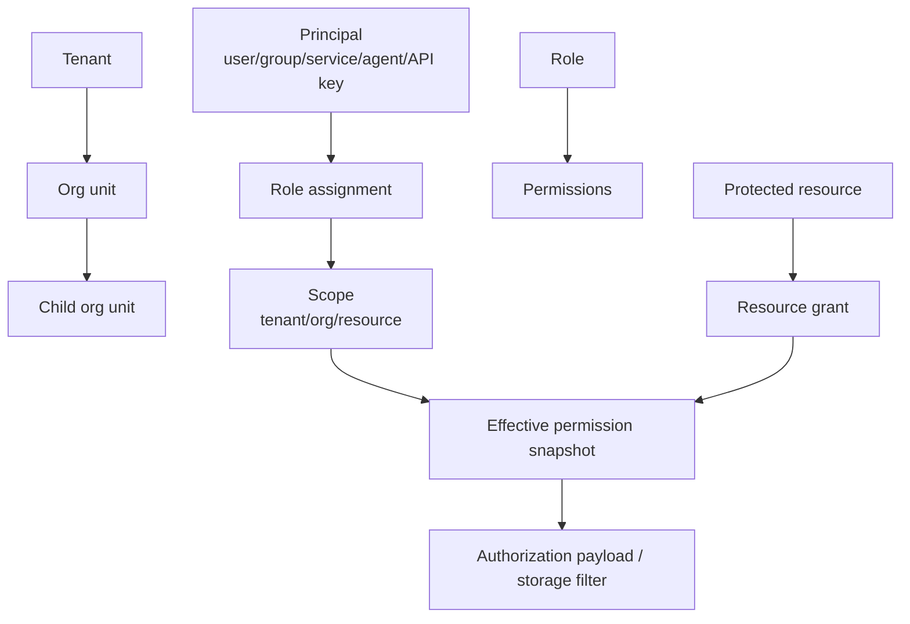

That materially strengthens the enterprise story because tenancy and authorization can become explicit domain/runtime semantics instead of conventions hidden in controllers and database filters.

It also raises the security bar dramatically. Namespace/org logic must have:

- exhaustive negative tests;
- cross-tenant concurrency tests;
- scope inheritance tests;
- temporal/conditional grant tests where supported;
- storage-binding isolation tests;
- administrator escalation tests;
- auditable effective-permission explanations;
- migration compatibility when authorization models evolve.

### 8A.4 Secrets abstraction: portability without exposing the secret plane to application code

The secrets family provides a provider-neutral service/reference abstraction with concrete cloud/on-prem providers including AWS Secrets Manager, Azure Key Vault, GCP Secret Manager and HashiCorp Vault, with additional exported provider surface in the package manifest.[S43][S51]

The business value is not that Decaf invents a secrets manager. It does not. The value is that an application can depend on a stable Decaf-facing secret contract while deployment chooses the enterprise provider.

This supports:

- cloud portability;
- customer-specific deployment standards;
- sovereign/on-prem requirements;
- test/local substitutions;
- easier Decaf AI-generated infrastructure because the agent reasons about one application contract.

The abstraction must preserve escape hatches for provider-specific features such as rotation/versioning, identity federation and access policies. Secret values must never leak into logs, model serialization or error payloads.

### 8A.5 Blob abstraction: multi-cloud and local storage portability

The blob family exposes core blob services plus S3-compatible, Azure, GCP, local filesystem, IPFS and in-memory implementations.[S43][S52] The S3-compatible path is particularly useful because it can cover AWS S3 and compatible systems such as MinIO or R2-like deployments depending on implementation compatibility.

This is strategically relevant for Decaf's portability thesis:

```text
application/domain code
        ↓
Decaf blob contract
        ↓
AWS / Azure / GCP / local / IPFS / memory
```

The enterprise caution is that object stores have different semantics for IAM, retention, lifecycle, consistency, legal holds, signed URLs and regionality. Decaf should expose a common contract **plus capability discovery/escape hatches**, not force every provider into the weakest common denominator.

### 8A.6 User-request resolution: portable interaction workflows

The `user-requests` export binds a framework-agnostic user-request resolution engine into backend handlers while exposing renderer-facing interaction concepts such as modal, toast, spinner and router facades.[S53]

This is subtle but strategically important: it allows backend/domain workflows to request user interaction through an abstract contract rather than hard-coding one UI framework. In a portable application substrate, that can keep workflow intent stable while Angular/mobile/TV render the interaction differently.

A mature implementation should define:

- request identity and correlation;
- timeout/cancellation behavior;
- retries/idempotency;
- authorization context;
- multi-device/session behavior;
- audit events;
- accessibility requirements in each renderer.

### 8A.7 Graph/run subsystem: workflow automation belongs in the platform comparison

The public integrations README describes a canonical graph workflow document, a trusted backend node catalogue, a multi-stage validation gate, an asynchronous run lifecycle, authorized replayable SSE, results and cancellation. The source surface includes planning/topology/run/snapshot concepts and sandboxed evaluation facilities.[S28][S54]

This does **not** yet justify claiming Decaf is a mature BPM/workflow competitor to products with years of operational evidence. But it does mean the framework has an internal automation substrate that can connect model operations, integrations and user requests.

Potential enterprise value:

- declarative multi-step business workflows;
- reusable connector nodes;
- asynchronous automation;
- human-in-the-loop user requests;
- event streaming and progress views;
- workflow definitions that can be reasoned about by Decaf Intelligence.

Main risks:

- arbitrary/script evaluation and sandbox security;
- node-catalogue supply chain;
- retry/idempotency semantics;
- durable execution after process failure;
- exactly-once expectations;
- state growth/history retention;
- authorization at node and run boundaries;
- high-volume scheduling/queue semantics.

The benchmark should therefore test durability and failure recovery, not only happy-path execution.

### 8A.8 Dynamic loader: extension ecosystem enabler and security boundary

The loader can dynamically resolve Decaf object families including models, adapters, repositories, services, controllers, environment objects, Angular components and graph nodes.[S28]

That supports:

- plugins;
- customer-specific modules;
- late-bound components;
- modular deployments;
- AI-assisted discovery of available capabilities.

But dynamic loading of code is inherently security-sensitive. Production guidance should distinguish **trusted deployment-time modules** from untrusted/user-supplied content. Signed packages, allowlists, provenance, static manifests and sandboxing should be considered where loading crosses trust boundaries.

### 8A.9 Redis/Dragonfly adapter: useful, but position it correctly

The Redis adapter stores model tables as Redis hashes and applies filtering/sorting/aggregation/pagination in JavaScript after loading the relevant table; transactions use optimistic `WATCH`/`MULTI`/`EXEC`, and observer events can use pub/sub.[S28]

This is useful for:

- small/medium fast state stores;
- cache-like Decaf persistence;
- ephemeral/session/stateful services;
- event propagation across processes;
- integration testing against Redis-compatible systems such as DragonflyDB.

It should **not** be positioned as a replacement for indexed analytical/query databases at very large table sizes. The benchmark needs a data-volume curve showing when JavaScript-side scans cease to be appropriate.

### 8A.10 SFTP: unglamorous but commercially important enterprise plumbing

SFTP remains pervasive in banking, healthcare, pharma, logistics and government. A standardized SFTP integration can remove repetitive key management, connection lifecycle, file transfer/error handling and adapter code across applications.[S43]

This is a good example of why the enterprise value of `integrations` should be measured at **portfolio level**. SFTP might be irrelevant to one application and essential to another; independent subpath imports let both use the same platform without both paying the dependency/runtime cost.

### 8A.11 Docker tooling: developer/bootstrap compression, not orchestration replacement

The Docker subpath manages/validates local Compose-style container environments and is used in integration-test preparation.[S43] Its value is predictable developer and test bootstrap, especially for services such as Dragonfly/Redis and integration dependencies.

It should not be marketed as a replacement for Kubernetes/ECS/Nomad or production platform engineering. Its economic contribution is reducing **time-to-reproducible-local-environment**.

### 8A.12 Calendar/iCalendar: a domain interoperability primitive

The calendar module provides cross-runtime iCalendar generation with recurrence/timezone concerns and is explicitly useful for reminder-style workflows such as medication schedules.[S55] This has particular relevance to Pharma/healthcare but should be positioned precisely: it is an interoperability/output capability, not evidence of a general distributed scheduler.

### 8A.13 Kibana and Superset: one embed contract, different BI engines

The BI plugin layer exposes a shared DOM-free `DashboardEmbedPlugin` API for Kibana and Superset implementations.[S28][S56] This is a strong example of Decaf's broader portability pattern: application code speaks to one contract; environment/customer choice determines the BI backend.

A portfolio can therefore standardize “embedded analytical dashboard” as an application capability while supporting different infrastructure choices.

### 8A.14 What the complete integrations surface does to the Decaf category

With the full package surface considered, Decaf increasingly resembles an **enterprise application substrate** rather than a framework that happens to generate CRUD.

A fair alternative is no longer merely:

```text
Angular + Nest
```

It is closer to:

```text
Angular/React
+ Nest/Spring/other backend
+ OIDC/Keycloak integration
+ tenant/org authorization model
+ feature-flag platform
+ request context / logging / tracing
+ secrets abstraction
+ blob abstraction
+ SFTP integration
+ BI embedding
+ workflow engine
+ plugin loader
+ local integration environments
+ persistence adapters
+ project-specific conventions tying all of those together
```

A strong enterprise team can build that stack. Decaf's business question is whether standardizing it **once** reduces portfolio-wide Platform Bootstrap Effort, Change Amplification Factor and integration defects enough to justify adopting the Decaf semantic model.

### 8A.15 Proposed KPI: Control Plane Reuse Ratio (CPRR)

Define:

```text
CPRR = standardized enterprise-control capabilities consumed from Decaf
       ---------------------------------------------------------------
       common control capabilities required by applications in portfolio
```

For example, if 20 applications all require SSO, namespace scoping, flags, secrets, blob, logging and BI, but 15 applications consume six of those seven concerns from the shared Decaf platform, the reuse ratio is far higher than an organization where every team implements its own middleware and adapters.

CPRR should be tracked together with PBE and incident/change metrics; high reuse is only beneficial if the shared substrate remains reliable and evolvable.

## 9. Cross-stack portability: potentially Decaf's strongest enterprise differentiator

### 9.1 The strategic framing

A conventional application often makes the chosen framework part of its business semantics.

```text
Business meaning
  -> Angular form validators
  -> Angular template visibility
  -> Angular routing
  -> Angular components
  -> Angular-specific model assumptions
```

Five years later, "migrate from Angular to React" becomes a rewrite because the application meaning was embedded in Angular artifacts.

Decaf's larger proposition is:

> **The application semantic model is not the UI framework.**

Public Decaf organization documentation describes multiple persistence adapters and UI engines, including Angular, React, and React Native.[S1]

### 9.2 Portability architecture

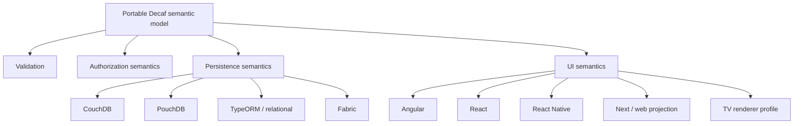

Not every model will be perfectly portable. Some applications deliberately use stack-specific capabilities. The goal should be explicit separation:

```text
portable semantic core
+
stack-specific exceptions
```

### 9.3 Suggested metric: Semantic Retention Ratio (SRR)

Define:

```text
SRR = semantic application code unchanged after stack migration
      ----------------------------------------------------------
      total semantic application code before migration
```

Examples of "semantic application code" include:

- domain models;
- validation semantics;
- authorization declarations;
- field/list/form intent;
- repository interfaces;
- business logic independent of the target runtime.

### 9.4 Why SRR matters commercially

High SRR means:

- lower framework lock-in;
- lower rewrite risk;
- easier modernization;
- more negotiating power with frontend technology choices;
- longer useful life for domain investments;
- more feasible multi-channel products;
- easier acquisition/integration after corporate technology-standard changes.

A 10-year enterprise application is often far more concerned with **future migration cost** than with whether its first implementation took two extra weeks.

### 9.5 Benchmark Decaf portability directly

Build one representative 50-model application and move it through:

```text
Angular + CouchDB
        -> React + CouchDB
        -> React + relational adapter
        -> React Native client + same backend
```

Measure:

- unchanged semantic LOC;
- rewritten LOC;
- number of files changed;
- tests reused;
- model metadata reused;
- business rules reused;
- migration person-days;
- bundle/performance before and after.

A measured SRR of even 70-80% on appropriate application surfaces would be commercially meaningful. An 85-95% result would be exceptional. Those are benchmark ambitions, not present claims.

---

## 10. Development time, skills, and expertise requirements

### 10.1 Decaf does not eliminate expertise; it changes where expertise is concentrated

The simplistic claim "developers need less skill because CRUD is automatic" would be wrong.

A model-driven platform moves expertise from repeated screen/controller implementation into:

- domain modeling;
- metadata semantics;
- framework extension points;
- performance boundaries;
- security design;
- identity and claim design (Keycloak/OIDC);
- role versus namespace versus organization semantics;
- request-context and correlation invariants;
- adapter behavior;
- renderer design;
- architecture governance.

This can be economically advantageous because a smaller platform team can encode good patterns once and many product teams can reuse them. The objective is **not** to eliminate IAM, security, or observability expertise. It is to concentrate that expertise in a reviewed platform layer so every product team does not independently reinvent Keycloak claim mapping, tenant/scope enforcement, correlation IDs, logging conventions, and dashboard provisioning.

### 10.2 Team-shape effect

A conventional large estate often distributes framework expertise everywhere:

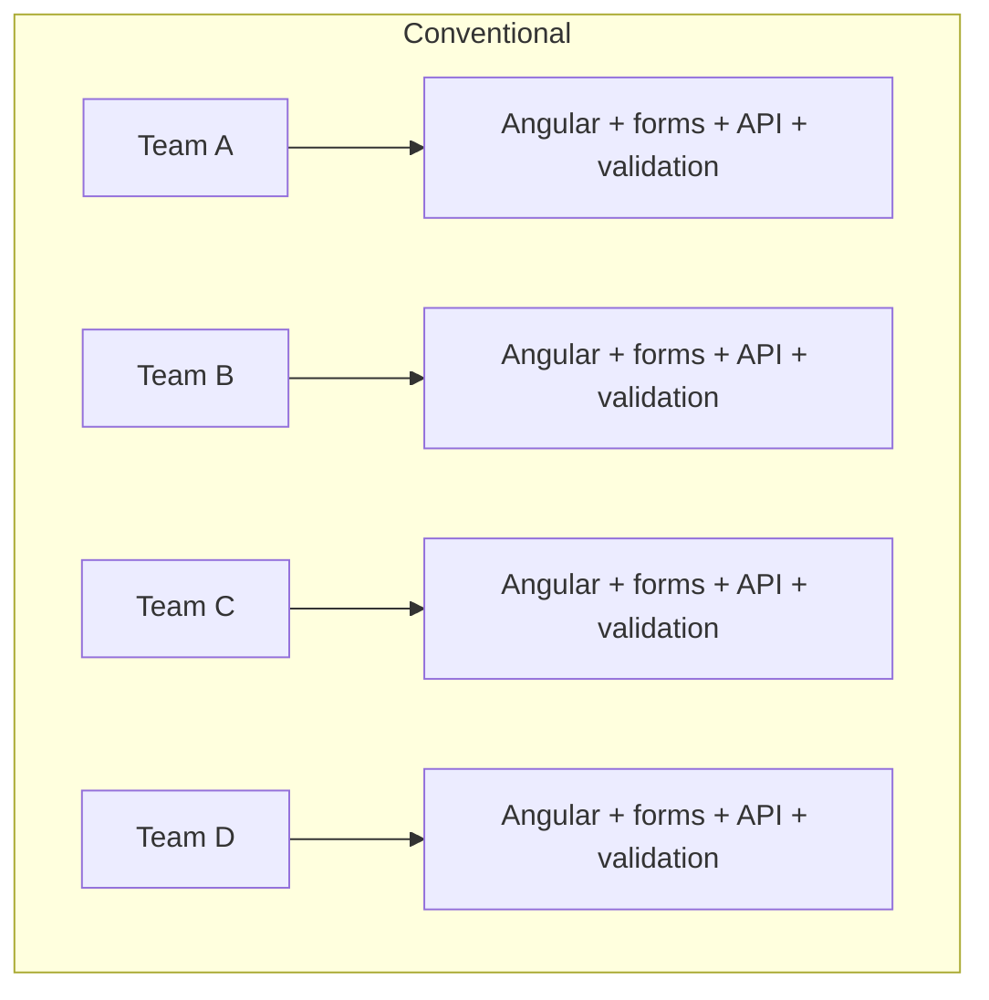

A Decaf organization can centralize repeated expertise:

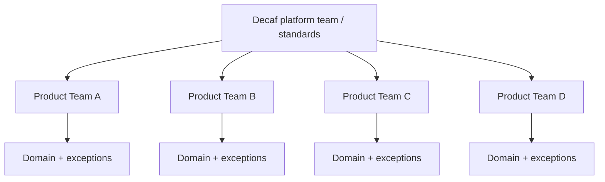

The economic benefit is largest when multiple applications share the same platform capability.

### 10.3 Learning curve

There are two opposing effects.

#### Positive

Once developers understand Decaf's model/decorator/renderer conventions, they can build standard features with far less stack-specific code.

#### Negative

A new developer cannot always rely on generic Angular/Nest/React intuition. They must understand:

- metadata precedence;
- renderer resolution;
- persistence flavour behavior;
- generated routes/services;
- role, `@namespace`, and organization-scope semantics;
- how Keycloak claims are mapped into Decaf authorization context;
- how request `Context`, correlation identity, and logging flow through layers;
- extension and override conventions;
- Decaf lifecycle and introspection.

The smaller public ecosystem increases the cost of self-service troubleshooting today.

### 10.4 Expertise-risk mitigation

Decaf should reduce the specialist bottleneck through:

1. **an executable tutorial**, not only API docs;
2. reference applications at small/medium/large scale;
3. architecture decision records;
4. "why did Decaf do this?" introspection tools;
5. generated effective-metadata views;
6. stable compatibility matrices;
7. migration guides for every significant release;
8. Decaf Intelligence available directly in IDE/CLI/MCP workflows;
9. certification/training for enterprise partners;
10. LTS releases for organizations that do not want rapid framework churn.

### 10.5 The debugging problem: "magic" must become inspectable

Automatic behavior is productive until something unexpected happens.

Every major Decaf abstraction should answer:

```text
Why did this property use this renderer?
Which decorator supplied this value?
Which flavour override won?
Why is this model exposed over HTTP?
Which route was generated?
Why is this operation forbidden?
Which adapter is active?
Which validation rule failed and where was it declared?
What will change if I switch UI flavour?
```

A strong product feature would be an **Effective Model Inspector** that presents the fully resolved metadata tree with provenance.

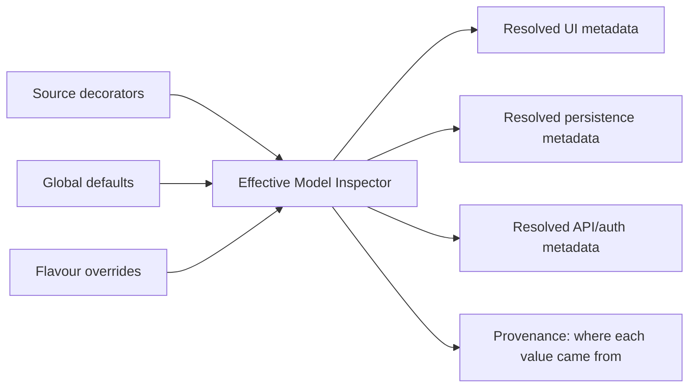

This directly reduces the adoption objection that model-driven frameworks are "too magical."

### 10.6 Development-time scenario: 100 models

The following is an illustrative planning model.

#### Frontend

Conventional standardized implementation after common design-system infrastructure:

```text
100 models x 1.5-3.0 developer-days/model
= 150-300 developer-days
```

Decaf model metadata, exceptions, integration, and testing:

```text
100 models x 0.3-0.8 developer-days/model
= 30-80 developer-days
```

Illustrative frontend saving:

> **70-270 developer-days**

#### Backend

Conventional controller/service/DTO/validation/security/resource wiring:

```text
100 models x 1.0-2.5 developer-days/model
= 100-250 developer-days
```

Decaf exposure/configuration/custom business logic/verification:

```text
100 models x 0.25-0.75 developer-days/model
= 25-75 developer-days
```

Illustrative backend saving:

> **25-225 developer-days**

#### Combined

> **~100-400 developer-days**, or roughly 5-20 developer-months if a productive month is treated as approximately 20 working days.

This should not be quoted as observed ROI. It is a scenario to validate with a controlled implementation study.

---

## 11. Maintenance economics and Change Amplification Factor

### 11.1 Initial development is only part of enterprise TCO

A long-lived platform may spend far more on:

- changing requirements;
- regulatory changes;
- dependency upgrades;
- schema evolution;
- authorization changes;
- UI redesigns;
- migrations;
- bug fixes;
- accessibility changes;
- localization;
- platform upgrades;

than on the initial release.

Semantic compression can therefore create more value in year 5 than in month 5.

### 11.2 Suggested metric: Change Amplification Factor (CAF)

Define:

```text
CAF = number of application artifacts that must be understood or changed
      to implement one representative domain change
```

Example: `Customer.status` gains new validation, role visibility, list formatting, and API constraints.

A conventional application could require changes in:

```text
migration
entity
create DTO
update DTO
validator
service
OpenAPI schema
frontend type
create form
edit form
list
show/details
permissions
tests across multiple layers
```

A model-driven architecture could collapse much of this into:

```text
model metadata
migration if necessary
exceptional business rule
focused tests
```

### 11.3 Example CAF model

| Change surface | Conventional | Decaf model-driven |
|---|---:|---:|
| Persistence/migration | 1-2 | 1-2 |
| Backend DTO/API artifacts | 2-5 | 0-1 |
| Frontend type/form/list/detail | 3-6 | 0-2 |
| Validation/authorization declarations | 1-3 | 1-2 |
| Tests touched | 2-5 | 1-3 |
| **Illustrative total CAF** | **9-21** | **3-8** |

This is illustrative. Decaf should measure CAF on a fixed set of change scenarios.

### 11.4 Why CAF matters to AI as well as humans

Every additional artifact is another opportunity for:

- the developer to forget a layer;
- the LLM to miss a file;
- a review to overlook inconsistency;
- two teams to diverge;
- validation to differ between client and server.

Reducing CAF compounds human and AI productivity.

---

## 12. LLM and agent advantage

### 12.1 Decaf is structurally AI-friendly

An LLM performs better when it has:

- fewer relevant files;
- fewer equivalent implementation choices;
- a small, consistent vocabulary;
- deterministic framework behavior;
- machine-readable metadata;
- tests that verify semantic outcomes.

Decaf can reduce all four major dimensions of agent complexity:

```text
Agent difficulty ~
  relevant files
  x architectural degrees of freedom
  x context required
  x probability of cross-layer inconsistency
```

### 12.2 The strongest AI claim

The most defensible message is not:

> "AI writes Decaf code faster."

It is:

> **"Decaf reduces how much code an AI is required or allowed to invent."**

That has implications for:

- reliability;
- reviewability;
- token consumption;
- diff size;
- testability;
- policy enforcement;
- secure coding.

### 12.3 Example task comparison

Task:

> Add `creditLimit` to customers; required for enterprise accounts, editable only by finance, listed as currency, validated server-side, available through API.

A conventional agent may need to find and coordinate:

```text
schema/migration
ORM model
DTOs
validation
controller/OpenAPI
service permissions
frontend type
create/edit forms
list/detail presentation
tests
```

A Decaf-aware agent can potentially express most of the repeated intent close to the model and add only the unique business rule.

### 12.4 The current disadvantage: public corpus size

Generic LLMs have enormous prior exposure to React, Angular, Nest, Spring, Django, React-admin, and other mainstream technologies.

Decaf's public corpus is comparatively small. Therefore:

| Situation | Expected relative result |
|---|---|
| Zero-context generic LLM | Mainstream frameworks have an advantage |
| LLM given Decaf docs only | Gap narrows |
| LLM + Decaf MCP introspection | Stronger Decaf result |
| LLM + proprietary Decaf Intelligence agents/skills/evals | Potential structural advantage |

### 12.5 Private Decaf Intelligence changes the equation

Per stakeholder input, Decaf has a private `decaf-ai` repository containing specialized Decaf skills and tailored agents across the framework.

Under the recommended licensing strategy, this should become a proprietary **Decaf Intelligence Platform**, not a public AGPL repository containing the crown-jewel expertise.

The private layer can include:

- expert system prompts;
- model-change planning;
- renderer selection knowledge;
- framework upgrade strategies;
- migration graphs;
- failure diagnosis;
- repair strategies;
- security checks;
- compatibility knowledge;
- test generation;
- bundle/performance advice;
- private evaluation suites;
- production-derived failure/repair cases where legally permitted and appropriately anonymized.

### 12.6 The eval corpus may be a stronger moat than prompts

Prompts are easy to imitate. A curated corpus such as:

```text
broken Decaf implementation
-> diagnosed root cause
-> correct remediation
-> regression tests
-> compatibility context
```

is much harder to reproduce.

The long-term AI moat should therefore prioritize:

1. private evals;
2. failure/repair pairs;
3. compatibility matrices;
4. migration intelligence;
5. high-quality architectural decisions;
6. production performance knowledge;
7. domain-specific safe patterns.

### 12.7 Public MCP, private intelligence

A thin public MCP/SDK can expose capabilities without exposing expert implementation.

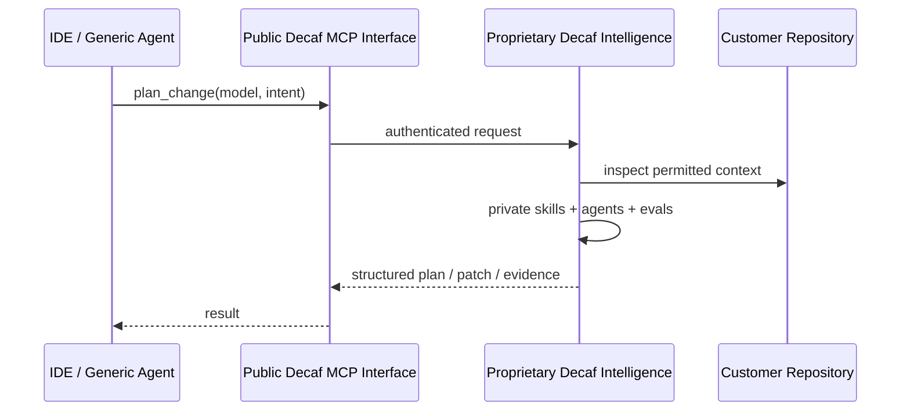

The public skill can say "invoke `plan_change`" without embedding the actual planning heuristics.

### 12.8 AI economics metrics

Decaf should benchmark:

- input tokens per task;
- output tokens per task;
- number of repository files opened;
- patch size;
- tests passed on first attempt;
- retries to green;
- human review minutes;
- regressions introduced;
- cross-layer inconsistencies;
- cost in model inference per successful task.

A framework that uses 40% fewer tokens and produces 50% fewer failed patches can have a material operating-cost advantage at enterprise AI scale even if raw developer typing time is no longer the main constraint.

---

## 13. Licensing strategy and its business consequences

### 13.1 Recommended architecture

The complete migration plan is documented separately in `01-decaf-licensing-migration-plan.md`. The business rationale is summarized here.

| Asset | Recommended treatment | Business effect |
|---|---|---|
| Core semantic/runtime packages | MPL-2.0 | Low adoption friction, file-level reciprocity |
| UI engines and standard adapters | MPL-2.0 | Encourages ecosystem and portability |
| Thin protocol/SDK/MCP clients | Apache-2.0 or MPL-2.0 | Maximum integrations |
| Customer application code | Customer choice | Removes procurement fear |
| Ordinary AI-generated application output | Customer choice | Enables agentic adoption |
| Decaf Intelligence engine | Proprietary | Preserves commercial scarcity |
| Expert skills/agents/prompts/evals | Trade secret | Protects accumulated know-how |
| On-prem appliance | Commercial binary/object license | Enterprise deployment without source disclosure |
| Optional framework commercial license | Commercial | OEM/private framework modifications/LTS/support |
| Trademarks | Controlled trademark policy | Protects brand and canonical implementation |
| Contributions | CLA with sublicensing/relicensing grant | Preserves commercial licensing flexibility |

### 13.2 Why MPL is a good adoption compromise

Mozilla describes MPL as file-level copyleft: covered files remain under MPL obligations when distributed, while a larger work can combine those files with proprietary code.[S12]

This aligns well with Decaf's desired enterprise contract:

> "Your application remains yours; if you modify distributed Decaf framework files, the MPL rules continue to apply to those covered files."

That is much easier for proprietary enterprise users than AGPL while retaining more reciprocity than a fully permissive license.

### 13.3 Why the AI-triggered AGPL approach should be removed from framework packages

The reviewed `for-angular` manifest currently reports `MPL-2.0 OR AGPL-3.0`, while reviewed Decaf licensing text includes an AI-oriented addendum.[S3][S4]

This creates multiple problems:

- SPDX `OR` conventionally means a recipient can choose an alternative license; it does not express a later conditional switch.[S13]
- special AI conditions increase legal review cost at exactly the moment Decaf should encourage AI-assisted adoption;
- making app licensing depend on the development method is difficult to explain operationally;
- the private Decaf Intelligence layer is a much cleaner place to monetize AI value.

### 13.4 Why proprietary AI is stronger than AGPL for the crown jewels

AGPL is effective when the objective is:

> "Recipients may receive source, but network-deployed modifications should also remain open under the license."

It does not solve:

> "We do not want competitors to receive our full expert knowledge."

Once skills, prompts, evals, and orchestration are disclosed, copyright does not make the learned ideas secret again. The recommended architecture therefore keeps the intelligence layer undisclosed and protects it through trade-secret controls, contracts, access management, and operational architecture.

### 13.5 Open framework, private intelligence creates a trust balance

For enterprise buyers:

- the critical runtime substrate is inspectable and survivable;
- framework lock-in is reduced;
- the customer can maintain or fork the runtime if necessary;
- application code is not captured by a broad proprietary license;
- premium intelligence/support remains optional.

For Decaf:

- open distribution creates adoption and ecosystem network effects;
- portability becomes more valuable as third parties add integrations;
- premium AI, LTS, support, migration and enterprise tooling remain monetizable;
- private expertise is not given away.

### 13.6 Avoid per-user runtime royalties

A framework designed for patient-facing, citizen-facing, mobile, or TV applications should not punish customer success with per-end-user fees.

Recommended commercial axes:

- organization subscription;
- developer/AI seats;
- hosted Decaf Intelligence usage;
- support/SLA level;
- on-prem or air-gapped deployment tier;
- OEM/redistribution rights;
- LTS/compliance package;
- optional professional services.

Runtime end users should normally be unlimited.

### 13.7 Licensing as an adoption feature

The clean message should fit on one slide:

```text
Decaf Framework: MPL-2.0
Your application: your license
Decaf Intelligence: optional commercial service/software
```

If the explanation requires a page of exceptions before an engineer can run `npm install`, adoption will suffer.

---

## 14. Security, compliance, and governance

### 14.1 Enterprise value raises the security bar

Automatic CRUD and AI generation can accelerate both good and bad decisions. Enterprise Decaf needs secure defaults.

### 14.2 Model-driven security benefits

A semantic model can centralize security-related declarations:

- roles;
- namespaces/scopes;
- organization/tenant context;
- writeability;
- visibility;
- validation;
- API exposure;
- sensitive-field handling.

`@decaf-ts/integrations` strengthens this from a metadata concept into an enterprise IAM path: Keycloak provisioning helpers handle realms/users/roles/IdPs/client-role wiring, while Decaf auth helpers extract roles, namespace scopes and user context and apply them to route/model checks.[S28][S30] This can reduce inconsistent policy implementations and make identity configuration more reproducible across applications.

A strategically important distinction is **roles vs namespaces**. Roles answer "what may this principal do?" while namespaces can answer "within which logical scope may it do it?" Keeping those as separate claim dimensions is cleaner than multiplying role names such as `tenantA-order-reader`, `tenantB-order-reader`, etc.

### 14.2.1 Enterprise identity-plane implications

For a Keycloak-centric enterprise, the reusable integration layer can standardize a large portion of the otherwise project-specific IAM work:

1. realm/client/role/IdP provisioning;
2. token claim extraction;
3. route-level authorization;
4. model-level namespace metadata;
5. organization context;
6. request-context binding;
7. downstream logging/audit enrichment.

This is a business advantage because IAM integration is expensive not primarily due to the login screen, but because inconsistent role naming, client setup, claim mapping, tenant filters and observability conventions become long-term operational debt.

It also raises Decaf's responsibility. A flaw in shared IAM helpers has a portfolio-wide blast radius. Security review, threat modeling, compatibility testing against supported Keycloak versions, and default-deny policy tests should therefore be release gates for the integration package.

### 14.3 Model-driven security risks

Centralization also creates blast radius. A bad default can affect many models.

Required controls:

- default-deny exposure for sensitive operations;
- explicit audit of generated endpoints;
- metadata linting;
- security policy tests;
- route inventory export;
- field-level sensitive-data classification;
- rate limits/query limits;
- authorization tests generated per model;
- security review for bulk/aggregation endpoints;
- dependency/SBOM management;
- namespace/organization boundary tests;
- Keycloak claim-mapping conformance tests;
- request-context isolation tests under high concurrency;
- correlation/log redaction so tokens, secrets and sensitive attributes cannot leak into logs.

### 14.4 Decaf Intelligence security

The private AI layer introduces additional requirements:

- tenant isolation;
- repository-access scoping;
- no unauthorized training on customer code;
- retention controls;
- regional deployment options;
- audit logs of agent actions;
- approval gates for destructive operations;
- prompt-injection resistance for repository content;
- secret redaction;
- tool permission policies;
- signed agent/tool releases;
- provenance of generated changes.

### 14.5 On-prem and air-gapped strategy

Some regulated customers will not permit source code to leave their environment.

Recommended tiers:

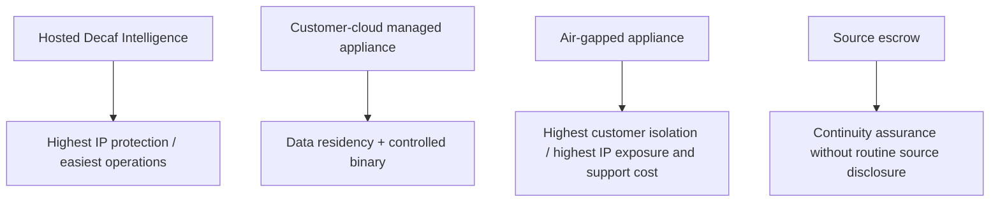

Pricing should reflect support and IP exposure, especially for fully air-gapped deployments.

---

## 15. PharmaLedger: production evidence and strategic value

### 15.1 What is publicly evidenced

PharmaLedger's public site states that:

- it originated from an EU/EFPIA program with EUR 22.1 million in funding and 29 partners;
- its association includes major pharmaceutical and technology organizations;
- its patient/HCP ePI application has been in production since 2023;
- that ePI application is described as live in 46 countries and 29 languages;
- the platform supports managed SaaS and self-hosted deployment modes;
- PharmaLedger describes itself as a member-governed, regulated-industry platform.[S10][S11]

These are powerful independent indicators of a serious production context.

### 15.2 What is stakeholder-provided for this report

The Decaf stakeholder states that a running PharmaLedger enterprise application is Decaf-based and can potentially reach millions.

This report treats that relationship as **internal/stakeholder evidence**, because the public PharmaLedger pages reviewed do not prominently establish the Decaf implementation relationship.

The phrase "potential to reach millions" should also not be transformed into "millions of current Decaf users" without telemetry.

### 15.3 Why this matters to Decaf

If formally documented, PharmaLedger could demonstrate:

- regulated production use;
- multinational/multilingual delivery;
- real enterprise governance;
- complex domain models;
- cloud deployment;
- operational longevity;
- potentially very high end-user reach;
- a stronger maturity story than public GitHub popularity suggests.

### 15.4 Recommended case study structure

With customer/association approval, publish:

1. business problem and regulatory environment;
2. Decaf architecture diagram;
3. number of domain models;
4. number/percentage of model-driven screens;
5. generated/API surface counts;
6. custom vs generic UI percentage;
7. production bundle sizes;
8. runtime performance and p95 API latency;
9. languages/countries/deployments;
10. update/change lead time;
11. defect/change-amplification data;
12. examples of cross-stack or adapter portability, if used;
13. AI-assisted development data only where contractually appropriate;
14. lessons learned and boundaries where custom code was necessary.

### 15.5 Credibility effect

There is a major difference between:

> "A young framework claims it can scale."

and:

> "A regulated production platform with global pharmaceutical participation uses it, and here are the measured operating numbers."

Decaf should convert private credibility into public evidence without disclosing customer-confidential architecture.

---

## 16. Competitive landscape

### 16.1 Competitive categories

Decaf competes across several categories rather than with one exact product.

```mermaid
mindmap
  root((Decaf competition))
    Metadata-driven enterprise platforms
      SAP CAP + Fiori Elements
    Admin/resource frameworks
      React-admin
      Refine
      AdminJS
    Code generation platforms
      JHipster
    Backend CRUD/service frameworks
      LoopBack
      Feathers
    Schema-driven UI
      JSON Forms
    Low-code/internal app platforms
      Retool
      Mendix
      OutSystems
      Appsmith
```

### 16.2 The closest conceptual enterprise analogue: SAP CAP + Fiori Elements

SAP CAP's generic service providers can serve standard CRUD and related service behavior from declarative models and metadata, while Fiori Elements uses metadata/annotations to generate standardized enterprise UI.[S8]

The conceptual similarity is important:

```text
SAP:
CDS model -> generic services -> OData metadata -> Fiori Elements

Decaf:
TypeScript semantic model -> adapters/for-nest -> ui-decorators -> UI engine/flavour
```

#### SAP advantages

- very high enterprise maturity;
- large implementation ecosystem;
- established support/procurement model;
- extensive references;
- tight integration with SAP business systems.

#### Decaf potential advantages

- TypeScript-first developer experience;
- less dependence on SAP ecosystem assumptions;
- broader explicit renderer/adapter portability ambition;
- potential to use the same semantics in non-SAP products;
- private AI layer tailored to the framework;
- potentially lower licensing/platform cost.

The strategic lesson is that metadata-driven enterprise application development is not an exotic proposition. SAP validates the category. Decaf's challenge is to offer comparable semantic leverage with a more portable/open runtime model.

### 16.3 React-admin

React-admin is a highly mature React framework for B2B/admin applications with a large public ecosystem. Its resource model significantly reduces CRUD work, but applications commonly still declare resource-specific list/create/edit/show components, even if those components are highly composable.[S9]

#### Relative Decaf opportunity

Decaf can potentially remove more entity-specific page source by interpreting model/UI metadata at runtime.

#### React-admin advantage

- much larger community;
- more public examples and LLM prior knowledge;
- mature component/data-provider ecosystem;
- easier staffing.

### 16.4 Refine

Refine positions itself as a React meta-framework for internal tools, admin panels, dashboards, and B2B apps, with headless abstractions and many connectors.[S14]

Its headless architecture is a strong competitor because it balances productivity with UI freedom and can target more than one React environment.

Decaf must therefore avoid a weak claim such as "you can build CRUD quickly." Refine already does that extremely well.

Decaf's stronger differentiation is:

> one semantic model extending further downward into persistence/API semantics and upward into multi-renderer UI projection.

### 16.5 AdminJS

AdminJS is strong when the need is:

> "Expose an administration interface over existing Node data resources quickly."

It can infer resource structures and provide CRUD actions. Its scope is narrower than Decaf's proposed portable application substrate, but for internal admin panels that narrower scope can be an advantage because it is easy to understand.

### 16.6 JHipster

JHipster is a mature full-stack application generator. It creates application artifacts that teams then own.

The comparison is therefore:

```text
JHipster: generate the boilerplate fast
Decaf: avoid needing much of the boilerplate as entity-specific source
```

JHipster has the maturity/ecosystem advantage; Decaf has a potentially stronger long-term artifact-reduction story.

### 16.7 LoopBack

LoopBack is a particularly relevant backend comparison because it has model/repository/controller abstractions and generic REST CRUD capabilities.

Decaf's backend differentiation cannot simply be "automatic REST CRUD." The broader story is continuity of the semantic model into UI, validation, and portability.

### 16.8 Feathers

Feathers provides lightweight service abstractions, adapters, and real-time APIs. It is highly effective at compressing the transport/service/persistence layer.

Again, Decaf's stronger proposition is wider full-stack semantic reach.

### 16.9 JSON Forms

JSON Forms validates the schema-driven renderer category. It supports multiple UI technologies and maps schemas into forms.

Its scope is primarily UI/form generation. Decaf aims to connect a broader enterprise model to persistence, APIs, CRUD semantics, and multiple rendering surfaces.

### 16.10 Low-code platforms

Retool, Mendix, OutSystems, Appsmith, and similar products compete for budget even if their technical model differs.

They often offer:

- extremely fast internal-app development;
- visual builders;
- connectors;
- hosted platforms;
- governance and deployment tooling.

Their tradeoffs can include:

- platform dependency;
- different source-control ergonomics;
- runtime/platform licensing;
- lower portability;
- less conventional-code ownership.

Decaf's answer should not be "we are low-code." It should be:

> **Decaf preserves normal TypeScript engineering and source ownership while achieving some of the repetition reduction associated with low-code systems.**

### 16.11 Enterprise control-plane comparison: identity, tenancy, context and observability

The additional Decaf integration capabilities change the most relevant competitor set. Decaf is not only competing with CRUD/UI frameworks; it increasingly overlaps with application-platform capabilities normally assembled from IAM, context propagation, logging, BI and workflow libraries.

#### SAP CAP + Fiori

SAP CAP remains the strongest mature analogue. CAP provides pluggable authentication with IAS/XSUAA, request user/tenant context, model-level authorization concepts, remote-service user propagation, and an audit-logging plugin for sensitive-data and security events.[S33][S34] Decaf's advantage is openness/TypeScript portability and explicit Keycloak/namespace/org integration outside an SAP platform dependency; SAP's advantage is production maturity, compliance depth and a much larger ecosystem.

#### JHipster

JHipster has a strong enterprise bootstrap story: OAuth2/OIDC with Keycloak as the default OIDC server, generated security configuration, metrics, Prometheus, Logstash forwarding and distributed tracing patterns.[S35][S36] This makes JHipster a stronger comparison than a simple "code generator." The difference remains architectural: JHipster generates an application stack; Decaf is trying to keep identity/scope/context and domain semantics as reusable runtime substrate across applications and renderers.

#### Spring Boot / Spring Security

Spring Security has extremely mature OAuth2/OIDC resource-server/client support and integrates cleanly with external IdPs such as Keycloak through standards.[S37] Spring's observability ecosystem is also much more mature. Decaf should not claim superior IAM primitives. Its potential advantage is **integration coherence and lower assembly cost** for TypeScript applications: the same Decaf context can connect auth metadata, namespace scoping, repositories, generated routes and framework logging.

#### NestJS baseline

Nest provides authentication patterns, a flexible logger, AsyncLocalStorage recipes, request-scoped providers and now first-party observability/trace-context support.[S38][S39] A skilled Nest team can therefore build essentially every individual capability. Decaf's comparison should be: how much custom application/platform code is needed to make those capabilities consistent across 20 services and 100 models? `@decaf-ts/integrations`, `for-http`, `for-nest` and `logging` aim to make that consistency a platform feature rather than a project convention.

#### LoopBack and Feathers

LoopBack has explicit authentication and authorization components, including decorators and extensible strategies.[S40] Feathers has first-class JWT/local/OAuth authentication.[S42] Both remain credible backend alternatives. Decaf's differentiated claim is the continuity from auth context through namespace/model semantics, repositories and UI/runtime portability—not merely having authentication.

#### React-admin / Refine / AdminJS

These frameworks generally consume an already secured API. They can integrate with OIDC providers, but identity governance, tenant scoping, backend authorization and correlated operations remain largely outside the UI framework. For enterprises wanting a full-stack application substrate, Decaf's integration plane is more relevant; for frontend-only modernization, their narrower scope is often an advantage.

### 16.12 Enterprise platform-completeness matrix

The scores below are analyst estimates, not benchmark results. They evaluate **how coherently the concern is provided as part of the platform**, not whether the capability can be built at all.

| Platform | SSO/IAM integration | Scoped auth / tenancy | Request context / correlation | Logging / ops integration | Full-stack semantic continuity | Maturity of control plane |
|---|---:|---:|---:|---:|---:|---:|
| **Decaf-TS** | **8.5** (Keycloak-oriented) | **9 potential** (roles + namespaces + org scaffold) | **9 potential** | 8 (logging/Kibana; tracing gap) | **9.5** | 5-6 |
| SAP CAP + Fiori | **10** | **10** | 9.5 | **10** | **9.5** | **10** |
| JHipster | 9 | 7.5 | 8.5 | 9 | 7.5 | 9.5 |
| Spring Boot/Security | **10** | 9 | 9.5 | **10** | 6 | **10** |
| NestJS baseline | 8 | 7 | 9 with Observe/ALS | 9 | 5 | 9 |
| LoopBack 4 | 8 | 8 | 7 | 7 | 7 | 8.5 |
| Feathers | 8 | 6.5 | 6.5 | 6.5 | 7 | 9 |
| React-admin / Refine | 6 frontend | 4 backend-wide | 4 | 5 | 6-7 UI | 9 |

The key Decaf opportunity is therefore **not** to beat Spring/SAP at the raw capability level today. It is to make a credible case that a much smaller TypeScript team can obtain a coherent enterprise baseline with fewer bespoke integration layers while preserving cross-stack portability.

---


### 16.13 Dedicated feature-management platforms: LaunchDarkly, Flagsmith and OpenFeature

Feature flags broaden Decaf's competitor/partner map, but the correct comparison is nuanced.

| Dimension | Decaf feature flags | LaunchDarkly / mature hosted flag platform | Flagsmith / self-hostable flag platform | OpenFeature |
|---|---|---|---|---|
| Model/route/UI semantic integration | **Native Decaf advantage** | Requires application integration | Requires application integration | Depends on provider/application |
| Namespace/model subject concepts | **Can be first-class Decaf subjects** | Flexible targeting/contexts | Segments/traits | Standard evaluation context |
| Management UI/governance | Emerging / not assumed | **Very mature** | Mature | Not a management product |
| Experimentation/analytics | Not assumed | **Strong** | Available depending deployment/features | Provider-dependent |
| Vendor neutrality | Decaf-native | Lower | Moderate | **Core purpose** |
| Self-hosting | Natural in app stack | product-dependent | **Strong** | provider-dependent |
| Cross-layer authorization decorator integration | **Strong Decaf-specific** | custom | custom | can be bridged |

The strategic recommendation is not to build every LaunchDarkly feature. It is to make **Decaf semantics compatible with OpenFeature**, allowing enterprises to choose the evaluator while retaining `featureAuth`, route/model/UI metadata and namespace-aware behavior.

### 16.14 The realistic TypeScript competitor is a composed stack

Many enterprises will not choose one competitor. They will compose:

```text
NestJS
+ Angular/React
+ Keycloak/OIDC middleware
+ CASL/custom RBAC/ABAC
+ LaunchDarkly/Flagsmith/OpenFeature
+ OpenTelemetry
+ Pino/Winston
+ AWS/Azure/GCP secret SDKs
+ S3/blob SDKs
+ BullMQ/Temporal/Camunda-style workflows
+ custom BI embeds
+ SFTP libraries
+ internal design system
```

This composed stack has two enormous advantages:

1. every individual subsystem can be best-of-breed;
2. staffing/ecosystem knowledge is much larger.

Decaf's potential advantage is **coherence and lower integration entropy**. The same user/namespace/context can flow through model metadata, generated routes, repositories, feature gates, user requests, logging and rendering rather than being manually mapped between independently designed libraries.

Therefore the canonical benchmark should compare Decaf not only with single frameworks, but with a **well-engineered composed NestJS enterprise baseline**. Anything weaker would exaggerate Decaf's value.

### 16.15 Low-code comparison changes when renderer extensibility is included

Low-code platforms typically win on standard-surface speed but can create difficulty when highly custom UI or code ownership is required. Decaf's dynamic component registry changes this tradeoff:

- model-driven defaults can cover common surfaces;
- arbitrary compatible framework components can be selected for exceptions;
- subclass/override patterns can preserve most existing renderer behavior;
- corporate design systems can remain ordinary Angular/React components;
- source code and normal framework tooling remain available.

This potentially gives Decaf a **“low-code productivity, pro-code escape hatch”** position. It must be proven through ECI benchmarks rather than asserted.

## 17. Competitive scorecard

Scores below are analyst estimates intended to show relative strategic shape, not objective benchmark results. `10` means strongest in that dimension.

| Technology | Semantic compression | Cross-stack portability | Enterprise integration coherence | Runtime control | AI prior/ecosystem | Enterprise maturity | Public adoption | Full-stack semantic scope |
|---|---:|---:|---:|---:|---:|---:|---:|---:|
| **Decaf-TS** | **9.5** | **9 potential** | **8.5-9 potential** | **9** | 5 public / **9+ with private Intelligence** | 6-8 implementation / 4 ecosystem | 2-3 | **9.5** |
| SAP CAP + Fiori | **9.5** | 5-6 | **10** | 7 | 8 | **10** | **10** | **9.5** |
| Spring Boot/Security ecosystem | 6 | 6 | **10** | **9.5** | **10** | **10** | **10** | 7 |
| JHipster | 8 via generation | 6 | 9 | 8.5 | 9 | 9.5 | 9 | 8 |
| NestJS baseline | 5 | 5 | 8-9 with selected modules | **9.5** | **10** | 9 | **10** | 6 |
| React-admin | 6.5 | 5 | 5 frontend-centric | 9 | **9.5** | 9.5 | 9.5 | 6.5 |
| Refine | 6.5 | 7.5 within React ecosystem | 5 frontend-centric | **9** | **9.5** | 8.5 | 9 | 7.5 |
| AdminJS | 8 for admin | 4 | 5.5 | 7.5 | 8.5 | 8 | 7.5 | 5 |
| LoopBack | 8.5 backend | 5 | 7.5 | 8 | 8.5 | 8.5 | 7 | 7 |
| Feathers | 7.5 backend | 6 | 6.5 | 8.5 | 9 | 9 | 8 | 7 |
| JSON Forms | 8 for forms | 8 UI | 3 | 8.5 | 8.5 | 9 | 7 | 4 |

### 17.1 What Decaf should not compete on

Decaf should not try to win a popularity contest today.

It should win on:

- marginal cost per domain model;
- change amplification;
- semantic retention across stack migrations;
- full-stack consistency;
- application-specific source reduction;
- AI task reliability and token efficiency;
- long-term maintainability.

Those dimensions fit the architecture and are harder for conventional frameworks to answer.

---

## 18. Scalability: seven different meanings

"Can Decaf scale?" is not one question. Enterprise buyers mean at least seven different things.

### 18.1 User/load scalability

Can applications serve large volumes of users and requests?

Decaf does not intrinsically determine database scalability, cloud topology, CDN use, caching, or API autoscaling. Its responsibility is to avoid introducing bottlenecks that prevent ordinary scaling techniques.

For large-scale deployment, validate:

- stateless request handling;
- horizontal server replication;
- cache compatibility;
- adapter connection-pool behavior;
- generated-route observability;
- pagination and query limits;
- SSE connection scaling;
- rate limiting;
- CDN/static asset caching;
- client chunk caching;
- mobile network resilience.

A framework can be used by a system with millions of reachable users without itself being the component that "handles millions." The entire architecture must be measured end-to-end.

### 18.2 Model-count scalability

Can one application have 10, 100, 500, or 1,000 registered models without unacceptable:

- startup time;
- metadata memory;
- route-registration time;
- type-check/build time;
- generated documentation size;
- developer-tooling slowdown?

This dimension is directly Decaf-specific and should be part of every release benchmark.

### 18.3 UI-complexity scalability

Can generic rendering remain understandable when models contain:

- nested relations;
- conditional fields;
- large enums/lookups;
- dynamic role visibility;
- computed fields;
- nested collections;
- custom controls;
- multi-step workflows;
- rich editors?

The risk is metadata becoming an alternative programming language that is harder to reason about than ordinary code.

The rule should be:

> when behavior becomes procedural, use procedural code; metadata should describe intent, not simulate arbitrary programs.

### 18.4 Team/organization scalability

Can 5, 50, or 500 engineers work safely on Decaf applications?

Requirements include:

- namespaced modules;
- bounded context guidance;
- ownership rules;
- package boundaries;
- linting conventions;
- generated metadata inspection;
- release compatibility contracts;
- dependency governance;
- decentralized extension without forking the core.

### 18.5 Portfolio scalability

The biggest business opportunity may be a company with **many applications**, not merely one large app.

A platform team can reuse:

- renderer conventions;
- design systems;
- adapters;
- auth integrations;
- audit patterns;
- Decaf Intelligence;
- testing standards;
- compliance patterns;
- observability.

The savings then compound across the portfolio.

```mermaid
flowchart TB
    P[Enterprise Decaf Platform] --> A[Operations app]
    P --> B[Partner portal]
    P --> C[Compliance app]
    P --> D[Mobile field app]
    P --> E[Admin console]
    P --> F[TV/kiosk surface]
    P --> G[Future React migration]
```

### 18.6 Tenant / authorization scalability

The Keycloak + namespace + organization model creates an additional scale dimension: how authorization behaves with many tenants, organizations, principals, roles, namespaces and grants.

The critical question is not only whether Keycloak itself scales; that is an external-system sizing issue. Decaf must prove that its own claim extraction, metadata resolution, namespace validation, authorization payload filtering and context binding remain predictable as policy cardinality grows.

Benchmark:

- 10 / 1,000 / 100,000 principals;
- 10 / 100 / 10,000 namespaces or tenant scopes;
- nested organization structures;
- many-role tokens vs compact claims;
- authorization cache hit/miss behavior;
- cross-namespace negative tests;
- generated bulk/aggregation endpoints under scoped authorization.

### 18.7 Operational scalability

Request-bound logging and shared integration infrastructure should reduce operational entropy as service count grows, but only if context is isolated correctly and telemetry volume remains controllable.

At portfolio scale, benchmark:

- concurrent request-context isolation;
- correlation-ID continuity across HTTP/repository/external calls;
- log throughput and backpressure;
- PII/secret filtering;
- Kibana space/dashboard provisioning time;
- cardinality explosion from model/tenant labels;
- trace/log storage cost;
- ability to diagnose one request across generated and custom code.

### 18.8 Suggested scalability benchmark grid

| Dimension | 10-model app | 100-model app | 500-model app | 1,000-model stress |
|---|---:|---:|---:|---:|
| Build time | measure | measure | measure | measure |
| Server startup | measure | measure | measure | measure |
| Browser initial JS | measure | measure | measure | measure |
| Total deployed JS | measure | measure | measure | measure |
| Metadata heap | measure | measure | measure | measure |
| Generated routes | measure | measure | measure | measure |
| IDE/type-check responsiveness | measure | measure | measure | measure |
| AI context/files per change | measure | measure | measure | measure |

---

## 19. Reliability, testing, and quality engineering

### 19.1 Generic infrastructure changes the testing economics

When every entity has a bespoke list/form/controller, each implementation needs repeated behavioral tests.

When one renderer implements a behavior for 100 models, the strategy can shift to:

```text
very deep framework tests
+
metadata contract tests
+
model-specific business tests
+
small number of end-to-end representative flows
```

This can reduce test duplication while increasing the importance of framework quality.

### 19.2 Testing pyramid for Decaf

```mermaid
flowchart TB
    E2E[Representative end-to-end business journeys] --> CT[Model/metadata contract tests]
    CT --> FT[Renderer + adapter + for-nest framework tests]
    FT --> UT[Pure domain/business unit tests]
```

The graphic is conceptual; teams may organize layers differently.

### 19.3 Contract tests should become a product feature

A Decaf model should be automatically testable for:

- invalid metadata combinations;
- missing renderers;
- unsupported property types;
- API exposure mismatch;
- conflicting authorization rules;
- relation cycles;
- unbounded collections;
- dangerous bulk exposure;
- non-portable stack-specific metadata;
- localization gaps;
- accessibility metadata requirements.

This turns configuration errors into build-time failures rather than production surprises.

### 19.4 Framework regression impact

Shared infrastructure creates a tradeoff:

- fixing the renderer once can fix every model;
- breaking the renderer once can break every model.

Therefore Decaf needs unusually strong:

- semantic versioning discipline;
- integration tests;
- compatibility matrices;
- canary releases;
- migration tooling;
- LTS branches;
- visual regression tests for renderers;
- API compatibility tests for adapters.

### 19.5 Recommended release confidence model

Every framework release should publish:

```text
unit/integration test status
browser matrix
Node/Nest/Angular/React compatibility matrix
bundle-size deltas
performance benchmark deltas
migration notes
known regressions
security changes
```

That is enterprise product maturity, not just code quality.

---

## 20. Accessibility, localization, and design-system leverage

### 20.1 Accessibility can become systemic rather than screen-by-screen

A shared renderer architecture creates an important positive externality.

If a common `date`, `relation`, `currency`, or `select` renderer is made accessible, every model using it can inherit the improvement.

This can reduce the number of opportunities for teams to independently get:

- labels;
- keyboard behavior;
- focus states;
- ARIA relationships;
- validation announcements;
- contrast;
- error semantics

wrong.

### 20.2 The converse risk

A renderer accessibility bug can propagate everywhere.

Therefore accessibility must be part of renderer certification:

- automated axe-style checks;
- keyboard tests;
- screen-reader spot testing;
- high-contrast modes;
- focus-order validation;
- responsive reflow;
- TV focus semantics where relevant.

### 20.3 Localization leverage

Metadata-driven field labels, validation messages, display formatting, and renderer conventions can centralize i18n behavior.

For a multinational enterprise this can reduce repeated localization wiring.

PharmaLedger's public 46-country/29-language ePI footprint is a useful context for why internationalization and localization are not secondary concerns in enterprise products.[S11]

### 20.4 Design-system governance

A conventional organization may have hundreds of subtly different date pickers, tables, filters, and validation summaries.

A Decaf renderer registry can act as an executable design system:

```mermaid
flowchart LR
    DS[Enterprise design system] --> R[Certified Decaf renderers]
    R --> A[App A]
    R --> B[App B]
    R --> C[App C]
    R --> D[Mobile flavour]
```

That improves consistency and reduces redesign costs.

---

## 21. Observability and operations

### 21.1 Decaf already has an observability substrate, not just a recommendation

The prior version of this report treated observability mostly as a future requirement. Public Decaf packages show that more infrastructure already exists:

- `@decaf-ts/logging` is a lightweight cross-runtime logging layer with context-aware `MiniLogger`, correlation IDs, child contexts, filtering/transports, method logging/benchmark decorators, and Pino/Winston integration.[S31]
- `Context` is a first-class object for propagating operation state through Decaf layers.[S32]
- `for-http` passes request-scoped flags/headers in context and explicitly binds auth data for downstream services.[S30]
- `@decaf-ts/integrations/kibana` provisions Kibana spaces, data views, dashboards and realm-specific access control; the package also exposes shared embedded-dashboard contracts for Kibana and Superset.[S28]
- Fabric demonstrates the same context-aware logging philosophy in a blockchain execution context, suggesting that context is intended to survive adapter changes rather than being HTTP-only.[S41]

This changes the enterprise assessment: observability can be part of the **portable application contract**, not something each generated controller must rediscover.

### 21.2 Request-bound context should become a formal invariant

The stakeholder states that application logging is bound per request. The public packages independently support the building blocks for that architecture. Decaf should formalize an invariant such as:

> Every externally initiated operation has one immutable correlation identity and one authenticated execution context; all generated/custom Decaf operations can access or derive their logs from that context without cross-request leakage.

Useful context dimensions include:

```text
correlationId
requestId / traceId
userId
organizationId
namespace(s)
roles
model
operation
adapter
route
frameworkVersion
applicationVersion
```

Not every field should be emitted to every log line. Sensitive values and high-cardinality fields need controlled enrichment/filtering.

### 21.3 Why this matters operationally

Generic infrastructure increases the importance of correlation. Without it, a generated stack can feel opaque: "the framework did something." With context-bound logs, an operator can reconstruct:

```mermaid
flowchart LR
    A[User request] --> B[Identity + namespace]
    B --> C[Generated/custom route]
    C --> D[Model operation]
    D --> E[Repository / adapter]
    E --> F[External integration / DB]
    A -. same correlation .-> L[(Logs / Kibana)]
    B -. same correlation .-> L
    C -. same correlation .-> L
    D -. same correlation .-> L
    E -. same correlation .-> L
    F -. trace propagation target .-> L
```

The business outcomes are lower MTTR, better support handoffs, stronger evidence for regulated operations, and easier automated diagnosis by Decaf Intelligence.

### 21.4 Kibana/BI integration reduces another class of platform glue

`@decaf-ts/integrations` publicly includes helpers for Kibana spaces/data views/dashboards and realm-specific access control, plus a common dashboard embed contract used by Kibana and Superset plugins.[S28]

This is not a core-framework differentiator by itself—many platforms can embed BI—but it strengthens the **horizontal compression** thesis. A portfolio can standardize:

- identity boundary;
- namespace/org boundary;
- data view/dashboard provisioning;
- embedding contract;
- operational log exploration.

For regulated or multi-tenant applications, provisioning operational/analytics spaces consistently with identity scopes can be more valuable than the raw embedding component.

### 21.5 The important gap: correlated logs are not distributed tracing

Decaf should avoid conflating correlation with full observability. A mature enterprise platform also needs:

- OpenTelemetry-compatible trace/span creation and propagation;
- outbound HTTP/message trace propagation;
- metrics and exemplars;
- sampling;
- service dependency visualization;
- error-to-trace linking;
- queue/background-job context;
- standardized redaction and data-retention policies.

This is an area where Spring/SAP ecosystems are more mature, and modern NestJS now provides first-party tracing/context tooling around AsyncLocalStorage.[S38][S39] A first-class Decaf OpenTelemetry bridge would significantly strengthen the platform story.

### 21.6 Recommended telemetry dimensions

Generated server routes should attach stable labels such as:

```text
model=Customer
operation=readAll
adapter=typeorm
source=decaf-generated
namespaceClass=tenant
version=framework-version
```

Client telemetry can include:

```text
model=Invoice
renderer=list
control=relation-picker
flavour=angular-mobile
chunk=relation-picker
```

Avoid raw tenant/user IDs as unconstrained metric labels; keep them in logs/traces where cardinality is manageable.

### 21.7 Framework-level SLOs and observability targets

Decaf Enterprise could provide reference SLOs and conformance targets for:

- model-render failure rate;
- generated-route error rate;
- metadata resolution errors;
- renderer chunk-load failures;
- version compatibility;
- Decaf Intelligence availability;
- 100% correlation coverage for generated HTTP operations;
- zero request-context leakage in concurrency stress tests;
- deterministic namespace/user attribution in security audit logs;
- bounded logging overhead under configured production levels;
- documented OpenTelemetry propagation behavior.

## 22. Developer experience and ecosystem requirements

### 22.1 Current architecture can be stronger than current discoverability

A common failure mode for technically sophisticated frameworks is that insiders understand the abstraction while outsiders encounter:

- incomplete examples;
- inconsistent package licenses;
- peer versions such as `latest`;
- unfamiliar terminology;
- small search-engine footprint;
- sparse Stack Overflow/Reddit content.

That creates a perceived-maturity discount.

### 22.2 Package governance recommendations

The reviewed `for-angular` manifest contains Decaf dependencies/peers using `latest` in several places.[S3]

For enterprise use, move toward:

- explicit semver compatibility ranges;
- a tested compatibility matrix;
- release trains;
- LTS lines;
- upgrade tooling;
- deprecation windows;
- no silent cross-package breakage.

### 22.3 Documentation architecture

Recommended documentation layers:

1. **5-minute success path** - model to running CRUD.
2. **Mental model** - how metadata, flavour, renderer, persistence, and Nest layers relate.
3. **Cookbook** - common patterns.
4. **Reference** - exhaustive APIs/decorators.
5. **Production guide** - security/performance/observability.
6. **Portability guide** - what remains portable and what does not.
7. **Extension guide** - custom renderer/adapter/controller patterns.
8. **Enterprise guide** - LTS, deployment, compliance, support.
9. **AI guide** - public MCP usage without exposing private intelligence.
10. **Migration guides** - release-to-release and stack-to-stack.

### 22.4 Community strategy

The framework should make it attractive for third parties to contribute:

- adapters;
- renderers;
- integrations;
- examples;
- documentation;
- testing;

without requiring access to Decaf's private AI IP.

The proposed MPL framework + public SDK boundary is compatible with that goal.

---

## 23. Market segmentation and ideal customer profile

### 23.1 Highest-fit applications

Decaf's ideal workloads have several of these characteristics:

- 30-500+ business entities;
- many forms/lists/detail views;
- long maintenance horizon;
- multiple user roles;
- multi-tenant, namespace-scoped, or organization-scoped authorization;
- enterprise SSO/OIDC requirements, especially Keycloak-centered estates;
- audit/support requirements that benefit from request-correlated context;
- multiple target devices;
- frequent schema/regulatory change;
- high cost of inconsistencies;
- pressure to modernize stacks over time;
- TypeScript/JavaScript engineering organization;
- desire to retain code ownership rather than adopt a closed low-code runtime.

### 23.2 High-fit industries

- pharmaceuticals and healthcare administration;
- regulated product information;
- government/citizen services;
- banking operations;
- insurance operations;
- manufacturing systems;
- telecom operations;
- logistics and supply chain;
- compliance and audit platforms;
- asset/fleet management;
- energy/utilities operations;
- enterprise SaaS with extensive back-office workflows;
- large B2B portals.

### 23.3 Medium-fit applications

- SaaS products with a substantial administration layer plus bespoke core UX;
- e-commerce operations tools;
- content management back offices;
- marketplace administration;
- customer support operations.

### 23.4 Low-fit applications

- simple marketing sites;
- tiny products with <10 screens;
- graphics-heavy games;
- highly animation-centric consumer products;
- mostly algorithmic backend services with little data CRUD;
- teams that intentionally want framework-native handcrafted UI everywhere.

### 23.5 Buyer personas

#### CTO / VP Engineering

Cares about:

- engineering throughput;
- long-term maintainability;
- staffing;
- AI development strategy;
- migration risk;
- architecture standardization.

#### CIO / enterprise architect

Cares about:

- lock-in;
- lifecycle;
- portability;
- governance;
- support;
- security;
- procurement/licensing.

#### Product leadership

Cares about:

- lead time;
- consistency;
- multi-channel delivery;
- ability to change requirements.

#### CFO / procurement

Cares about:

- TCO;
- predictable licensing;
- vendor continuity;
- support terms;
- no surprise runtime/user tax.

### 23.6 Positioning statement

Recommended external positioning:

> **Decaf-TS is an open, TypeScript-first semantic application framework for long-lived enterprise software. Define business meaning once, project it into persistence, APIs, validation and multiple user-interface stacks, and write custom code only where the business is actually unique.**

Supporting line:

> **Open framework. Portable semantics. Optional private AI acceleration.**

---

## 24. Total cost of ownership model

### 24.1 Cost categories

Enterprise TCO should include:

```mermaid
pie title Enterprise application TCO categories - conceptual
    "Initial feature development" : 25
    "Maintenance and changes" : 30
    "Testing and regression" : 15
    "Upgrades and migrations" : 10
    "Operations and performance" : 10
    "Onboarding and knowledge" : 10
```

*Illustrative distribution only.*

Decaf potentially affects every category except some underlying infrastructure costs.

### 24.2 Initial development

Savings come from:

- fewer entity-specific pages;
- fewer DTO/controller/service artifacts;
- reuse of renderer and repository semantics;
- automatic standard API exposure;
- consistent validation and authorization projection.

### 24.3 Maintenance

Savings come from lower CAF and centralized framework fixes.

### 24.4 Testing

Savings come from deep shared framework tests plus model contract tests rather than duplicated CRUD behavior tests for every screen.

### 24.5 Upgrades and migrations

Portability can reduce major frontend/backend migration costs if application semantics remain decoupled from specific stacks.

### 24.6 Onboarding

There is an initial Decaf learning cost, but a smaller application artifact set can reduce the amount of project-specific code a new engineer must understand.

Decaf Intelligence can further reduce onboarding friction by acting as an interactive expert.

### 24.7 TCO scenario model

Assume a five-year, 100-model enterprise application. The following values are purely illustrative and intended for sensitivity analysis.

| Cost category | Conventional relative units | Decaf relative units | Mechanism |
|---|---:|---:|---|
| Initial CRUD-heavy implementation | 100 | 50-70 | Fewer artifacts |
| Ongoing domain changes | 100 | 55-75 | Lower CAF |
| CRUD regression testing | 100 | 60-80 | Shared framework behavior |
| Major UI-stack migration | 100 | 30-70 | Semantic retention potential |
| Specialist framework onboarding | 100 | 80-110 initially | Decaf learning curve can offset savings early |
| Operational infra | 100 | 95-105 | Mostly neutral; depends on implementation |

### 24.8 Horizontal platform-foundation savings

The integration plane adds a cost category that the earlier model understated: **platform foundation engineering**. A conventional enterprise product often needs a reusable baseline for:

- OIDC/Keycloak configuration and provisioning;
- role/tenant claim mapping;
- route and model authorization;
- request context/correlation;
- structured logging/transports/redaction;
- dashboard/log-space provisioning;
- common embedding/integration adapters.

The first application pays most of that cost, but without a strong internal platform each additional product pays a significant integration and hardening tax. Decaf can potentially convert that into shared framework capability.

Rather than invent a universal developer-day saving, Decaf should measure **Platform Bootstrap Effort (PBE)**:

```text
PBE = person-days from empty service/application
      to security-reviewed SSO + scoped authorization
      + correlated logging + operational dashboard baseline
```

A sensible benchmark objective is **>=50% lower PBE** than a comparable NestJS baseline assembled from standard libraries, while preserving equivalent security and observability quality. This is a target, not a current result.

At portfolio scale, PBE may be more financially significant than a few kilobytes of bundle size because every new team/product otherwise repeats architecture decisions, IaC/configuration, integration testing, runbooks and security review.

### 24.9 Break-even logic

Decaf is more likely to break even quickly when:

```text
models are numerous
x CRUD/UI repetition is high
x application lifetime is long
x developer cost is high
x requirements change frequently
x multiple target stacks/devices are needed
```

It is less likely to break even when all six are low.

### 24.10 A simple decision model

Define:

```text
Decaf Leverage Score =
  model_count_factor
+ repetition_factor
+ longevity_factor
+ multi_platform_factor
+ change_rate_factor
+ AI_automation_factor
- bespoke_UX_factor
- algorithmic_backend_factor
```

This should eventually become an interactive assessment tool backed by measured customer data.

---

## 25. Pricing and monetization under the proposed licensing scheme

### 25.1 Free/open layer

The open framework must be genuinely useful without a commercial license. Otherwise the ecosystem will correctly perceive "open source" as a trial mechanism.

Community users should be able to:

- build and deploy proprietary applications under MPL rules;
- use model-driven rendering;
- use standard adapters;
- use `for-nest`;
- build their own integrations;
- use thin public MCP clients/protocols;
- keep their application code under their chosen license.

### 25.2 Commercial products

Potential offerings:

#### Decaf Enterprise Platform

- LTS releases;
- support SLA;
- certified compatibility matrix;
- security advisories/backports;
- enterprise architecture support;
- compliance/SBOM packs;
- commercial framework license where needed;
- indemnity where commercially appropriate.

#### Decaf Intelligence Cloud

- hosted private expert agents;
- usage or seat-based pricing;
- enterprise repository integrations;
- audit logs;
- policy controls;
- migration and review agents.

#### Decaf Intelligence Private

- customer-cloud appliance;
- VPC/private connectivity;
- regional control;
- customer-managed model endpoint option;
- no source-code training by default.

#### Decaf Intelligence Air-Gapped

- offline binary/appliance;
- higher support and license tier;
- signed updates;
- offline eval/knowledge packs;
- optional escrow.

#### OEM / ISV program

- embedding Decaf runtime in commercial products;
- private framework modifications;
- branding/white-label rights if negotiated;
- redistribution support.

### 25.3 Pricing principles

1. **Do not meter end users by default.** It conflicts with public-facing scale.
2. Price for developer/organization value.
3. Charge more where Decaf takes more operational/IP risk: air-gapped, OEM, indemnity, guaranteed LTS.
4. Keep the community path credible.
5. Make ROI legible: commercial Decaf should cost materially less than the engineering capacity it saves.

### 25.4 Illustrative packaging, not a price recommendation

```text
Community
  MPL framework
  public docs/SDK
  community support

Enterprise
  LTS + SLA + security + certified matrix
  commercial framework option

Intelligence Cloud
  enterprise agents + usage/seat limits

Intelligence Private
  VPC/customer-cloud

Intelligence Air-Gapped
  appliance + premium support + escrow option
```

Actual pricing should be derived from customer interviews and willingness-to-pay, not from competitor mimicry.

---

## 26. Go-to-market strategy

### 26.1 Do not lead with decorators

Enterprise buyers do not buy decorators. They buy outcomes:

- faster delivery;
- lower maintenance cost;
- lower migration risk;
- fewer inconsistencies;
- faster AI-assisted development;
- longer-lived software assets.

### 26.2 Recommended narrative sequence

```mermaid
flowchart LR
    A[Enterprise software repeats semantics] --> B[Repetition drives cost and inconsistency]
    B --> C[Decaf encodes semantics once]
    C --> D[Render/API/persist across stacks]
    D --> E[Less code + lower change amplification]
    E --> F[Portable over 10+ year lifecycle]
    F --> G[Decaf Intelligence accelerates safely]
```

### 26.3 Land motion

The easiest initial sale may not be a greenfield replacement of the customer's primary application.

Good pilots:

- new back-office module;
- regulated master-data subsystem;
- administration console;
- partner portal;
- modernization of one legacy CRUD domain;
- mobile companion application using existing domain semantics.

### 26.4 Expand motion

Once the customer has:

- shared models;
- renderer conventions;
- adapters;
- security patterns;
- Decaf Intelligence integration;

the incremental cost of the next application decreases.

That supports a platform expansion motion.

### 26.5 Proof-of-value proposal

A serious enterprise pilot should be 4-8 weeks in scope and compare against an agreed baseline.

Measure:

- feature throughput;
- source LOC;
- files created;
- CAF;
- bundle sizes;
- p95 API latency;
- Lighthouse/mobile metrics;
- defect count;
- LLM token/retry data;
- developer sentiment;
- portability of at least one feature to a second renderer if feasible.

Do not define success only as "the app works." Conventional stacks can also make the app work.

### 26.6 Partner strategy

Because the ecosystem is currently small, Decaf can accelerate trust through:

- certified system integrators;
- cloud partners;
- regulated-industry partners;
- design-system/component vendors;
- consulting/training partners.

A partner certification program can encode implementation quality without giving away private Decaf Intelligence internals.

---

## 27. Adoption barriers and mitigations

| Barrier | Why buyer cares | Mitigation |
|---|---|---|
| Small public community | Staffing/continuity risk | Open MPL core, training, partners, strong docs, case studies |
| "Magic" / runtime indirection | Debugging risk | Effective Model Inspector, provenance, route inventories |
| Performance uncertainty | Mobile/scale risk | Public benchmark suite and budgets |
| Inconsistent package licensing | Legal friction | Normalize to canonical MPL / Apache edges |
| Cross-package version churn | Upgrade risk | Compatibility matrix, semver, LTS |
| Decorator/metadata lock-in | Architectural concern | Portable-model contract, escape hatches, code export where useful |
| AI service dependency | Vendor/IP concern | Optional use, private appliance, escrow, clear data policy |
| Private AI source unavailable | Continuity/security review | binary/on-prem options, audit reports, source escrow triggers |
| Lack of public references | Procurement risk | PharmaLedger-approved case study + additional references |
| Generic API overexposure | Security risk | safe defaults, query limits, model exposure controls |
| UI edge cases | Product risk | clean component override path |
| Contributor relicensing rights | Commercial-license risk | provenance audit + CLA going forward |
| Keycloak / IAM compatibility drift | Security and upgrade risk | supported-version matrix, automated conformance suite, LTS compatibility policy |
| Shared namespace/auth bug | Portfolio-wide authorization blast radius | default-deny tests, cross-namespace isolation suite, security review gates |
| Request-context leakage under concurrency | Security/audit/diagnostic risk | context isolation stress tests, immutable request identity, release-gate tests |
| Correlated logs mistaken for distributed tracing | Operational overclaim | explicit distinction + OpenTelemetry propagation/trace roadmap |

---

## 28. Risk register

### 28.1 Strategic risks

#### R1. Strong architecture, weak distribution

**Probability:** High without GTM investment  
**Impact:** High

A superior framework can remain niche if developers never encounter it or enterprises do not trust it.

**Mitigation:** benchmark content, case studies, tutorials, community integrations, conference talks, partner network.

#### R2. Framework scope becomes too broad

**Probability:** Medium  
**Impact:** High

Supporting persistence, backend, multiple UI engines, AI, and many components can stretch a small core team.

**Mitigation:** strict contracts, modular maintainers, certification, contribution model, focus on semantic core and high-value engines.

#### R3. Metadata complexity becomes a second programming language

**Probability:** Medium  
**Impact:** High

**Mitigation:** keep metadata declarative; procedural escape hatches; lint rules; introspection; documented anti-patterns.

#### R4. Portability promise exceeds reality

**Probability:** Medium  
**Impact:** Very high because portability is a central differentiator.

**Mitigation:** define Portable Model Contract; grade metadata as portable/engine-specific; publish actual SRR tests.

### 28.2 Technical risks

#### R5. Renderer registry defeats lazy loading

**Mitigation:** async registry APIs, bundle CI, optional control entry points.

#### R6. Generic backend permits expensive queries

**Mitigation:** query budgets, pagination, auth, disabled-by-default dangerous operations, observability.

#### R7. Shared framework regression has wide blast radius

**Mitigation:** LTS, canary, contract tests, version pinning, compatibility suites.

#### R8. Low-end devices expose JS/DOM overhead

**Mitigation:** benchmark real devices, virtualization, lightweight target flavours, performance budgets.

#### R9. Shared IAM or namespace defect propagates across applications

**Probability:** Low-to-medium if release discipline is strong  
**Impact:** Very high

Centralizing authorization creates leverage but also concentrates risk. A defect in claim mapping, namespace comparison, organization filtering, or generated-route enforcement can affect many applications at once.

**Mitigation:** default-deny semantics, supported Keycloak matrix, adversarial authorization tests, cross-namespace data-isolation tests, independent security review of shared auth modules, and LTS/canary release gates.

#### R10. Request context leaks or loses identity under concurrency

**Probability:** Low-to-medium  
**Impact:** High

If correlation/user/namespace context is mutable or incorrectly propagated, logs can be misattributed and authorization/audit behavior may become unreliable.

**Mitigation:** immutable request identity, explicit context boundaries, high-concurrency isolation tests, async propagation tests, and a release target of zero context-crossing defects.

#### R11. Logging coherence is marketed as full observability

**Probability:** Medium  
**Impact:** Medium

Request-correlated structured logging is valuable, but it does not by itself provide cross-service spans, baggage propagation, metrics exemplars, or end-to-end distributed tracing.

**Mitigation:** state the distinction explicitly and productize OpenTelemetry-compatible propagation, traces, and metrics rather than overclaiming the current logging substrate.


#### R11A. Feature-flag debt becomes hidden production complexity

Temporary rollout flags can become permanent branches. Mitigation: ownership, expiry metadata, stale-flag reports, audit history, classification between temporary rollout and durable entitlement flags, and automated cleanup checks.

#### R11B. Feature flags are accidentally treated as authorization

A hidden UI control is not security. Mitigation: server-side role/namespace/resource authorization remains authoritative; add conformance tests for direct API calls when UI is hidden and for cross-namespace flag targeting.

#### R11C. Dynamic loader / plugin surface becomes a code-execution boundary

Late-bound components, graph nodes and other loaded objects increase extensibility but can expand the attack surface. Mitigation: trusted-module policy, package signing/provenance, allowlists, immutable deployment manifests and sandboxing where untrusted execution is unavoidable.

#### R11D. Graph execution/sandbox vulnerabilities have platform-wide blast radius

Workflow engines execute complex, potentially user-authored definitions. Mitigation: trusted node catalogue, resource/time limits, strict schema validation, no implicit arbitrary code path, dependency security reviews, cancellation, audit logs and adversarial tests.

#### R11E. Provider abstractions hide material cloud differences

Secrets/blob providers differ in IAM, lifecycle, retention, consistency and regional guarantees. Mitigation: capability discovery, explicit provider-specific escape hatches, conformance suites, and documentation of what the common API does **not** guarantee.

#### R11F. Redis adapter is used outside its query/data-volume envelope

The documented adapter performs table-level loads and JavaScript filtering/sorting. Mitigation: publish scale guidance and benchmark curves; recommend indexed adapters beyond defined thresholds.

#### R11G. Unlimited UI extensibility fragments the design system

The ability to register any compatible component can create inconsistency if unmanaged. Mitigation: certified component packs, renderer conformance tests, registry naming/version rules, accessibility gates, design tokens and central design-system governance.

#### R11H. Component registry defeats lazy loading

If every optional custom control is eagerly imported merely to register it, the dynamic system can inflate initial bundles. Mitigation: async component factories/dynamic imports, per-route registration, bundle regression budgets and build-graph tests.

### 28.3 Business/legal risks

#### R9. Licensing ambiguity damages adoption

**Mitigation:** canonical licenses, SPDX consistency, counsel review, one-page licensing FAQ.

#### R10. Decaf Intelligence trade-secret leakage

**Mitigation:** private repositories, least privilege, no plaintext distribution of expert skills, contractual protections, secure appliances, escrow rather than routine source delivery.

#### R11. Commercial relicensing blocked by contributor rights

**Mitigation:** provenance audit; CLA; obtain consent or maintain separate community/commercial implementations where necessary.

#### R12. Customer fears vendor dependency on private AI

**Mitigation:** framework remains open and fully usable without AI; public protocols; optional private deployment; data export; escrow.

---

## 29. Maturity and adoption analysis

### 29.1 Three maturity dimensions must be separated

A framework can be mature in implementation but immature in market evidence. Decaf appears to have exactly this problem.

#### Implementation maturity

Signals include:

- substantial repository history in key packages;
- broad runtime scope;
- testing/tooling visible in package manifests;
- real production use reported by stakeholders;
- continued alignment with current Angular/Nest versions.

#### Ecosystem maturity

Signals include:

- number of third-party integrations;
- external tutorials;
- community Q&A;
- external maintainers;
- training ecosystem;
- integrators;
- package interoperability.

This dimension is much weaker today.

#### Market-proof maturity

Signals include:

- public case studies;
- named reference customers;
- benchmarks;
- published production metrics;
- analyst/industry coverage;
- security/compliance documents;
- procurement references.

This is also weaker than the underlying implementation may justify.

### 29.2 Public popularity gap

As of the review date, public GitHub signals for established alternatives are orders of magnitude larger than Decaf's visible footprint. Examples include approximately:

- Refine: **35.7k** GitHub stars;[S14]
- React-admin: **26.9k**;[S15]
- JHipster: **22.5k**;[S16]
- AdminJS: **9.0k**;[S17]
- LoopBack's main current repository: about **5.1k**;[S18]
- JSON Forms: **2.7k**.[S19]

Stars are not production usage and should never be treated as a quality metric. They do, however, approximate ecosystem awareness, available examples, and probability that a random developer or LLM has encountered the technology.

### 29.3 The implication

Decaf should not hide from the popularity gap. It should neutralize it with stronger evidence in dimensions that matter more to enterprise buyers:

- regulated production reference;
- reproducible performance benchmarks;
- measurable source/TCO reduction;
- stable LTS policy;
- support SLA;
- source availability of the runtime;
- portability demonstration;
- security/compliance posture.

### 29.4 Revised maturity view

Given stakeholder-reported enterprise use, this report would distinguish:

| Dimension | Indicative assessment |
|---|---:|
| Core implementation depth | **7-8/10** |
| Public ecosystem | **~4/10** |
| Public adoption visibility | **~2-3/10** |
| Enterprise productization | **~5/10 today, with clear path upward** |
| Architectural potential | **~9/10** |

The exact scores are subjective; the separation is more important than the numbers.

---

## 30. Financial sensitivity analysis

### 30.1 Why developer-day savings matter

Suppose a fully loaded engineering day costs an organization between EUR 500 and EUR 1,000 after salary, employer costs, management, facilities, tooling, and overhead. This is intentionally broad and geography-dependent.

Using the earlier **100-400 developer-day** scenario:

| Fully loaded cost/day | 100 days | 250 days | 400 days |
|---:|---:|---:|---:|
| EUR 500 | EUR 50k | EUR 125k | EUR 200k |
| EUR 750 | EUR 75k | EUR 187.5k | EUR 300k |
| EUR 1,000 | EUR 100k | EUR 250k | EUR 400k |

This does not include maintenance savings, faster revenue, reduced defect cost, or migration savings.

### 30.2 Portfolio effect

If the same platform patterns are reused across five applications, the value can compound while the central framework/platform investment is reused.

```text
Application 1: pays much of the learning/platform setup cost
Application 2: reuses design/render/auth/adapters
Application 3: reuses more
Application 4: reuses more
Application 5: portfolio standard becomes established
```

This is why the strongest commercial target may be an enterprise platform program rather than a single isolated project.

### 30.3 Time-to-market value

Engineering savings do not only lower cost. They can shorten critical paths.

If Decaf removes three months from a regulatory or enterprise product release, the economic value may exceed the direct engineering cost saved.

This should be modeled customer by customer:

```text
Value of acceleration =
  earlier revenue
+ avoided legacy-system cost
+ regulatory deadline value
+ opportunity cost of freed engineering capacity
```

### 30.4 Risk-adjusted ROI

Decaf also has adoption costs:

- training;
- architecture setup;
- immature ecosystem friction;
- potential framework defects;
- additional vendor/support dependence;
- migration if Decaf is abandoned.

A credible ROI model must subtract these costs.

A useful buyer calculation is:

```text
Risk-adjusted Decaf value =
  development savings
+ maintenance savings
+ migration savings
+ AI savings
+ time-to-market value
- training cost
- platform engineering cost
- licensing/support cost
- risk reserve
```

---

## 31. The canonical benchmark program

### 31.1 Why Decaf needs a benchmark more than another feature

The largest current barrier is evidence. A rigorous benchmark can support:

- sales;
- architecture reviews;
- performance decisions;
- product optimization;
- investor conversations;
- documentation;
- competitive positioning.

### 31.2 Benchmark application design

Build a deliberately non-trivial 100-model enterprise application containing:

- one-to-one, one-to-many, many-to-many relationships;
- nested objects;
- inheritance/polymorphism where supported;
- role and scope-based permissions;
- standard CRUD;
- bulk operations;
- aggregations;
- search/filter/sort/pagination;
- files/media;
- rich text;
- code editor/heavy optional control;
- charts;
- localization;
- mobile layouts;
- realtime/SSE events;
- audit fields;
- business workflow exceptions;
- custom pages that deliberately escape generic rendering.

### 31.3 Implementations

At minimum:

1. **Conventional Angular + Nest** following strong modern best practices.
2. **Decaf Angular + `for-nest`** using the same domain and infrastructure.
3. **Representative productivity competitor** such as Refine/React with a comparable backend, where fair comparison is possible.

Do not intentionally make the baseline bad. A weak baseline produces impressive but useless numbers.

### 31.4 Source and complexity metrics

Measure:

- application LOC excluding generated lockfiles;
- files owned by the application;
- CRUD-specific LOC;
- model/metadata LOC;
- test LOC;
- component count;
- route/controller count;
- duplicate validation declarations;
- cyclomatic complexity where useful;
- files changed per domain change;
- model count vs build/startup scaling.

### 31.5 Frontend metrics

Measure:

- initial JS raw/gzip/brotli;
- total JS raw/gzip/brotli;
- first entity chunk;
- twentieth entity navigation cumulative transfer;
- optional CodeMirror/chart control isolation;
- parse/evaluate time;
- LCP/INP/CLS where relevant;
- time to first usable list;
- time to open 30-field/100-field forms;
- memory after 30 minutes navigation;
- 100/1,000/10,000 record list behavior;
- low-end Android and modern desktop.

### 31.6 Backend metrics

Measure:

- cold start by model count;
- memory by model count;
- RPS;
- p50/p95/p99;
- read/create/update/delete;
- aggregation endpoints;
- bulk operations;
- authorization overhead;
- SSE connections;
- CPU and memory;
- database query count;
- horizontal scaling.

### 31.6.1 Identity, authorization, integration and observability metrics

Measure the horizontal platform layer directly:

- person-days to bootstrap Keycloak/OIDC SSO;
- person-days to add role + namespace authorization to a new model;
- number of application-specific auth middleware/guard files;
- number of IAM configuration artifacts per application;
- time to provision realm/client/roles/IdP for a new environment;
- cross-namespace leakage tests (must remain zero);
- authorization p50/p95 overhead;
- correlation coverage percentage;
- request-context leakage under concurrency (must remain zero);
- logging CPU/latency overhead by log level/backend;
- trace/correlation propagation across outbound HTTP and queues;
- time to provision Kibana space/data views/dashboard;
- bundle/module impact of importing no integration subpaths vs one specific subpath;
- operational MTTR in a controlled fault-injection exercise.

Compare at least:

1. plain NestJS assembled from standard security/logging/observability libraries;
2. JHipster OAuth2/Keycloak baseline where equivalent;
3. Decaf `for-nest` + `for-http` + `integrations` + `logging`.

### 31.7 Development metrics

Have multiple engineers implement the same change set:

- add a new model;
- add a relationship;
- change a validation rule;
- make a field role-sensitive;
- expose an aggregation;
- add a custom control;
- port a screen to a second UI engine.

Measure:

- elapsed time;
- active coding time;
- files touched;
- defects;
- review comments;
- test failures.

### 31.8 AI metrics

Run the same agent/model with equivalent instructions and repository access.

Measure:

- tokens;
- tool calls;
- files read;
- files modified;
- first-pass test success;
- number of retries;
- human corrections;
- elapsed inference/agent time;
- estimated inference cost;
- security/policy violations.

Compare:

```text
Conventional stack + generic LLM
Decaf + generic LLM
Decaf + Decaf Intelligence
```

This isolates the value of the semantic framework from the value of the private agent system.

### 31.9 Portability benchmark

Measure Angular -> React or another supported engine.

Report:

- SRR;
- total LOC rewritten;
- views rewritten;
- domain files unchanged;
- validation unchanged;
- API/backend unchanged;
- test reuse;
- person-days.

### 31.10 Benchmark integrity rules

- publish source for public parts of the benchmark;
- publish hardware/software versions;
- pin dependency versions;
- run repeated trials;
- report median and tail values;
- include unfavorable results;
- do not mix server/database improvements with framework improvements;
- distinguish developer-generated code from framework source.

This rigor will make the benchmark far more persuasive.

---


### 31.11 Complete integration-plane benchmark

The canonical benchmark should include an **enterprise bootstrap track**, not only CRUD entities.

Implement in both Decaf and the composed reference stack:

1. Keycloak/OIDC login and token validation;
2. role authorization;
3. namespace/tenant scope;
4. organization/resource permission checks;
5. feature flag targeted to one namespace and one user cohort;
6. request/correlation context from HTTP entry to repository/log;
7. one secret fetched through AWS/Azure/Vault-compatible abstraction;
8. one blob upload/download through two provider backends;
9. SFTP transfer;
10. embedded dashboard abstraction;
11. asynchronous graph/workflow with cancellation/progress;
12. one backend-triggered user request resolved by the UI.

Measure:

- developer-days to production-quality baseline;
- application-specific LOC;
- number of glue/configuration files;
- number of independent schemas/concepts mapping user/tenant identity;
- negative security-test pass rate;
- failure-recovery behavior;
- provider migration effort;
- per-request CPU/latency overhead;
- cold-start/bootstrap time;
- logging/trace continuity;
- upgrade effort when Keycloak/provider versions change.

### 31.12 Feature-flag benchmark

Test 10, 1,000 and 10,000 flag/access records with user, namespace, model, route and UI subjects. Measure:

- evaluation latency p50/p95/p99;
- cache behavior;
- cold-start synchronization;
- update propagation time;
- multi-instance consistency;
- direct API enforcement when UI is hidden;
- namespace isolation;
- stale-flag/expiry governance support;
- OpenFeature/provider interchange if implemented.

### 31.13 Renderer extension benchmark

Implement the five ECI components defined in section 4.7 and measure:

- hours/LOC/files;
- reuse of base component behavior;
- bundle delta;
- accessibility conformance;
- upgrade breakage;
- renderer portability;
- whether custom controls can be lazy-loaded independently.

## 32. Suggested benchmark targets

Targets are intentionally ambitious but plausible enough to test.

| Metric | Target to investigate |
|---|---:|
| CRUD-specific frontend LOC reduction | >=60% |
| Whole frontend application LOC reduction | >=30% in 100-model benchmark |
| Repetitive backend LOC reduction | >=50% |
| Files touched for standard domain change | >=50% fewer |
| Initial JS vs strong lazy Angular baseline | no worse than +5%; aim for >=10% better |
| Total application-specific JS | >=30% lower |
| Optional heavy renderer in initial chunk | 0 bytes when unused |
| p95 CRUD latency overhead | <=5% vs equivalent Nest baseline |
| Server startup at 500 models | within defined production cold-start budget |
| Low-end mobile interaction | no material INP regression vs baseline |
| AI tokens per standard change | >=30% lower with Decaf |
| AI first-pass success | meaningfully higher with Decaf Intelligence |
| CAF | >=50% lower on benchmark change set |
| SRR Angular -> second renderer | >=80% for portable semantic code |
| Platform Bootstrap Effort: SSO + scoped auth + correlated logging baseline | >=50% lower than strong NestJS assembly baseline |
| Generated-route auth/context correlation coverage | 100% |
| Cross-request context leakage under concurrency | 0 observed in stress suite |
| Cross-namespace unauthorized data access | 0 observed in security suite |
| Auth/context/logging overhead | bounded and published at representative loads |
| OpenTelemetry trace propagation | deterministic across supported HTTP/service boundaries |

These are **targets**, not claims.

---

## 33. Product roadmap priorities

### Phase 1 - Trust and clarity

1. Complete the licensing migration.
2. Normalize SPDX/package metadata across all repos.
3. Publish the Decaf architecture and Portable Model Contract.
4. Establish semver compatibility matrices.
5. Publish a security policy and support lifecycle.
6. Publish an explicit Keycloak support matrix and upgrade policy.
7. Document canonical roles vs `@namespace` vs organization authorization semantics, including default-deny behavior.
8. Formalize the request-context/correlation invariant and logging/redaction contract.
9. Create an Effective Model Inspector that also exposes effective auth/namespace policy.
10. Create a generated-route/API inventory tool including effective authorization requirements.

### Phase 2 - Evidence

1. Build the canonical 100-model benchmark.
2. Publish bundle/performance dashboards.
3. Benchmark Platform Bootstrap Effort against a strong NestJS baseline.
4. Publish auth/context overhead, namespace-isolation, and high-concurrency context-isolation results.
5. Productize and benchmark OpenTelemetry-compatible trace propagation.
6. Publish a PharmaLedger case study if approved.
7. Publish an AI productivity study.
8. Publish portability/SRR results.

### Phase 3 - Enterprise productization

1. LTS line.
2. Enterprise support/SLA.
3. SBOM/compliance packs.
4. customer-cloud Decaf Intelligence appliance.
5. source escrow option.
6. certified partner program.
7. reference architectures for regulated environments.


### Phase 3A - Integration-plane productization

- publish complete `integrations` documentation matching the package export map;
- document feature-flag subject semantics, lifecycle and security boundaries;
- provide OpenFeature provider/bridge support;
- publish namespace/org authorization threat model and conformance tests;
- publish secrets/blob provider capability matrix;
- publish Redis adapter scale envelope;
- harden graph-node catalogue/sandbox guidance;
- publish plugin/dynamic-loader trust model;
- add OpenTelemetry trace/span propagation from HTTP context through repositories/integrations;
- standardize BI embed context and authorization guidance.

### Phase 3B - Renderer ecosystem productization

- formalize the Decaf component contract;
- ship conformance tests and Storybook fixtures;
- document subclass/override/register extension patterns;
- add explicit asynchronous/lazy component registration API if not already guaranteed;
- define registry versioning/collision rules;
- publish enterprise design-system integration guide;
- build reference mobile and TV component packs demonstrating semantic portability;
- measure Extension Cost Index publicly.

### Phase 4 - Ecosystem expansion

1. renderer/adaptor certification kits;
2. more UI engines and device-specific profiles;
3. community adapter marketplace/index;
4. training/certification;
5. IDE integrations;
6. public thin MCP ecosystem.

### Phase 5 - Compounding intelligence

1. private eval corpus;
2. automated compatibility reasoning;
3. migration agents;
4. performance optimization agents;
5. security review agents;
6. cross-stack transformation agents;
7. enterprise policy packs.

```mermaid
gantt
    title Recommended Decaf productization sequence
    dateFormat  YYYY-MM-DD
    axisFormat  %b %Y
    section Foundation
    Licensing normalization       :a1, 2026-10-15, 60d
    Compatibility/LTS policy      :a2, after a1, 60d
    Introspection tooling         :a3, 2026-11-01, 120d
    section Evidence
    Canonical benchmark           :b1, 2026-11-15, 150d
    PharmaLedger case study       :b2, 2026-11-15, 90d
    Portability benchmark         :b3, after b1, 90d
    section Enterprise
    Intelligence private offering :c1, 2026-11-01, 180d
    Support/SLA/compliance        :c2, 2027-01-15, 120d
    Partner program               :c3, 2027-03-01, 150d
```

*Dates are illustrative planning placeholders and should be replaced with actual program dates.*

---

## 34. Strategic recommendations

### 34.1 Position Decaf as a semantic platform, not a CRUD library

The phrase "CRUD framework" undervalues the architecture and puts Decaf into crowded comparisons with admin libraries.

Lead with:

> **semantic application portability and compression**

Use automatic CRUD as proof of the idea, not the category definition.

### 34.2 Make portability measurable

Create the Portable Model Contract and SRR benchmark. Portability is one of the few claims that can materially change a 10-year enterprise architecture decision.

### 34.3 Make the bundle claim precise

Do not say "Decaf makes bundles X% smaller" until measured.

Say:

> shared renderers can remove entity-specific compiled UI duplication; standalone/lazy controls allow expensive features to remain optional; benchmark results will report initial, total, and marginal chunk cost separately.

That is both technically stronger and harder to challenge.

### 34.4 Turn the private AI corpus into a product, not a repository

The crown-jewel IP should be operated as Decaf Intelligence:

- proprietary;
- private;
- continuously evaluated;
- accessible through thin public interfaces;
- deployable in controlled enterprise environments.

Do not distribute the full skill/agent/eval corpus merely to make the AI product look open.

### 34.5 Use open licensing to reduce runtime lock-in

The open MPL runtime should become a sales argument:

> Customers are not trapped behind a proprietary runtime to keep their application alive.

That directly offsets the risk of a smaller vendor/framework.

### 34.6 Make production proof visible

PharmaLedger can potentially change the market perception from "interesting small framework" to "framework with regulated production pedigree." Formalize the evidence.

### 34.7 Invest heavily in introspection

The main psychological cost of Decaf is that generic behavior can appear magical. Excellent introspection converts magic into automation.

### 34.8 Establish LTS and compatibility governance before aggressive enterprise sales

Enterprise buyers can tolerate a smaller community more easily than unpredictable upgrades.

### 34.9 Benchmark AI advantage independently

Separate three effects:

1. generic LLM + conventional stack;
2. generic LLM + Decaf semantic compression;
3. generic LLM + Decaf + proprietary Decaf Intelligence.

That can reveal whether the real moat is the framework, the intelligence system, or the combination.

### 34.10 Position the integration plane as horizontal semantic compression

Do not market `@decaf-ts/integrations` as a miscellaneous bag of connectors. Its strategic story is:

> **Decaf standardizes the enterprise execution context: who the user is, what scopes they have, what organization they act in, which model operation is running, and how that operation is observed.**

That is far more valuable than "we have a Keycloak helper."

The integration package should have its own architecture documentation, security model, compatibility matrix and conformance suite. The public exports for Keycloak, namespaces, Kibana, dashboard plugins and graph execution should be presented as optional capabilities around a common context contract.

### 34.11 Make request traceability a product promise

The combination of `Context`, AuthHandler, correlation-aware logging and integration helpers should become a tested platform guarantee. This is especially valuable in pharma, finance, government and other regulated environments where support teams must reconstruct "who did what, in which scope, through which operation".

Add OpenTelemetry propagation so that the same identity can bridge logs, traces and external calls.

### 34.12 Sell economic outcomes

The strongest enterprise commercial message is:

```text
fewer artifacts
-> fewer changes
-> fewer inconsistencies
-> smaller review surface
-> less migration work
-> better AI reliability
-> lower lifetime cost
```

---


### 34.13 Make feature rollout a semantic platform capability, not a hidden utility

Document and benchmark feature flags as a cross-layer primitive covering model, route, operation and UI semantics. Add lifecycle governance and OpenFeature compatibility so Decaf can integrate with existing enterprise flag platforms.

### 34.14 Turn extensibility into a formal product promise

The ability to point the rendering engine at any component that obeys Decaf conventions is too important to leave implicit. Publish the contract, compatibility guarantees and conformance suite. Position the renderer as **default-to-standard, escape-to-custom**.

### 34.15 Market `@decaf-ts/integrations` as a modular control plane, not a bag of connectors

The package spans IAM, tenancy, rollout control, secrets, storage, BI, workflow, user interaction, file exchange, fast state and developer environments. The product story should show the common architecture and independent subpath packaging while clearly documenting which areas are infrastructure abstractions versus dedicated-product replacements.

## 35. Proposed executive decision framework for adopters

An enterprise should seriously pilot Decaf if most answers are "yes":

| Question | Yes/No |
|---|---|
| Will the system have dozens or hundreds of business entities? | |
| Are forms/lists/detail views a large part of the product? | |
| Will the system live for 5-10+ years? | |
| Are requirements/regulations likely to change frequently? | |
| Is TypeScript already strategically acceptable? | |
| Would multi-platform delivery or future frontend migration matter? | |
| Is reducing cross-layer inconsistency important? | |
| Is AI-assisted software development part of the roadmap? | |
| Can a platform team own shared renderer/adapter standards? | |
| Is source-code/runtime ownership preferable to closed low-code? | |

If only one or two answers are yes, a conventional framework may be simpler.

---

## 36. Final conclusion

Decaf's value proposition becomes much more compelling when viewed across the full enterprise software lifecycle rather than through the narrow question "how much CRUD code does it save?"

The architecture can potentially reduce:

- the number of representations of each business concept;
- entity-specific UI and API source;
- change amplification;
- cross-layer consistency defects;
- total application-specific compiled code;
- migration cost between rendering and persistence stacks;
- context and degrees of freedom required by LLM agents.

At the same time, Decaf introduces real costs and risks:

- another abstraction layer;
- smaller public ecosystem;
- need for specialized mental models;
- risk of overly complex metadata;
- dependence on framework quality;
- unproven public performance numbers;
- need for disciplined compatibility and licensing governance.

The proposed licensing strategy improves this balance:

> **MPL-2.0 runtime/framework for trust and adoption; public thin integration protocols for reach; proprietary Decaf Intelligence for commercial differentiation and protection of accumulated know-how; customer-owned application output; optional commercial framework terms for enterprises that need them.**

The strongest business thesis is therefore:

> **Decaf is a portable semantic substrate for enterprise applications. It compresses both vertical business-model repetition and horizontal enterprise-platform plumbing, allowing organizations to preserve domain, identity, authorization, operational, frontend, backend, device, and AI investment across technology changes.**

If the canonical benchmark confirms substantial reductions in LOC, CAF, marginal bundle size, development time, and agent context while showing runtime performance near strong conventional baselines, Decaf would have a differentiated and credible enterprise adoption story.

The next constraint is not another abstraction. It is **proof**.

---

# Appendix A - Evidence classification summary

| Claim | Classification |
|---|---|
| Decaf publicly lists multiple persistence/UI engines | Observed |
| `for-angular` direct dependency layout reviewed | Observed |
| `for-nest` automatic CRUD/service/grouping/bulk/auth/SSE capabilities | Observed |
| `@decaf-ts/integrations` Keycloak/Kibana/namespaces/org auth/graph modules | Observed |
| `for-http` roles/namespaces/org request-context binding | Observed |
| `@decaf-ts/logging` correlation/context and Pino/Winston extensibility | Observed |
| Per-request logger binding in the enterprise implementation | Stakeholder-provided; public packages support the underlying pattern |
| Angular supports deferred standalone components/dynamic route imports | Observed |
| PharmaLedger ePI production footprint | Observed publicly |
| PharmaLedger application is Decaf-based | Stakeholder-provided; not independently public-verified in reviewed pages |
| 25-50% whole frontend source reduction | Estimated |
| 10-30% total browser JS reduction | Estimated |
| Low-single-digit backend overhead | Estimated hypothesis |
| 100-400 developer-day savings on 100 models | Estimated scenario |
| 80%+ SRR | Proposed benchmark target |
| <=5% p95 API overhead | Proposed benchmark target |
| >=50% lower Platform Bootstrap Effort for SSO + scoped auth + correlation baseline | Proposed benchmark target |
| 100% correlation/auth-context continuity across generated routes | Proposed benchmark target |
| 0 cross-request context leaks in concurrency stress tests | Proposed benchmark target |
| 0 cross-namespace data leaks in security test suite | Proposed benchmark target |

---

# Appendix B - Proposed enterprise KPI dashboard

```mermaid
flowchart TB
    KPI[Decaf Enterprise KPI Dashboard]
    KPI --> DEV[Development]
    DEV --> LOC[Application LOC]
    DEV --> TIME[Days per model/change]
    DEV --> CAF[Change Amplification Factor]

    KPI --> PERF[Performance]
    PERF --> JS[Initial / total / marginal JS]
    PERF --> API[p95 API latency]
    PERF --> MOB[Mobile/TV interaction]

    KPI --> PORT[Portability]
    PORT --> SRR[Semantic Retention Ratio]
    PORT --> MIG[Migration person-days]

    KPI --> AI[AI]
    AI --> TOK[Tokens per successful task]
    AI --> FPR[First-pass success]
    AI --> REV[Human review minutes]

    KPI --> IAM[Identity / Operations]
    IAM --> PBE[Platform Bootstrap Effort]
    IAM --> NS[Namespace isolation]
    IAM --> CORR[Correlation continuity]
    IAM --> MTTR[Mean time to diagnose]

    KPI --> REL[Reliability]
    REL --> DEF[Defect rate]
    REL --> SEC[Security policy violations]
    REL --> REG[Framework regressions]
```

---

# Appendix C - Sources and research references

The following sources were reviewed during preparation. Repository state, package metadata, star counts, and web content can change over time; dates should be rechecked before external publication.

- **[S1] Decaf GitHub organization overview:** https://github.com/decaf-ts
- **[S2] `@decaf-ts/ui-decorators` npm:** https://www.npmjs.com/package/@decaf-ts/ui-decorators
- **[S3] `for-angular` package manifest:** https://github.com/decaf-ts/for-angular/blob/master/package.json
- **[S4] `ui-decorators` license file reviewed:** https://github.com/decaf-ts/ui-decorators/blob/master/LICENSE.md
- **[S5] `for-nest` README:** https://github.com/decaf-ts/for-nest/blob/master/README.md
- **[S6] Angular deferred loading:** https://angular.dev/guide/templates/defer
- **[S7] Angular lazy-loaded routes:** https://next.angular.dev/best-practices/performance/lazy-loaded-routes
- **[S8] SAP CAP Generic Service Providers:** https://cap.cloud.sap/docs/guides/services/served-ootb
- **[S9] React-admin features:** https://github.com/marmelab/react-admin/blob/master/docs/Features.md
- **[S10] PharmaLedger Association:** https://pharmaledger.org/association
- **[S11] PharmaLedger platform:** https://pharmaledger.org/platform
- **[S12] Mozilla MPL 2.0 FAQ:** https://www.mozilla.org/en-US/MPL/2.0/FAQ/
- **[S13] SPDX license expressions:** https://spdx.github.io/spdx-spec/v3.0.1/annexes/spdx-license-expressions/
- **[S14] Refine GitHub:** https://github.com/refinedev/refine
- **[S15] React-admin GitHub:** https://github.com/marmelab/react-admin
- **[S16] JHipster GitHub:** https://github.com/jhipster/generator-jhipster
- **[S17] AdminJS GitHub:** https://github.com/SoftwareBrothers/adminjs
- **[S18] LoopBack GitHub:** https://github.com/loopbackio/loopback-next
- **[S19] JSON Forms GitHub:** https://github.com/eclipsesource/jsonforms
- **[S20] JHipster entity generation documentation:** https://www.jhipster.tech/creating-an-entity/
- **[S21] LoopBack REST CRUD API documentation:** https://loopback.io/doc/en/lb4/apidocs.rest-crud.html
- **[S22] Feathers database adapters:** https://feathersjs.com/api/databases/adapters
- **[S23] JSON Forms architecture:** https://jsonforms.io/docs/architecture/
- **[S24] AdminJS resource documentation:** https://docs.adminjs.co/basics/resource
- **[S25] GNU AGPL 3.0:** https://www.gnu.org/licenses/agpl-3.0.en.html
- **[S26] EU Trade Secrets Directive:** https://eur-lex.europa.eu/eli/dir/2016/943/oj/eng
- **[S27] EU Software Directive:** https://eur-lex.europa.eu/legal-content/EN/TXT/?uri=CELEX:32009L0024
- **[S28] `@decaf-ts/integrations` repository / README:** https://github.com/decaf-ts/integrations
- **[S29] `@decaf-ts/integrations` package manifest / subpath exports and optional peers:** https://github.com/decaf-ts/integrations/blob/master/package.json
- **[S30] `@decaf-ts/for-http` documentation (AuthHandler, namespace scopes, request Context):** https://www.npmjs.com/package/@decaf-ts/for-http
- **[S31] `@decaf-ts/logging` repository / README:** https://github.com/decaf-ts/logging
- **[S32] `@decaf-ts/db-decorators` Context documentation:** https://www.npmjs.com/package/@decaf-ts/db-decorators
- **[S33] SAP CAP authentication / IAS / XSUAA:** https://cap.cloud.sap/docs/guides/security/authentication
- **[S34] SAP CAP audit logging:** https://cap.cloud.sap/docs/guides/security/dpp-audit-logging
- **[S35] JHipster application/security docs (OAuth2/OIDC/Keycloak):** https://www.jhipster.tech/creating-an-app/
- **[S36] JHipster monitoring/logging:** https://www.jhipster.tech/monitoring/
- **[S37] Spring Security OAuth2:** https://docs.spring.io/spring-security/reference/servlet/oauth2/
- **[S38] NestJS Async Local Storage / observability context:** https://docs.nestjs.com/recipes/async-local-storage
- **[S39] NestJS logging:** https://docs.nestjs.com/techniques/logger
- **[S40] LoopBack 4 authentication/authorization:** https://loopback.io/doc/en/lb4/Authentication-overview.html
- **[S41] `@decaf-ts/for-fabric` context-aware logging:** https://github.com/decaf-ts/for-fabric
- **[S42] Feathers authentication:** https://feathersjs.com/guides/basics/authentication
- **[S43] `@decaf-ts/integrations` current package export map / dependencies:** https://github.com/decaf-ts/integrations/blob/master/package.json
- **[S44] `@decaf-ts/integrations` feature-flags source family:** https://github.com/decaf-ts/integrations/tree/master/src/feature-flags
- **[S45] `@decaf-ts/for-angular` rendering-engine source / component registry:** https://github.com/decaf-ts/for-angular
- **[S46] `@decaf-ts/for-angular` dynamic component renderer/decorators:** https://github.com/decaf-ts/for-angular/tree/master/src
- **[S47] OpenFeature JavaScript SDK:** https://github.com/open-feature/js-sdk
- **[S48] Flagsmith:** https://github.com/Flagsmith/flagsmith
- **[S49] LaunchDarkly feature flags guidance:** https://docs.launchdarkly.com/home/flags
- **[S50] `@decaf-ts/integrations` namespaces source family:** https://github.com/decaf-ts/integrations/tree/master/src/namespaces
- **[S51] `@decaf-ts/integrations` secrets source family:** https://github.com/decaf-ts/integrations/tree/master/src/secrets
- **[S52] `@decaf-ts/integrations` blob source family:** https://github.com/decaf-ts/integrations/tree/master/src/blob
- **[S53] `@decaf-ts/integrations` user-request source family:** https://github.com/decaf-ts/integrations/tree/master/src/user-requests
- **[S54] `@decaf-ts/integrations` graph source family:** https://github.com/decaf-ts/integrations/tree/master/src/graph
- **[S55] `@decaf-ts/integrations` calendar source family:** https://github.com/decaf-ts/integrations/tree/master/src/calendar
- **[S56] `@decaf-ts/integrations` dashboard plugin family:** https://github.com/decaf-ts/integrations/tree/master/src/plugins

---

# Appendix D - Questions to answer before using this report externally

1. Which exact PharmaLedger applications/modules currently use Decaf?
2. Is permission available to state that relationship publicly?
3. What are the current production model counts, screen counts, user/scan traffic, p95 latency, and bundle sizes?
4. Which Decaf UI engines are production-ready today versus roadmap/experimental?
5. What percentage of `for-angular` optional controls are truly lazy-loadable with current registry behavior?
6. Which repositories/packages can Decaf legally relicense commercially based on contributor ownership history?
7. What exact LTS/support commitments can be offered?
8. Which parts of the private `decaf-ai` repository have ever been distributed outside the controlling organization?
9. What data sources are used to improve Decaf Intelligence, and are customer permissions sufficient?
10. What benchmark results can be reproduced independently?
11. Which Keycloak versions and deployment modes are officially supported?
12. What exact namespace semantics are guaranteed at model, route and persistence layers?
13. Is per-request context implemented with explicit Context propagation, AsyncLocalStorage, or a hybrid in each runtime?
14. What percentage of logs in the production PharmaLedger path carry a correlation/request identity today?
15. Which OpenTelemetry trace/metric integrations already exist privately and can be productized?
16. What is the current production use of `feature-flags`, and which subject types are exercised at scale?
17. Are feature-flag updates strongly consistent, eventually consistent, or process-local between refreshes in each deployment mode?
18. Which feature flags are temporary rollout controls versus long-lived entitlements, and is expiry governance implemented?
19. Which `integrations` subpaths are production-hardened versus experimental/roadmap?
20. Which secrets/blob providers have conformance tests proving equivalent core behavior?
21. What is the measured Redis/Dragonfly adapter data-volume envelope before JavaScript-side filtering becomes inappropriate?
22. What graph/run durability guarantees exist across process crashes and deployments?
23. What are the trust/provenance rules for dynamic loaded components, controllers and graph nodes?
24. Is there a formal renderer/component compatibility contract for custom components today?
25. What percentage of production custom controls are implemented by subclass/override versus entirely new components?
26. Can component registration be performed lazily without eagerly importing optional component dependencies?
27. Can an approved PharmaLedger case study disclose which of the integrations/control-plane capabilities are in production?

Answering these questions would materially strengthen a customer-facing version of this analysis.
