# Decaf-TS: A Portable Semantic and Enterprise-Control Platform

**Enterprise Adoption Pitch — Version 3.0 — 2026-10-03**

**Enterprise adoption pitch - Markdown presentation**  
**Version 1.1 - 2026-10-03**

> This presentation summarizes the accompanying full business analysis. Quantitative reductions shown as estimates are planning hypotheses until replaced by controlled benchmark measurements.

---

# 1. The enterprise software problem is repetition

One business concept is often implemented many times.

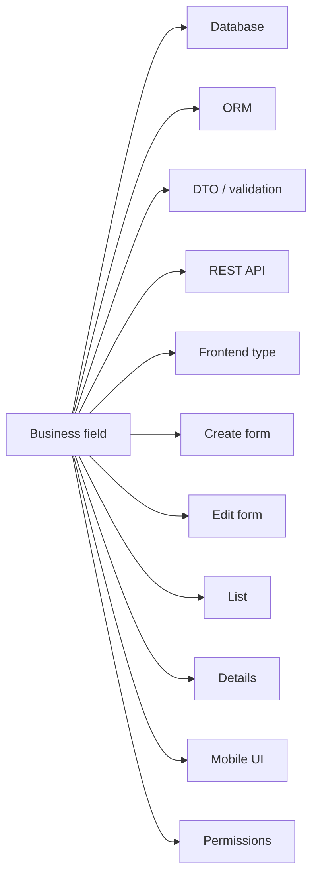

Every duplicate representation adds:

- implementation time;
- maintenance cost;
- inconsistency risk;
- test surface;
- migration effort;
- LLM context and failure opportunities.

**The cost is not the first screen. It is every representation and every future change.**

---

# 2. Decaf's thesis: define meaning once

Decaf makes the domain model the semantic source and projects it into the application stack.

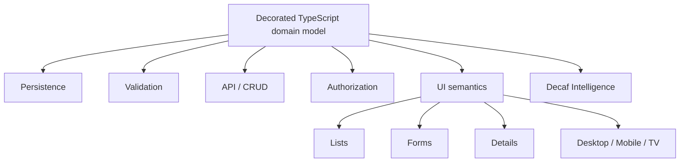

### The proposition

> **Write code for what is unique to the business. Let the platform execute what is repeated.**

---

# 3. This is semantic compression, not another CRUD generator

A generator creates boilerplate quickly.

Decaf's stronger objective is to make much of the boilerplate **unnecessary as application source**.

```text
Code generation
--------------
Generate 400 CRUD files quickly
-> application owns 400 files
-> maintain / merge / migrate / test 400 files

Decaf semantic projection
-------------------------
Shared renderer + shared API/runtime behavior
-> models + metadata + exceptions
-> repeated behavior remains framework infrastructure
```

The difference becomes more valuable as model count and application lifetime grow.

---

# 4. Decaf compresses three kinds of enterprise complexity


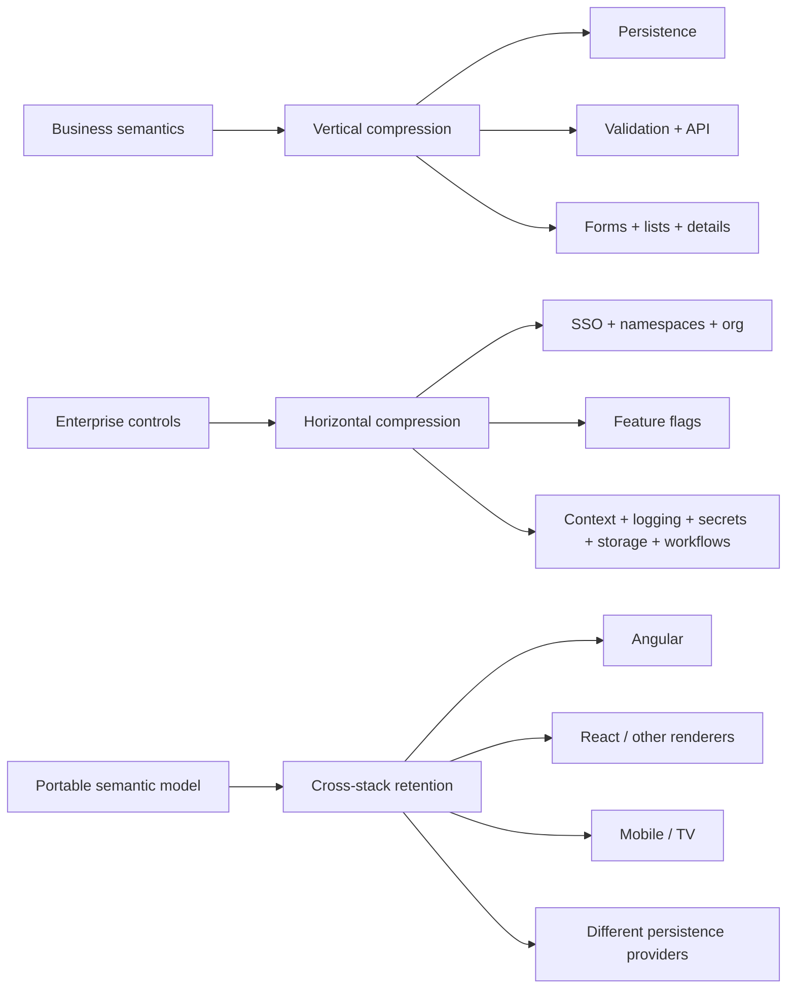

**Vertical:** stop rewriting a domain concept across DB/API/UI.  
**Horizontal:** stop rebuilding SSO, tenancy, flags, secrets, logging, storage and workflow plumbing in every application.  
**Portability:** keep semantic code when the UI/persistence/runtime stack changes.

The original CRUD story is only one axis.

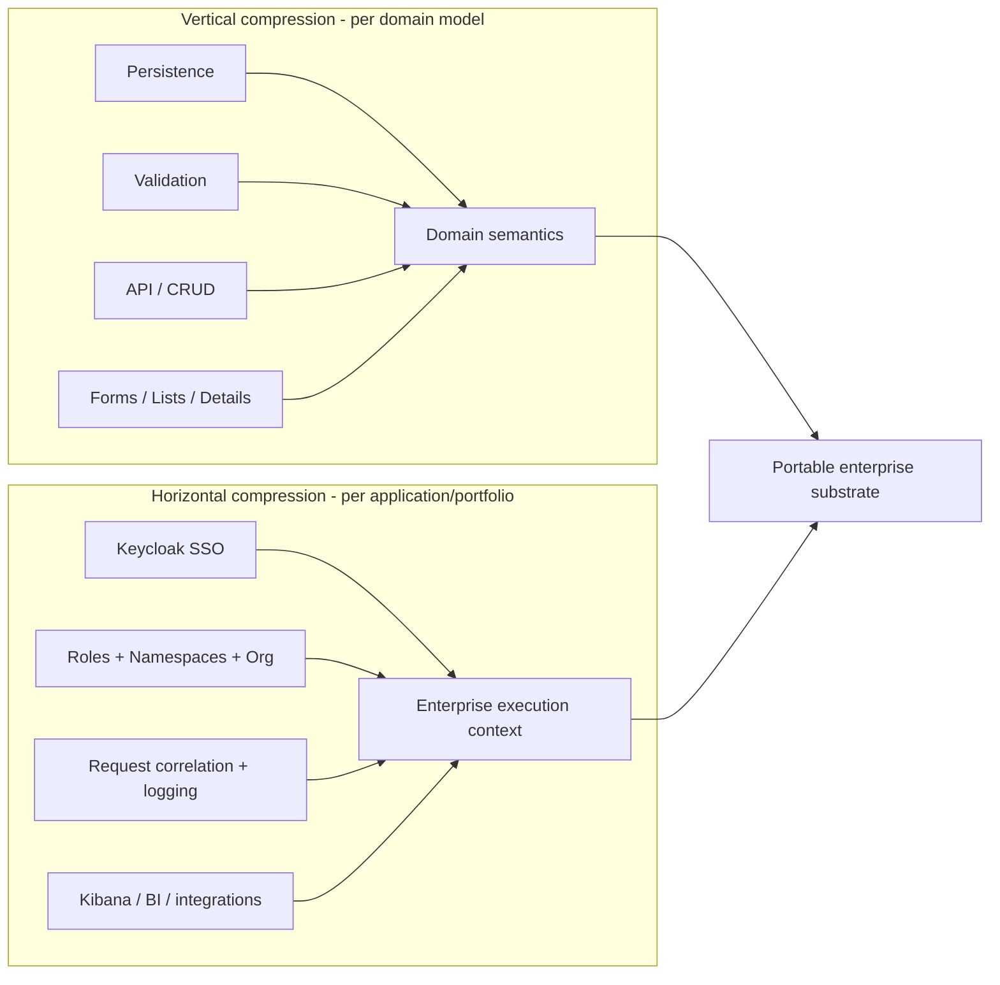

> **Decaf can reduce both entity-by-entity boilerplate and application-by-application platform plumbing.**

That second axis materially improves the enterprise TCO case.

---

# 5. The economic curve improves with scale

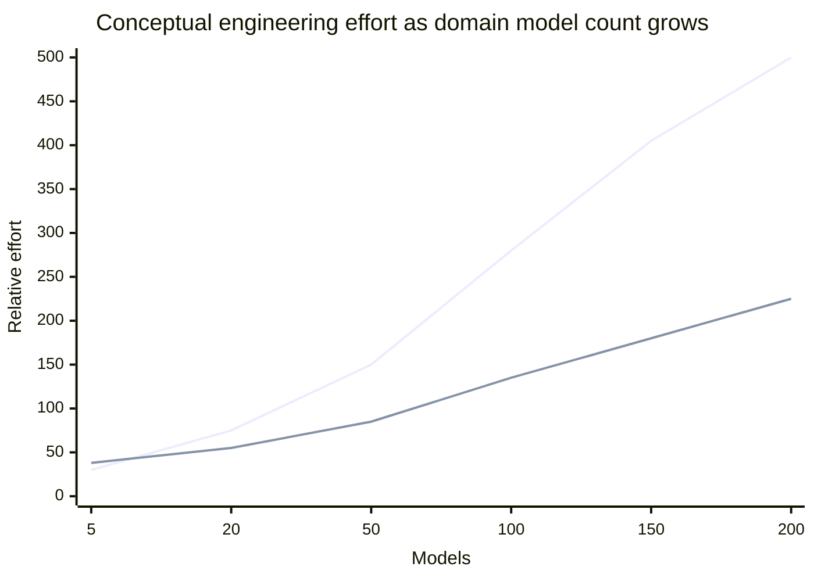

*Illustrative shape, not measured benchmark data.*

### Best fit

- dozens to hundreds of domain models;
- long-lived enterprise systems;
- forms, lists, detail views and role-based workflows;
- frequent changes;
- multiple channels/stacks;
- high cost of inconsistency.

---

# 6. Estimated development leverage

For a typical large enterprise operations application:

| Area | Working estimate |
|---|---:|
| CRUD-specific frontend code reduction | **60-85%** |
| Whole frontend source reduction | **25-50%** |
| Repetitive backend plumbing reduction | **50-80%** |
| Whole backend source reduction | **30-60%** |

For an illustrative **100-model** CRUD-heavy system:

> **~100-400 developer-days of implementation effort may be avoidable**

This is a scenario model to validate, not an observed Decaf benchmark.

---

# 7. The frontend advantage compounds

A conventional entity often owns:

```text
routes
list page
create page
edit page
detail page
filters
validators
permissions
relationship controls
mobile presentation
CRUD data glue
```

With Decaf, standard behavior can be amortized across the entire model estate.

### Key KPI: Standard Surface Coverage

```text
SSC = model-driven standard entity surfaces
      -------------------------------------
      total entity-oriented UI surfaces
```

The higher the SSC, the stronger the economics.

---


---

# 8A. Model-driven does not mean locked into generated UI

Decaf's renderer can target built-in or custom framework components that uphold Decaf conventions.

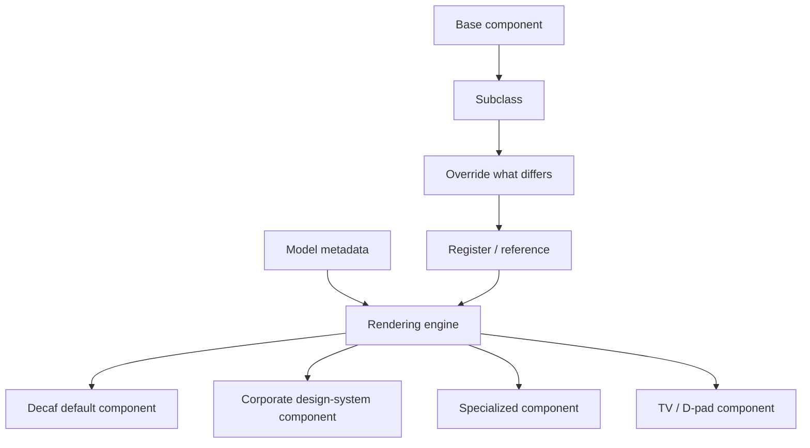

**Stakeholder design practice:** many extensions are effectively **subclass → override → register**.

The default UI is therefore a productivity floor, not necessarily a customization ceiling.

---

# 8B. Why this matters commercially

Metadata/low-code platforms often have a familiar curve:

```text
first 80%                  final 20%
very fast  ───────────────► platform fight
```

Decaf's intended curve is:

```text
standard behavior          exceptional behavior
metadata/runtime ─────────► ordinary custom component
                              ↓
                     keep Decaf semantics
```

This enables:

- corporate design-system integration;
- bespoke regulated controls;
- mobile/TV-specific widgets;
- incremental customization instead of page forks;
- lower perceived framework lock-in.

**Benchmark it:** Extension Cost Index — hours/LOC/bundle delta for five non-trivial custom controls.

# 8. Bundle size: the claim should be precise

There are four different bundle questions:

1. **Initial JS** - what loads before the first useful screen?
2. **Total deployed JS** - how much compiled application exists overall?
3. **Marginal model/feature JS** - what is added after shared renderers are cached?
4. **Runtime CPU/heap** - what does dynamic rendering cost while executing?

The reviewed `for-angular` package structure is favorable to a component-level model: heavyweight Angular/Ionic/CodeMirror-related packages are peers, while `cronstrue` is the ordinary direct runtime dependency in the current manifest.

### Working estimates for a large CRUD estate

- Initial JS vs strong lazy Angular baseline: **0-25% lower**
- Application-specific JS: **30-60% lower**
- Total JS including vendors/framework: **10-30% lower**
- Entity-specific chunks after common renderer cache: **30-70% lower**

**Benchmark before marketing these numbers as facts.**

---

# 9. "Pay for the renderer you use"

The architecture is strongest when optional controls are both tree-shakable and lazy.

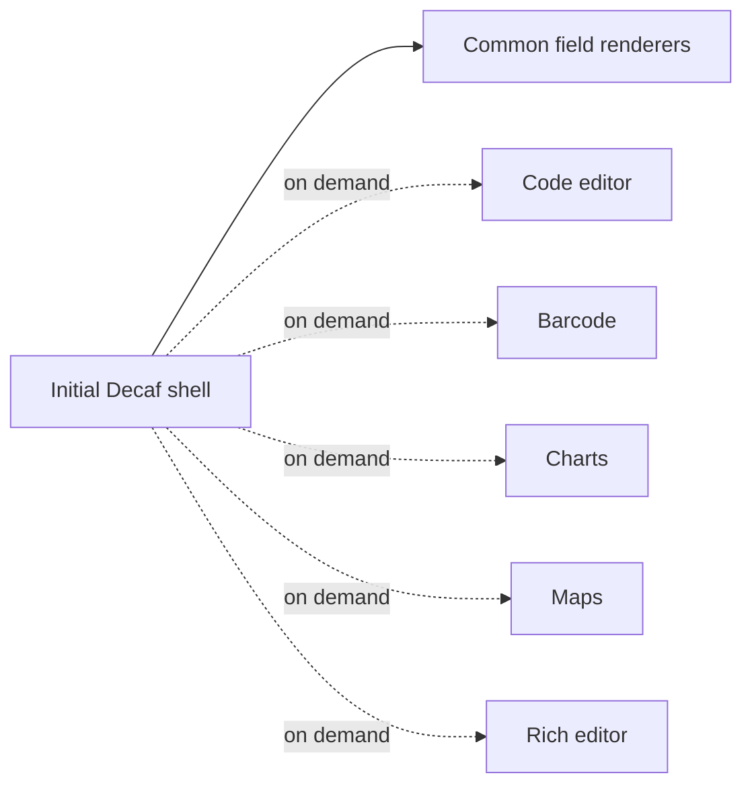

Angular supports deferred standalone dependencies and dynamic route imports.

### Product requirement

The renderer registry must preserve those chunk boundaries instead of eagerly importing every optional control.

---

# 10. Runtime performance: automation does not imply runtime compilation

Dynamic rendering adds:

```text
metadata lookup
+ renderer resolution
+ generic binding
```

But normal enterprise screens are often dominated by:

```text
API latency
+ database work
+ DOM creation
+ tables
+ media/charts
```

### Estimated suitability

| Target | Assessment |
|---|---:|
| Desktop | **8-9/10** |
| Flagship mobile | **~8/10** |
| Mid-range mobile | **7-8/10** |
| Low-end mobile | **6.5-7.5/10** |
| Generic smart-TV web | **6.5-7.5/10** |
| Dedicated TV renderer | **~8/10 potential** |

These are architectural estimates; publish measured device benchmarks.

---

# 11. TV and mobile demonstrate why renderer portability matters

The same semantic property can become a different interaction without rewriting the domain.

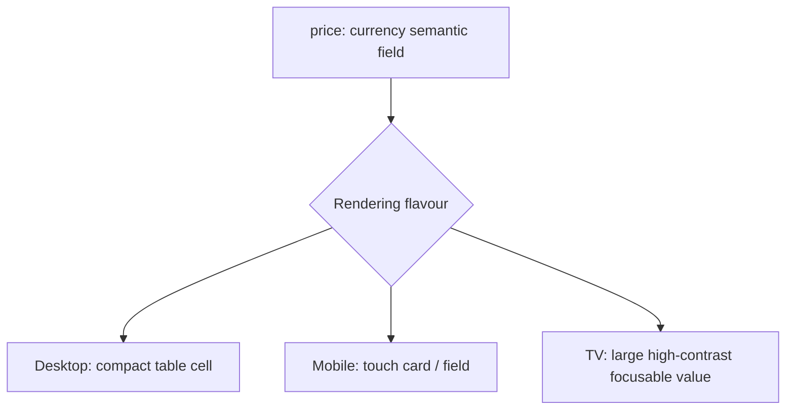

Decaf can be more than responsive CSS.

It can preserve application meaning while changing the **projection appropriate to the device**.

---

# 12. `for-nest`: backend savings are material

Public `for-nest` documentation describes support for:

- auto-generated CRUD controllers;
- optional model services;
- aggregation/grouping endpoints;
- bulk operations;
- controller-level authorization metadata;
- SSE observer events.

This can remove repeated layers such as:

```text
DTOs -> controller -> standard service -> repository glue -> API metadata
```

while preserving custom services for real business logic.

### Working estimate

**50-80% less repetitive backend plumbing** for typical enterprise data services.

---

# 13. `@decaf-ts/integrations`: enterprise plumbing becomes reusable infrastructure

The public integration package includes reusable modules for:

- Keycloak realms, users, roles, identity providers and client-role wiring;
- JWT extraction of roles, namespaces and user context;
- organization/tenant authorization scaffolding;
- Kibana spaces, data views, dashboards and realm-specific access;
- common Kibana/Superset dashboard embedding;
- dynamic loading of models, adapters, services, controllers and components;
- graph workflow execution and authorized run lifecycle.

```mermaid
flowchart TB
    I[@decaf-ts/integrations]
    I --> K[Keycloak / IAM]
    I --> N[Namespaces / Org auth]
    I --> O[Kibana / BI]
    I --> G[Graph workflows]
    I --> L[Dynamic loaders]
    K --> APP[Enterprise application]
    N --> APP
    O --> APP
    G --> APP
    L --> APP
```

**Strategic implication:** Decaf is closer to an enterprise application substrate than a CRUD helper.

---


---

# 13A. `@decaf-ts/integrations` is a modular enterprise control plane

The published package surface includes substantially more than Keycloak and Kibana.

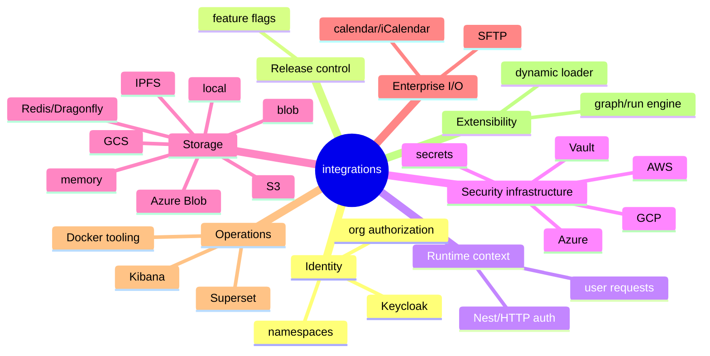

Each subpath can be consumed independently; provider peers are optional.

---

# 13B. Feature flags connect rollout to Decaf semantics

Feature subjects include **user, account, namespace, model, route and UI**.

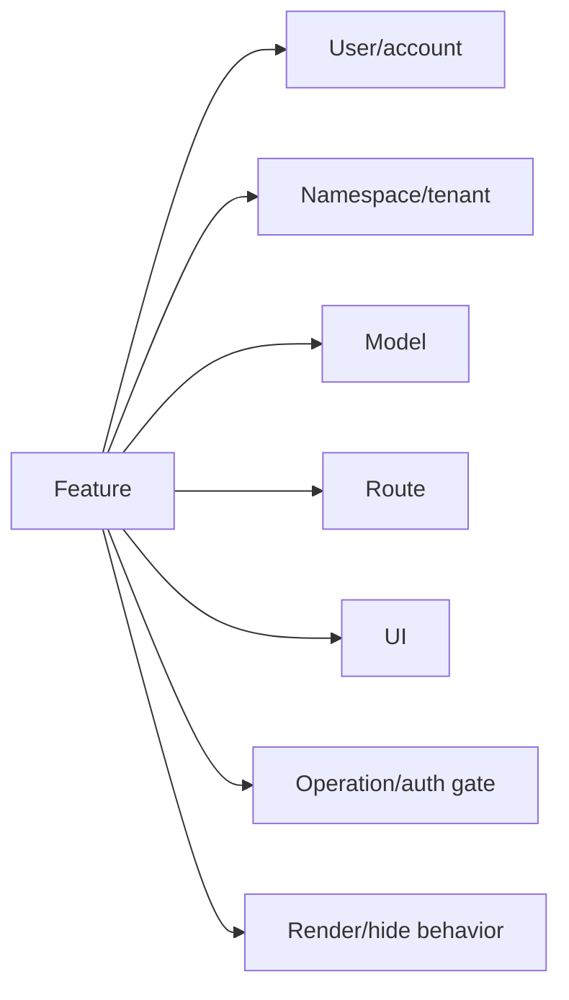

This can support:

- tenant-by-tenant rollouts;
- customer entitlements;
- dark launches;
- kill switches;
- route/operation gating;
- UI reveal/hide behavior;
- controlled migrations.

**Important:** flags complement authorization; they do not replace server-side role/namespace/resource security.

---

# 13C. Decaf should integrate with the feature-flag ecosystem, not fight it

| Capability | Decaf-native flags | LaunchDarkly / Flagsmith | OpenFeature |
|---|---|---|---|
| Model/route/UI semantics | **Native** | application integration | provider-neutral API |
| Namespace targeting | **Native semantic fit** | contexts/segments | evaluation context |
| Mature management/analytics | developing | **strong** | provider-dependent |
| Self-host / embedded | **natural** | varies / Flagsmith strong | provider-dependent |

**Recommended move:** implement an OpenFeature bridge so Decaf decorators stay stable while enterprises can use their corporate flag provider.

---

# 13D. Secrets and blob storage become provider-portable application contracts

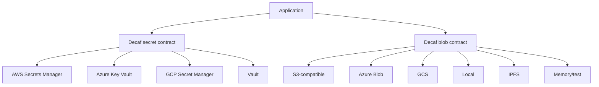

The value is not replacing those providers.  
The value is **keeping provider choice out of business/application code**.

---

# 13E. Workflow, user interaction and integration I/O are also part of the substrate

The public surface includes:

- graph/run workflow engine with validation, run lifecycle, SSE progress and cancellation;
- framework-neutral user-request handlers;
- SFTP;
- iCalendar generation;
- Redis/Dragonfly adapter and pub/sub observers;
- dynamic model/service/controller/component/node loading;
- Docker integration tooling;
- Kibana/Superset dashboard embedding.

This changes the alternative from:

> "Angular + Nest"

into:

> **"a composed enterprise stack of IAM + flags + secrets + storage + workflow + BI + I/O + observability + conventions."**

# 14. Keycloak SSO + `@namespace`: separate capability from scope

Decaf's auth path distinguishes:

- **roles** - what the principal may do;
- **namespaces** - where / within which logical scope it may do it;
- **organization context** - which tenant/org structure the request belongs to.

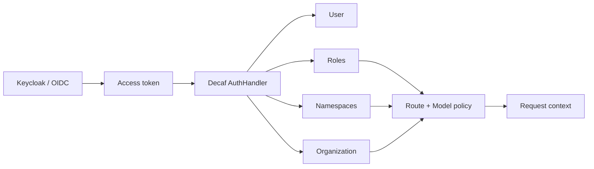

This is more scalable than encoding every tenant/scope combination into ad-hoc controller logic or exploding role names.

**The security promise must be benchmarked:** zero cross-namespace leakage, default-deny behavior, predictable claim mapping, and consistent generated/custom routes.

---

# 15. One request, one business context, one traceable path

The Decaf stack has public building blocks for request-level traceability:

- `Context` propagated through application layers;
- auth data bound into that context by `for-http`;
- correlation-aware `@decaf-ts/logging`;
- child contexts and Pino/Winston backends;
- context-aware logging across other adapters such as Fabric.

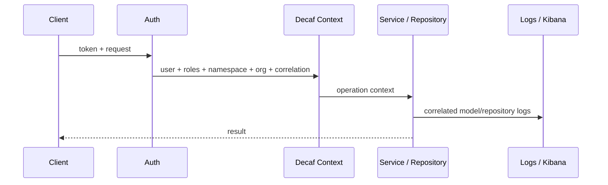

**Business value:** lower MTTR, stronger support/auditability, and less repeated request-correlation plumbing.

Important caveat: correlated logging is **not yet the same claim as full distributed tracing**. OpenTelemetry propagation should be a first-class benchmark/product objective.

---

# 16. Broad integration does not have to mean monolithic runtime weight

`@decaf-ts/integrations` exposes independent subpaths (`/keycloak`, `/kibana`, `/nest`, `/namespaces`, plugins, graph) and marks key peers as optional.

```mermaid
flowchart LR
    CORE[Application] --> N[/namespaces]
    CORE --> K[/keycloak - if used]
    CORE --> B[/kibana - if used]
    CORE --> G[/graph - if used]
    K -. absent when unused .-> X[Optional Keycloak dependencies]
    B -. absent when unused .-> Y[Optional BI dependencies]
```

This reinforces the same bundle principle as `for-angular`:

> **Share the platform implementation, but pay runtime/dependency cost only for the capabilities the application actually imports.**

Bundle/module-graph CI should prove this continuously.

---

# 17. Scalability has seven dimensions

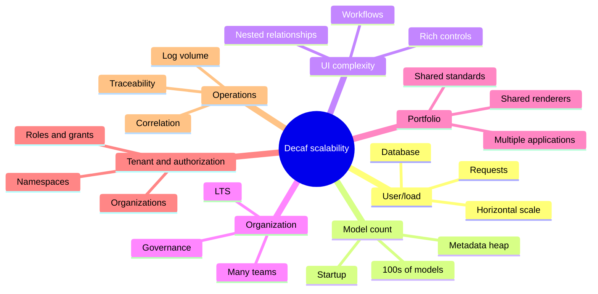

A credible enterprise benchmark must test all seven - not just requests per second.

---

# 18. Portability is the strategic differentiator

The public Decaf ecosystem describes multiple persistence adapters and UI engines including Angular, React, and React Native.

The goal is not merely "we also support React."

> **The application semantic model should outlive the chosen UI and persistence framework.**

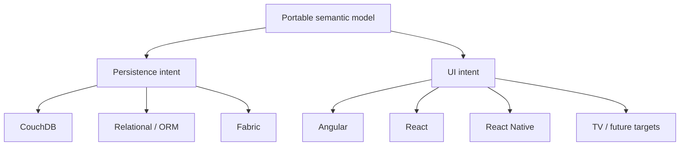

---

# 19. Measure portability: Semantic Retention Ratio

```text
SRR = semantic application code unchanged after migration
      ---------------------------------------------------
      total semantic application code before migration
```

A conventional Angular -> React migration can become a UI rewrite because business semantics are embedded in framework files.

A Decaf migration should preserve as much as possible of:

- domain models;
- validation;
- permissions;
- field semantics;
- business logic;
- repository contracts;
- model-driven tests.

### Benchmark target to investigate

> **80%+ SRR on suitable model-driven application surfaces**

Not a current measured claim.

---

# 20. AI changes the economics - Decaf is structurally well positioned

LLM difficulty increases with:

```text
relevant files
x implementation choices
x context required
x cross-layer inconsistency risk
```

Decaf can reduce all four.

### The stronger AI proposition

> **Decaf reduces how much code AI is required or allowed to invent.**

That can improve:

- first-pass correctness;
- token usage;
- review time;
- testability;
- consistency;
- autonomous-agent safety.

---

# 21. Decaf Intelligence turns a small public corpus into an advantage

Generic LLMs know React/Nest extremely well from public training data.

Decaf's public corpus is smaller.

The private Decaf Intelligence layer changes the equation:

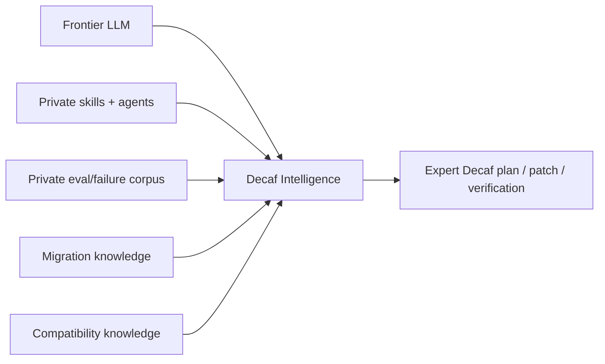

The moat is not a single prompt.

It is the accumulated **diagnosis -> repair -> verification** knowledge and cross-stack migration expertise.

---

# 22. New licensing architecture: open substrate, protected intelligence

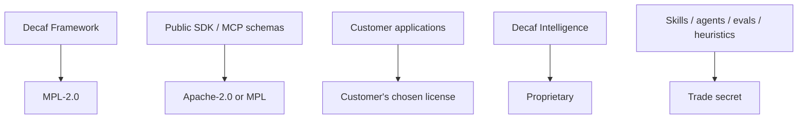

### One-line explanation

> **Decaf Framework: MPL-2.0. Your application: your license. Decaf Intelligence: optional commercial capability.**

This is easier to procure and more protective of the real AI moat than an AI-triggered AGPL condition in runtime packages.

---

# 23. Why this licensing model increases adoption

### For the customer

- inspectable/open runtime;
- proprietary applications remain possible;
- lower vendor lock-in;
- no per-user open-source licensing trap;
- application output remains theirs;
- private/on-prem AI can be optional.

### For Decaf

- more developers can adopt the runtime;
- more renderers/adapters increase network effects;
- trademark preserves the canonical brand;
- MPL protects distributed modifications to covered framework files;
- proprietary Intelligence preserves scarce know-how;
- commercial LTS/support/AI/OEM create revenue.

---

# 24. PharmaLedger changes the credibility discussion

Public PharmaLedger evidence describes:

- a platform originating from a **EUR 22.1M** EU/EFPIA program;
- major pharmaceutical and technology participants;
- ePI in production since 2023;
- **46 countries and 29 languages** for the patient/HCP ePI app;
- managed and self-hosted deployment options.

For this analysis, the Decaf stakeholder states that the relevant running enterprise application uses Decaf and has potential for very large reach.

### What should happen next

> Publish a jointly approved PharmaLedger/Decaf case study with measured architecture, scale, model count, bundle, latency, and engineering metrics.

Do not convert "potential to reach millions" into an unsupported claim of millions of current Decaf users.

---

# 25. Competitive position

| Platform | Strongest advantage | IAM / operations posture | Where Decaf can differentiate |
|---|---|---|---|
| SAP CAP + Fiori | Enterprise maturity + metadata-driven full stack | **Excellent** IAS/XSUAA, tenant context, audit logging | Open TypeScript substrate + non-SAP portability |
| Spring Boot/Security | Deep enterprise ecosystem | **Excellent** OAuth/OIDC + mature observability | Less assembly through one semantic/context model |
| JHipster | Mature full-stack generation | **Strong** Keycloak/OIDC + monitoring/tracing stack | Runtime projection + reusable platform semantics vs generated artifacts |
| NestJS baseline | Flexible TypeScript backend | **Strong pieces**, but teams assemble conventions/modules | Standardized model + namespace + context + integration plane |
| React-admin | Mature React B2B ecosystem | Primarily API-side concern | Less entity-specific page source; broader full-stack reach |
| Refine | Flexible headless React productivity | Primarily API-side concern | Persistence/API/UI semantic continuity |
| AdminJS | Automatic Node admin UI | Backend/application-defined | General application and multi-renderer scope |
| LoopBack | Strong model/API abstraction | Good auth/authz components | Same semantics continue into UI + Keycloak/namespace integration |
| Feathers | Lightweight CRUD/realtime services | Strong auth, lighter governance layer | Wider full-stack semantic model |
| Low-code platforms | Extremely fast visual development | Often integrated but platform-controlled | Normal TypeScript, open runtime, portability |

### What `@decaf-ts/integrations` changes

Decaf should not claim that it has better raw IAM or observability primitives than SAP or Spring today. The differentiated question is:

> **How much project-specific code and configuration does a TypeScript team need to make identity, scope, request context, repositories, generated routes and operations behave consistently?**

That is a measurable platform-completeness advantage.

### Decaf should not compete on popularity today

It should compete on:

- marginal engineering cost;
- change amplification;
- semantic retention;
- source reduction;
- AI efficiency;
- long-term TCO.

---


---

# 25A. The fairest competitor is often a composed enterprise stack

A capable TypeScript team can assemble:

```text
NestJS + Angular/React
+ Keycloak/OIDC
+ custom RBAC/ABAC
+ LaunchDarkly/Flagsmith/OpenFeature
+ OpenTelemetry + Pino
+ cloud secret/blob SDKs
+ workflow engine
+ SFTP + BI embeds
+ internal design system
```

That stack may be best-of-breed at each layer.

Decaf's proposition is different:

> **reduce the glue, duplicated identity/scope models, and change amplification between those layers.**

The benchmark should compare against this strong baseline — not a straw-man CRUD project.

---

# 25B. Extensibility changes the low-code comparison

| Question | Typical rigid metadata platform | Decaf target model |
|---|---|---|
| Standard CRUD | fast | **fast** |
| Custom component | platform-specific workaround | **ordinary compatible component** |
| Corporate design system | often constrained | **register/reference it** |
| Platform-specific mobile/TV UI | separate project | **new renderer/component mapping** |
| Source ownership | varies | **normal TypeScript code** |
| Escape hatch | can break metadata model | **preserve semantics where possible** |

The strategic message:

> **Low-code-like leverage without accepting a low-code ceiling.**

# 26. The market gap

Enterprises often choose between two imperfect extremes:

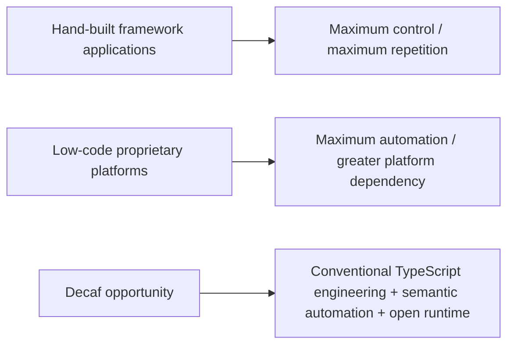

### Decaf's category opportunity

> **Low repetition without surrendering source ownership and portability.**

---

# 27. Change Amplification Factor: a CTO-level metric

```text
CAF = application artifacts that must be understood or changed
      for one representative domain change
```

Illustrative example:

| | Conventional | Decaf |
|---|---:|---:|
| Persistence/API/UI/security/test artifacts touched | 9-21 | 3-8 |

*Illustrative range, to be measured.*

Lower CAF means:

- faster changes;
- fewer regressions;
- smaller code review;
- fewer LLM mistakes;
- easier maintenance.

---

# 28. Five-year TCO is the real business case

Decaf can potentially affect both product code and the reusable enterprise foundation:

- SSO/IAM integration;
- scoped authorization and tenancy;
- request correlation/logging;
- dashboard/operations integration;
- product-specific CRUD and domain surfaces.

Decaf can potentially affect:

```mermaid
pie title Conceptual enterprise application TCO
    "Initial development" : 25
    "Maintenance / change" : 30
    "Testing / regression" : 15
    "Upgrades / migration" : 10
    "Operations" : 10
    "Onboarding / knowledge" : 10
```

*Illustrative distribution.*

The biggest value may come from years of change and migration - not initial CRUD generation.

---

# 29. Illustrative financial sensitivity

If Decaf saves **100-400 engineering days** in a 100-model implementation scenario:

| Fully loaded engineering cost/day | 100 days | 250 days | 400 days |
|---:|---:|---:|---:|
| EUR 500 | EUR 50k | EUR 125k | EUR 200k |
| EUR 750 | EUR 75k | EUR 187.5k | EUR 300k |
| EUR 1,000 | EUR 100k | EUR 250k | EUR 400k |

Before counting:

- maintenance savings;
- migration savings;
- faster release value;
- reduced defects;
- AI inference/review savings;
- reuse across multiple applications.

**This is scenario analysis, not measured Decaf ROI.**

---

# 30. The adoption risks are known - and manageable


Additional control-plane risks must be made explicit:

- stale feature flags become permanent complexity;
- a flag must never be mistaken for authorization;
- namespace/context bugs have portfolio-wide blast radius;
- dynamic loaders and graph nodes create code-execution boundaries;
- cloud abstractions need provider-specific escape hatches;
- Redis table scans have a finite scale envelope;
- unlimited custom components need design-system/conformance governance;
- eager component registration can defeat lazy loading.

| Risk | Mitigation |
|---|---|
| Small public ecosystem | Open core, partners, training, references |
| "Magic" debugging | Effective Model Inspector + provenance |
| Performance uncertainty | Public canonical benchmarks |
| Version churn | Compatibility matrix + LTS |
| Metadata complexity | Declarative limits + normal-code escape hatches |
| Portability overclaim | Portable Model Contract + SRR benchmark |
| Generic API security | Safe defaults + query/bulk limits + audit |
| AI vendor dependency | Framework works without AI; private/on-prem options |
| AI IP leakage | Private engine/skills/evals; thin public MCP |
| Licensing friction | Plain MPL core + simple commercial model |
| Keycloak/version coupling | Supported-version matrix + conformance tests + LTS policy |
| Shared namespace/auth defect | Default-deny + cross-namespace isolation tests + security gates |
| Request-context leakage | Concurrency isolation tests + immutable request identity |
| Logging mistaken for tracing | Explicit caveat + OpenTelemetry roadmap |

---

# 31. What an enterprise pilot should prove

A pilot should compare Decaf against an agreed strong baseline and measure:

### Engineering

- LOC and file count;
- time per model/change;
- CAF;
- defects and review effort.

### Frontend

- initial JS;
- total JS;
- marginal chunks;
- low-end mobile performance.

### Backend / identity / operations

- startup;
- p50/p95/p99;
- memory;
- generated endpoint safety;
- Platform Bootstrap Effort for SSO + scoped auth + correlated logging;
- auth/context overhead;
- cross-namespace isolation;
- request-context isolation under concurrency;
- correlation coverage and time-to-diagnose;
- OpenTelemetry propagation where enabled.

### AI

- tokens/task;
- files read/changed;
- first-pass test success;
- retries;
- review minutes.

### Portability

- migrate at least one meaningful surface to a second renderer;
- calculate SRR.

---

# 32. Benchmark targets worth proving


**New benchmark tracks:**

- feature flags: user/namespace/model/route/UI evaluation latency and isolation;
- control plane: SSO → namespace → feature gate → repository → correlated log continuity;
- integrations: secrets/blob provider migration effort;
- graph: crash/retry/cancel/durable run behavior;
- renderer extensibility: Extension Cost Index for five bespoke controls;
- bundle: prove custom/optional controls can remain lazy chunks;
- portfolio: Platform Bootstrap Effort and Control Plane Reuse Ratio.

| Metric | Target to investigate |
|---|---:|
| CRUD frontend LOC | **>=60% lower** |
| Whole frontend LOC in 100-model benchmark | **>=30% lower** |
| Repetitive backend LOC | **>=50% lower** |
| Files touched per standard change | **>=50% lower** |
| Heavy optional renderer in initial chunk | **0 bytes when unused** |
| p95 CRUD latency overhead | **<=5%** |
| AI tokens per standard change | **>=30% lower** |
| Semantic Retention Ratio | **>=80%** on portable surfaces |
| Platform Bootstrap Effort: SSO + scoped auth + correlation | **>=50% lower** vs strong NestJS baseline |
| Generated-route auth/context correlation coverage | **100%** |
| Cross-request context leakage | **0** in concurrency stress suite |
| Cross-namespace unauthorized data access | **0** in security suite |
| Auth/context/logging overhead | **bounded and published** at representative load |

These are benchmark objectives, not current published results.

---

# 33. Commercial model

```mermaid
flowchart LR
    C[Community] --> C1[MPL framework]
    E[Enterprise] --> E1[LTS + SLA + security + support]
    I[Decaf Intelligence Cloud] --> I1[Private expert agents]
    P[Private/VPC] --> P1[Customer-cloud appliance]
    A[Air-gapped] --> A1[Premium binary appliance + support]
    O[OEM] --> O1[Redistribution / private framework rights]
```

### Pricing principle

> Charge for **capability, assurance, and enterprise deployment** - not for the number of patients, citizens, viewers, or application end users.

---

# 34. Recommended adoption path

```mermaid
flowchart LR
    A[1. Select 20-50 model pilot] --> B[2. Establish model + renderer standards]
    B --> C[3. Measure LOC / CAF / bundle / latency]
    C --> D[4. Add Decaf Intelligence]
    D --> E[5. Test second renderer / portability]
    E --> F[6. Platform decision]
    F --> G[7. Expand across application portfolio]
```

### Low-risk entry point

Start with a new module or bounded domain, not a forced rewrite of an entire legacy estate.

---

# 35. Why adopt Decaf

### If Decaf proves the benchmark targets, an enterprise gains:

- **fewer application artifacts**;
- **less repeated CRUD/API/UI implementation**;
- **lower change amplification**;
- **smaller application-specific code estate**;
- **consistent validation/security/UI behavior**;
- **a path across Angular/React/mobile/device changes**;
- **better leverage from AI agents**;
- **an open runtime that reduces lock-in**;
- **optional proprietary expert intelligence rather than mandatory proprietary runtime**.

### The strategic proposition

> **Preserve the business semantics. Change the technology around them.**

---

# 36. The Decaf moat

The moat is not hiding the framework source.

```mermaid
flowchart TB
    A[Open semantic framework] --> B[Adoption]
    B --> C[More applications / stacks]
    C --> D[Production patterns]
    D --> E[Private eval + failure + repair corpus]
    E --> F[Decaf Intelligence]
    F --> G[Faster / safer implementation]
    G --> B
```

It compounds from:

- portable semantics;
- standardized identity/namespace/request context;
- enterprise integration and observability patterns;
- renderer/adaptor ecosystem;
- production expertise;
- private Decaf Intelligence;
- migration knowledge;
- enterprise references;
- support and trust.

---

# 37. The ask

## Run a measured enterprise pilot

Choose a representative bounded domain with enough complexity to matter.

Evaluate Decaf on:

1. **engineering effort**;
2. **change amplification**;
3. **bundle/runtime performance**;
4. **backend performance**;
5. **AI productivity**;
6. **cross-stack semantic retention**;
7. **identity, namespace and operational/security fit**.

Then make the platform decision from measured evidence.

> **Decaf does not need to be believed. It needs to be benchmarked.**

---


### Additional observed surfaces included in v3

- `@decaf-ts/integrations` package export map includes feature flags, user requests, secrets, blob providers, calendar, graph, SFTP, Redis, Docker, loader and dashboard plugins in addition to IAM/namespaces.
- feature flags expose user/account/namespace/model/route/UI-oriented subject semantics and decorators for operation/auth/render behavior.
- `for-angular` exposes dynamic component registration/resolution; stakeholder practice reports frequent subclass/override/register customization.
- these capabilities are treated as platform surfaces with explicit risks and benchmark requirements, not as unverified production-scale claims.

### Principal additional references

- https://github.com/decaf-ts/integrations
- https://github.com/decaf-ts/integrations/blob/master/package.json
- https://github.com/decaf-ts/integrations/tree/master/src/feature-flags
- https://github.com/decaf-ts/integrations/tree/master/src/namespaces
- https://github.com/decaf-ts/integrations/tree/master/src/secrets
- https://github.com/decaf-ts/integrations/tree/master/src/blob
- https://www.npmjs.com/package/@decaf-ts/ui-decorators
- https://github.com/decaf-ts/for-angular
- https://github.com/open-feature/js-sdk
- https://github.com/Flagsmith/flagsmith
- https://docs.launchdarkly.com/home/flags

---

# Appendix — `@decaf-ts/integrations` export inventory reviewed

```text
root                  kibana                docker
keycloak              nest                  nest/graph
loader                namespaces            feature-flags
user-requests         secrets               secrets/aws
secrets/azure         secrets/gcp           secrets/oneppassword
secrets/vault         blob                  blob/s3
blob/azure            blob/gcp              blob/local
blob/ipfs             blob/memory           calendar
graph                 sftp                  redis
plugins               plugins/kibana        plugins/superset
```

The repository README also documents `graph/shared`; package/README synchronization should become a release check.

The pitch groups these exports by business capability, but the analysis evaluates every family explicitly.

# Appendix - Evidence and caveats

- Public Decaf organization: https://github.com/decaf-ts
- `for-angular` package manifest: https://github.com/decaf-ts/for-angular/blob/master/package.json
- `for-nest` documentation: https://github.com/decaf-ts/for-nest/blob/master/README.md
- `@decaf-ts/integrations`: https://github.com/decaf-ts/integrations
- `@decaf-ts/integrations` package exports/dependencies: https://github.com/decaf-ts/integrations/blob/master/package.json
- `@decaf-ts/for-http` AuthHandler / namespaces / Context: https://www.npmjs.com/package/@decaf-ts/for-http
- `@decaf-ts/logging`: https://github.com/decaf-ts/logging
- `@decaf-ts/db-decorators` Context: https://www.npmjs.com/package/@decaf-ts/db-decorators
- Angular deferred loading: https://angular.dev/guide/templates/defer
- Angular lazy routes: https://next.angular.dev/best-practices/performance/lazy-loaded-routes
- PharmaLedger Association: https://pharmaledger.org/association
- PharmaLedger platform: https://pharmaledger.org/platform
- SAP CAP generic services: https://cap.cloud.sap/docs/guides/services/served-ootb
- SAP CAP authentication: https://cap.cloud.sap/docs/guides/security/authentication
- SAP CAP audit logging: https://cap.cloud.sap/docs/guides/security/dpp-audit-logging
- JHipster OAuth2/Keycloak: https://www.jhipster.tech/creating-an-app/
- JHipster monitoring: https://www.jhipster.tech/monitoring/
- Spring Security OAuth2: https://docs.spring.io/spring-security/reference/servlet/oauth2/
- NestJS Async Local Storage: https://docs.nestjs.com/recipes/async-local-storage
- React-admin: https://github.com/marmelab/react-admin
- Refine: https://github.com/refinedev/refine
- Mozilla MPL FAQ: https://www.mozilla.org/en-US/MPL/2.0/FAQ/

**Caveat:** The Decaf-to-PharmaLedger implementation relationship is stakeholder-provided context for this presentation. Public PharmaLedger pages independently support the regulated-production footprint, but an externally distributed pitch should use a jointly approved case study before representing Decaf's implementation role as a publicly verified reference.
